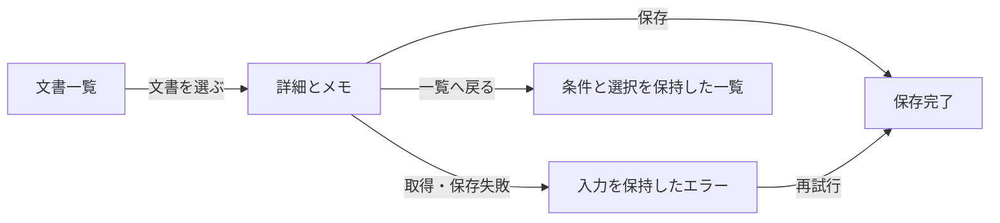

# UX設計の可視化と共同編集

[概要](README.md) · [導入・認証](installation.md) · [検証結果](validation.md) · [English](../en/codex-ux-stack/visual-design.md)

`ux-visual-design` は、要求と既存実装から主要なJourney、画面、状態、操作、復旧経路を整理し、
編集できる図・ワイヤーフレーム・UI設計へつなぎます。既存アプリでは影響する導線だけを扱い、
軽微な文言・CSS修正には資料一式を要求しません。OOUIの対象モデルを再利用し、申込のような固定手順にはタスク指向の構成を選べます。

## 呼び出し例

```text
$ux-visual-design
既存の文書管理アプリを調べ、検索→文書→関連文書→一覧の導線を可視化してください。
検索条件・選択・メモを保持し、保存失敗と再試行もワイヤーフレームへ含めてください。
docs/ux/design-contract.jsonと編集可能な図を残し、実装・ブラウザー検証まで進めてください。
Whimsicalが未接続ならローカルの代替を使ってください。
```

Skillは利用者・状況・目的・達成条件、シナリオ、ジャーニー、対象・属性・操作・関係を整理します。
情報構造、画面、遷移条件、入力保持、エラー・中断・取消・復旧を決め、主要画面を可視化します。
新規・大幅変更では確認できる成果物を提示します。実装まで依頼済みなら作業を継続し、人間の承認がない成果物を承認済みとは記録しません。

## 正本と編集可能な成果物

正本はローカルのJSON契約です。[スキーマ](../../tools/codex-ux-stack/ux-visual-design/assets/contract.schema.json)と
[文書管理の例](../../tools/codex-ux-stack/ux-visual-design/assets/document-example.json)を同梱しています。
JSONの構造検査はUI品質や機能の完成を保証しません。

| 情報 | 契約の項目 |
|---|---|
| 目的・利用者・対象モデル | project、journeys |
| 画面の目的・ルート・状態 | screens.id / purpose / route / states |
| 実装との対応 | screens.component.path / symbol |
| 操作と遷移条件・遷移先 | actions、transitions.from / condition / to |
| 異常系と入力保持 | transitions.on_error / retained_fields |
| 必須機能と受け入れ条件 | requirements.required / acceptance |
| 外部ファイル・ノードとの対応 | artifacts.provider / file_id / url / bindings |
| 承認・委任とその根拠 | approval.status / source |

承認済みデザインには、`artifacts[].revision` と `snapshot: {path, sha256}` で参照PNGを対応付けられます。
画像はプロジェクト内に保存し、ハーネスが契約と一緒に固定します。承認済みなのに参照画像がない場合、
外観の整合は未検証となりrunは合格しません。画像を用意しただけで一致したとは判定せず、独立レビューが実画面と比較します。

Journey IDをハーネスのflow ID、Screen IDをscreen IDとして引き継ぎます。
受け入れ条件は、画面・状態ごとの表示、文言、入力値、選択、フォーカス、アクセシブルな名前、URLを宣言できます。
ローカルの部品パスを検査する `--project` は実装後に使い、設計だけの段階では省略します。

```bash
python3 <skill-dir>/scripts/ux_contract.py validate --contract docs/ux/design-contract.json
python3 <skill-dir>/scripts/ux_contract.py export --contract docs/ux/design-contract.json --design docs/ux/visual
python3 <skill-dir>/scripts/ux_contract.py import --contract docs/ux/design-contract.json --design docs/ux/visual/wireframes.svg
```

出力は `flow.mmd`、`wireframes.svg`、操作できる `wireframes.html` と管理用manifestです。
SVGには画面・操作のID、Mermaidには画面・状態・正常／異常系の接続を残します。
HTMLは分岐と入力保持を確認する構造プレビューで、実サービスの保存・送信・決済は行いません。
主要画面では入力部品・情報の優先順位・状態の表示を補い、実装可能なデザインへ仕上げます。

例として、保存と復旧は次のように表せます。



## 人間の編集を取り込む

ローカルではSVGの画面名・操作名・位置・大きさ・色、Mermaidの画面名・状態の接続・条件を編集できます。
IDと埋め込みの比較元は残します。対応のない削除や異常系の付け替えは、黙って無視せず明示的に停止します。
画面の追加・削除、要求の変更は契約または `{base, contract}` のJSON交換形式で表します。

取り込みは、成果物を出力した時点のbase、現在のローカル契約、人間の編集後のremoteを比較します。
別々の項目の変更は統合し、同じ項目の競合は保持して報告します。無変更の取り込みでは版を増やしません。
`import` の既定は提案の表示です。差分を確認し、依頼範囲内の反映には同じコマンドへ `--apply` を付けます。
編集済みの出力を再生成で上書きせず、承認済みの設計を変更した場合は `needs_review` に戻します。
契約に対応しない注釈・スタイルは元ファイルへ残し、`preserved_unmapped_edits` として再生成を保護します。
この場合は別の出力先を使うか、残す編集を明示的に整理します。無変更の反映ではJSONの空白や改行も保持します。

外部キャンバスでも同じ手順を使います。エージェントは実行時に利用可能なreadツールで、対象ファイルの版と
IDを読み直し、bindingsを使って変更を契約へ対応付けます。API応答はツールごとに異なるため、
読み取った値を交換形式へ正規化し、三者比較を通して反映します。バックグラウンドの自動同期は行いません。
書き込み先は依頼されたファイル・フレーム・ノードに限定します。Figmaのコード実行型編集は公式のホスト側Skillを使い、
任意JavaScriptを汎用ヘルパーへ渡す経路は用意しません。[MCPの詳細](../../tools/codex-ux-stack/ux-visual-design/references/mcp.md)

## 実装と検証へ渡す

Product Design／Build Web Apps等には、契約、主要画面、部品・トークン、画面幅ごとの方針、必要な状態と未決事項を渡します。
階層、情報密度、タイポグラフィ、余白、CTA、フォーム、ナビゲーション、状態のフィードバックを揃えます。
複数案の比較は新規・大幅変更で有用な場合に行い、装飾の多さを品質として採点しません。

```bash
python3 <skill-dir>/scripts/ux_contract.py validate --contract docs/ux/design-contract.json --project .
ux-gan-harness run --project . --url http://localhost:3000 \
  --ux-contract docs/ux/design-contract.json --journey J-doc \
  --test-command 'npm test'
```

ハーネスは契約を固定し、ブラウザーの `ux_check_contract` がルート・表示・操作対象・遷移・入力保持を観測します。
別画面で入力欄が消えた場合は、戻って再表示された値まで照合します。必要な状態が実装されていない、ボタンが
別の経路へ移る、値が失われる、証拠がない場合はrunを合格にしません。契約変更も検出して新しい照合を要求します。
受け入れ条件を実装に合わせて弱めず、設計とコードのどちらを直すべきかを報告します。
承認済みの外観、コントラスト、レイアウト、認知負荷は画像と独立レビューでも確認します。
自動操作・AI評価と、人間によるユーザビリティテストは区別します。

レビュー役のファイル権限も分ける場合は `--role-sandbox read-only` を付けます。
fixerは実装を編集し、画像・receiptはブラウザーが専用の証拠ディレクトリへ記録します。
再開時は既存の権限設定を維持するため、切り替える場合も同じオプションを明示します。

追加配布経路では、Pythonヘルパーを `intelliforge kit-run ux-stack --agent codex --tool ux_contract.py -- <引数>`、
ハーネスを `intelliforge kit-run ux-stack --agent codex -- <引数>` から呼び出せます。
