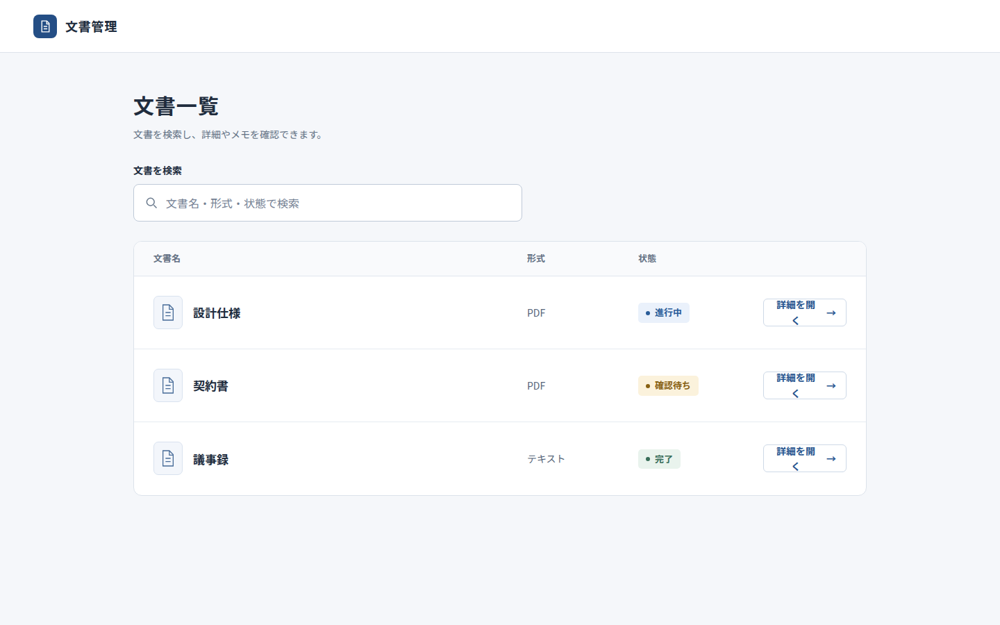
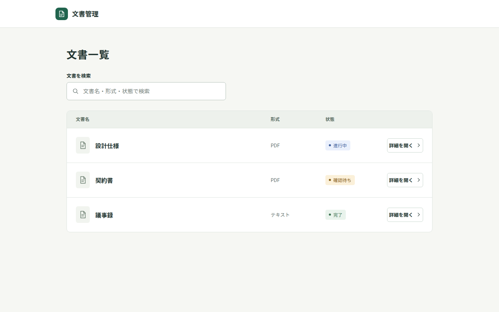

# UI・UXスキルの画面品質比較と改善

2026年10月31日。対象はUX Stack 1.2.0の設計スキルと監査ハーネス。

現行版は、合成の文書管理・設定フォーム・公開ページで、主要な情報と操作をおおむね整理できた。
文書一覧のDesktop表示では、ボタンの「詳細を開く」の末尾が改行される問題が見つかった。
短い指示へ整理した候補はこの表示を改善したが、他の画面まで一貫して良くなるとは確認できなかった。
そのため、スキル本文の全面的な置換は採用せず、既存の入口を維持した。

反映したのは、画面幅ごとのラベル確認、任意の局所検証、画像記録値の再確認、検証範囲の明示である。
**実モデルによる監査・修正・独立再評価の通し実行は未完了**であり、以下の画面比較や自動テストと区別する。

## 比較条件

| 項目 | 条件 |
|---|---|
| ケース | 文書管理、表示名設定、予約管理サービスの公開ページ |
| 方式A | 現行のooui-design |
| 方式B | 入口・重複指示の整理と既存の表示確認の具体化 |
| 方式C | Bに対象限定の確認、画像記録値の利用、キーボード確認を追加 |
| モデル | gpt-6.1-sol、推論設定medium |
| 素材・形式 | 同じケースごとの要求、単一HTML、外部依存なし。IDは自動操作の接続用に共通指定 |
| 回数・上限 | 各ケース・方式1回、生成は各150秒。実モデル試験全体の上限60分 |
| 画像 | Desktop 1440×900、Mobile 390×844 |
| 独立評価 | 方式名を伏せた画像ペアを、生成とは別のCodex実行へ渡した |

評価前に[契約](evidence/benchmark/evaluation-contract.json)を固定した。
画像の評価は階層、読みやすさ、簡潔さ、一貫性、画像上で分かる要求との対応を各1〜5で採点した。
1は理解を妨げる状態、3は使えるが摩擦が見える状態、5は明確で整っている状態とした。
操作の成否はPlaywrightの固定チェックで別に確認した。画像だけで保存や状態保持を成功と判断していない。

全方式のケース入力、モデル、推論設定、権限、時間枠は共通にした。
提供側の混雑、呼び出し時間帯、sampling seedは制御できないため、生成時間から速度改善を断定しない。
この試験は依存なしの小規模ページを対象とし、Product Design等との連携全体を再現したものではない。

## 画面と操作の結果

数値は各ケースの5項目の平均。人間によるユーザーテストの点数ではない。

| 方式 | 文書管理 | 設定フォーム | 公開ページ | 操作・表示チェック | 3ケースの生成時間合計 |
|---|---:|---:|---:|---:|---:|
| A | 3.8 | 4.8 | 4.8 | 22/22 | 210.2秒 |
| B | 4.8 | 4.8 | 4.4 | 22/22 | 191.8秒 |
| C | 4.8 | 4.6 | 4.8 | 補正後22/22 | 185.5秒 |

原データは[結果](evidence/benchmark/results.json)、[匿名化対応表](evidence/benchmark/blind-map.json)、
[文書管理の採点](evidence/benchmark/ratings/documents.json)、[設定の採点](evidence/benchmark/ratings/settings.json)、
[公開ページの採点](evidence/benchmark/ratings/landing.json)にある。

### 文書一覧：ボタンの折り返し

| 現行A | 比較候補C |
|---|---|
|  |  |

AではDesktopの全詳細ボタンで「く」が次の行へ落ち、Mobileでは一行に収まっていた。
B・Cでは両方の画面幅で一行になった。検索、詳細、関連文書、一覧への復帰、メモ保持は全方式で固定チェックを通過した。
表示と操作を分けたことで、「動くので表示も問題ない」という判定を避けられた。

### 良い画面を維持する

設定フォームのAは、入力欄と主要操作の関係が明確で、操作チェックも通過した。
Cの初期画像には取消ボタンが見えず、画像評価では要求との対応が低く採点されたが、取消は確認ダイアログ内に存在し、操作できた。
初期画像に見えないことを機能の欠落と同一視せず、採点だけを上げるための常設ボタンも追加しない。

Bの公開ページでは、機能名の一覧と説明の重複が指摘された。
Cは画面例を使ってサービスを具体化したが、平均点はAと同じだった。
装飾や指示を増やせば良くなるという結果ではない。

### フォーカス検査の誤検知

Cの文書管理では、最初の自動検査がフォーカス表示を2件失敗とした。
検査がinput自身のoutlineとshadowだけを見ており、親の検索欄に出るfocus-withinの枠を見逃していた。
[実際のフォーカス画像](evidence/benchmark/screens/C-documents-focus.png)を確認し、全方式に同じ補正検査を適用した。
元の失敗は[操作記録C](evidence/benchmark/operations-C.json)へ保持し、[補正結果](evidence/benchmark/focus-check-v2.json)を別に保存した。
画面、採点、採用条件は変更していない。CSSの有無だけで可視性を断定しない。

## 調べた規範と採用判断

| 原典・方式 | 判断 |
|---|---|
| 既存のOOUI・状態保持 | 原形として維持。固定対象の設定を無理に一覧・詳細へ分けない |
| [W3Cの可視フォーカス](https://www.w3.org/WAI/WCAG22/Understanding/focus-visible.html) | 要素と外枠の表示を画像・キーボード操作で確認する。特定のCSS指定を必須にしない |
| [WAI-ARIAのモーダル](https://www.w3.org/WAI/ARIA/apg/patterns/dialog-modal/) | 初期フォーカス、Tab、Escape、終了後の復帰を確認する。不要なモーダルは増やさない |
| [GOV.UKのエラー表示](https://design-system.service.gov.uk/components/error-summary/) | 入力とエラーを対応付ける。単一入力へ要約パネルを機械的に足さない |
| [Playwrightのアクセシビリティ検査](https://playwright.dev/docs/accessibility-testing) | 自動検査、手動操作、人間による評価の範囲を区別する |

5つの規範を確認し、既存機能との重複を避けるため実装比較は3方式に絞った。
外部の原実装を実行して優劣を測定したものではなく、[原典確認](evidence/benchmark/source-review.json)に基づく適用範囲の整理である。

事前条件は、重大な悪化や必須機能の欠落がなく、少なくとも2ケースで画面または操作が改善することだった。
B・Cとも改善は文書管理だけで、この条件を満たさなかった。
したがって全文置換は見送り、観測した表示の点検と、別途テストできる実行・証拠処理だけを変更した。
入口は元のooui-designのままで、新しいスキルは追加していない。

## 実ハーネスの結果と残る制約

| 実行 | 結果 |
|---|---|
| Design Research `20261031T080401Z-d212165f` | 原典資料の構造検査でblocked。research_completeではない |
| 現行full `20261031T080858Z-309436e4` | 参考画像の実URLとモデル記載URLが不一致でblocked |
| focused試作 `20261031T081408Z-6f0bae66` | 計画は取得。評価役が180秒で停止し、修正へ未到達 |
| 単一フローの別試験 `20261031T082221Z-8b7dcc51` | 対象と計画役の重複操作を限定した別契約。計画役が180秒で停止 |

停止の原記録は保持し、無条件の再試行や時間上限の引き上げはしていない。
[研究ハーネスが生成した停止報告](../uiux-quality-study/report.md)は、親による本比較報告と区別して残した。
focusedの試験アプリは、Aの設定フォームから保存ボタンを意図的に隠した合成の回帰試験であり、画面比較の点数には含めない。
[実行結果の要約](evidence/benchmark/workflow-results.json)に状態と撮影枚数を残した。
完全ログは`.artifacts/design-research/`以下でGit対象外とした。

fullで停止した画像は、ハッシュと画像自体は一致し、URLの転記が一致していなかった。
修正ではブラウザーの直近12枚の記録値を参照できるようにし、誤りの項目を診断へ表示した。
URLやハッシュの照合を緩めたり、保存済み結果を書き換えたりしていない。

実モデルの監査・修正・再評価が完了しやすくなったという効果は、まだ実証できていない。
Windows・Claudeの実機動作、大規模アプリ、人間の使いやすさ、請求費用も未測定である。

## 配布と検証

UX Stack 1.3.0では、既定のfull、旧runの再開、終了コード、編集保護を維持する。
focusedは明示した対象・画面幅だけの検証であり、レポートとstatus.jsonに範囲を残す。
参考URLがなければ比較工程を省略するが、指定した参考比較、重大問題、操作・画像・必要なテストは省略しない。

比較データのハッシュと集計は、モデルやネットワークを使わず再確認できる。

```bash
python3 tools/codex-ux-stack/evals/verify_quality.py \
  docs/design-research/uiux-skill-quality/evidence/benchmark
```

この検証は保存データの整合性を確認するもので、採点の妥当性や人間の使いやすさを認証しない。
Git対象ファイルの一時コピーで全体テスト474件が失敗なし、5件skipとなり、実Chromiumの5件は別途すべて成功した。
元の作業ツリーには旧yomiyasuのGit対象外データがあり、旧配布先の不存在を確認するテストだけが失敗する。既存データは保持した。
テストの結果と導入方法は[UXの検証範囲](../../codex-ux-stack/validation.md)と[使用例](../../codex-ux-stack/usage.md)を参照。
