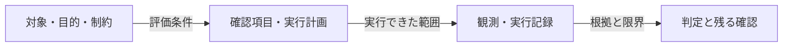

<!-- Generated by design-research compact-v1 -->
# 調査・検証報告

実行ID: 20261011T135446Z-083e3d55 / **reviewed** / 段階: reviewed / 反復: 1
更新: 2026-10-11T14:02:38.132550+00:00

## 結論と確認してほしいこと

Required evidence, reporting and independent review complete

課題: 単一の必須runtime基準Q1だけで、保存した比較記録の整合性と報告の主張範囲を監査する。48生成と18追試の入力ハッシュ・匿名採点・集計、調整後の16資材、ネイティブ3試行の全読込証拠をverify_explanation.pyで実照合する。docs/explanation-results.mdが初期主指標-0.0185、事前目安未達、追試各1回、初期案と調整版同点、人間評価未実施を正確に記していることを独立に読む。Q1の受入は実照合成功と重大な報告の過大主張がないこと。文章品質の優越そのものは今回の監査の受入に含めず、未改善も有効な結果。一次資料の再調査、モデル再生成、インストール、ソース編集、別の評価基準や実験追加は行わない。
対象版: Git管理なし

## 保存した工程と残る作業

| 工程 | 状態 | 必須 |
|---|---|---|
| 001-planner | complete | Yes |
| 001-review-Q1 | complete | Yes |

実測が保存されていても、必須の説明・独立レビューが未完了なら全体は完了していません。

未解消: Critical 0件 / High 0件 / Medium 0件 / Low 0件

## はじめて読む方へ：検証の範囲

目的：保存済み比較記録の整合性を実照合し、docs/explanation-results.mdに重大な過大主張がないことを確認する。

基準となる動作・構成：初期比較はbaseline（旧版proposal.2）とimprovedの12課題×各2回＝48稿。追試はbaseline・improved・revisedの未使用6課題×各1回＝18稿。報告値は初期主指標差−0.0185、改善目安+0.25未達。これらは今回の実照合前の記載値として扱う。

### 図：この報告を作る確認の流れ

以下は検証の段取り図であり、対象アプリの未確認な内部アーキテクチャを示すものではありません。

**図の読み方：** 対象から判定までを左から右へ追います。計画だけの確認と、実行記録を伴う確認は別です。

現在の記録：この反復の実行記録 1 件。レビュー記録あり。件数や図の存在は合格を意味しません。

実測は実行記録で確認した範囲、静的確認はコード等から読めた範囲、未確認は証拠が不足している範囲です。

対象とした具体的な入力・操作、期待と実際の差は、以下の確認項目と所見で説明します。

## 調査・比較・検証

対象: backend
目的: 保存済み比較記録の整合性を実照合し、docs/explanation-results.mdに重大な過大主張がないことを確認する。
基準案: 初期比較はbaseline（旧版proposal.2）とimprovedの12課題×各2回＝48稿。追試はbaseline・improved・revisedの未使用6課題×各1回＝18稿。報告値は初期主指標差−0.0185、改善目安+0.25未達。これらは今回の実照合前の記載値として扱う。

### 確認結果

| 確認対象 | 必須 | 結果 | 根拠・限界 |
|---|---|---|---|
| Q1: 保存記録の実照合が成功し、報告の主張が証拠の範囲に収まるか | Yes | pass | EV-00001は指定コマンドで終了コード0、タイムアウト・出力切詰めなし。stdoutは初期writing_prompts_verified=48、ratings_complete=true、holdout.writing_prompts_verified=18、holdout.ratings_complete=true、current_assets_verified=16、native_receipts_verified=3、native_reference_routes_passed=3。検証実装は入力ハッシュ、生成・匿名採点プロンプト、採点形式・重複、再集計と保存集計の一致を検査する。今回照合された集計のcompleted/ratedは初期48/48、追試18/18。ネイティブは3件ともcompletedで、N-depthには全文読込成功2件、N-mail/N-codeには該当読込なしとなり契約と一致する。報告本文は初期差−0.0185、目安+0.25未達、未使用6課題各条件1回、初期案と調整版の同点、人間評価未実施を正確に記載し、例示・追試・読込・インストーラー検査から一般的優越を主張していない。留保として、今回stderrのPATH補助バイナリ作成警告、および保存済みN-depth内のcompare終了コード1・REVIEW_REQUIRED・meaning_preservation_verified=falseを保持する。後者を意味保持の成功へ読み替えず、Q1の読込経路確認と区別する。検証の再実行はしていない。 [EV-00001](../001-checks/001/receipt.json) |

### 複雑さの評価

See scoped independent reviews; Q1だけを対象に、親の実行receipt・stdout・stderrと決定的な元ファイルを読んだ。追加実験、再生成、再採点、依存追加、ファイル変更は行っていない。保存集計は単独の測定証拠にせず、今回の再集計照合成功と併せて判断した。
評価: 許容

## 残る確認と実行記録

Required evidence, reporting and independent review complete
実測・AIによる評価の範囲を示しています。人間の利用確認、本番運用、方式の普遍的な有効性は未確認です。
中断した修正の差分は保持し、新しいaudit/runで再検証します。

[実行状態](../state.json) · [機械用の状態](status.json)
