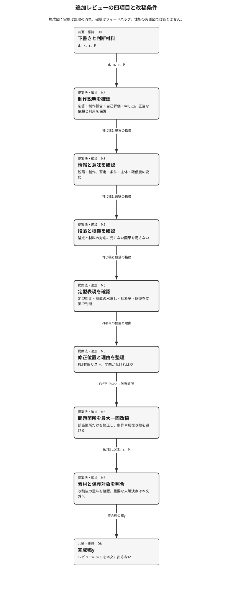
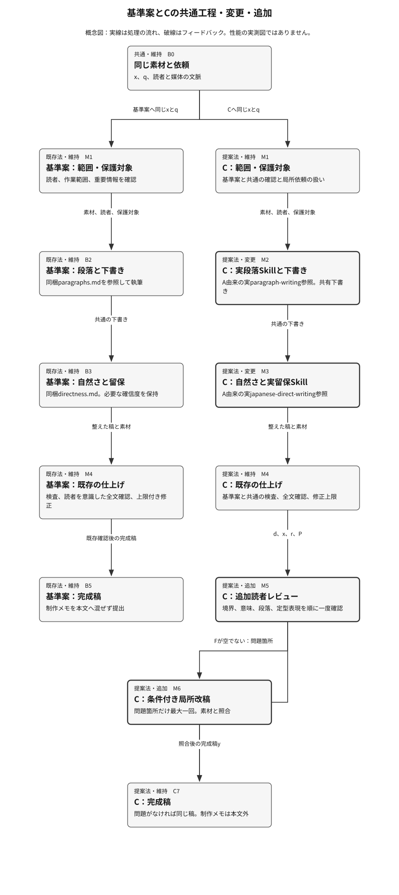

<!-- Generated by design-research compact-v1 -->
# 研究報告書

実行ID: 20261011T101101Z-7590eed5 / **blocked** / 段階: producer-design / 反復: 2
更新: 2026-10-11T12:41:40.435854+00:00

## 要旨と現時点の結論

Source changed outside a declared fix; start a fresh audit/run. docs/codex-yomiyasu/evidence/study-2026-10-11/native-prompt-provenance.json, native_provenance_audit.py, tools/codex-yomiyasu/evals/run_study.py, tools/codex-yomiyasu/evals/verify_native.py

課題: 比較対象は既存の日本語執筆Skill yomiyasu（2.0.0-proposal.1）と、改善案A（実補助Skill連携と点検）、B（A＋執筆前の素材/制作指示分離）、C（A＋下書き後の読者視点レビュー）。ユーザー指定の改善3案と基準案の4条件に限定するためtarget-methods=4の例外を記録する。これは新規アルゴリズムの発明ではなく、既存原則の適用比較。
必ずdocs/codex-yomiyasu/evidence/study-2026-10-11/research-inputs/capture.jsonの実際の最終出力・匿名採点・失敗記録・native_verificationを読んで研究する。モデル生成を呼び直さない。生成は同じgpt-6.1-sol/xhighの12課題×4条件×2回で96試行、94完了、2タイムアウト。完了94出力には重大な意味変更や制作コメント残存の所見がなく、各品質評点>=3。24/24成功の現行とCが同等で、Cの文章品質の優位性は未確認。A/Bは各23完了なのでタイムアウトを言語品質の不合格やCの因果的優位としない。補助SKILL実ファイル読込は8依頼×4条件で測り、現行6/8（1timeout、1未連携）、A5/8（3timeout）、B/C各8/8。Cを欠落なく要件を確認できた実装候補として条件付きで採用するが、Bを劣った手法と結論しない。
R1=重要情報・否定/因果/主体/確信度/義務の保持、R2=指示者向け説明を成果物へ混ぜない（正当なメール依頼・研究目的・引用を保持）、R3=必要な工程で実際のparagraph-writingとjapanese-direct-writingを読んで一度適用（狭い依頼や誤字・コードには全工程を強制しない）、R4=自然さと段落構成が>=3/4、R5=追加手間と速度は参考値（複数工程を並行したので因果的速度差や課金節約を主張しない）。主指標は完了かつR1/R2/R4を満たす出力率。採用には意味の重大変更0・正例破壊0・必要な連携成立、測定欠落を隠さない。
docs/codex-yomiyasu/evidence/study-2026-10-11/research-inputs/source-index.jsonとdocs/codex-yomiyasu/evidence/study-2026-10-11/research-inputs/S1.md～S5.mdは実際に開いたMIT公開スキルの固定原典。tools/codex-yomiyasu/evaluation-v200/以下に基準案と3案の実資材、tools/codex-yomiyasu/evaluation-v200/frozen-sources.jsonにハッシュがある。旧cacheだけは非入力で配布していない。捏造した論文や効果値を追加しない。発想は現行・blader/humanizer・coji/natural-japanese・iKora128/stop-ai-slop-jp等と重なる。数式を飾りで作らず、実スキル参照→段落→留保→読者レビューという擬似コードと3図で工程を説明する。約5候補の標準を4条件へ狭めた理由を記録。
最大3つの隔離された決定的検査で、捕捉済み出力と評定を再計算し、引用/数値/コードの代表例とSKILL全文読込の証拠を検査する。実験結果は親による実行receiptと結びつけ、完了出力とタイムアウトを別記。既存捕捉の結果を単なる定数へ置換して勝利を作らない。元の文書自体の修正や追加モデル生成・インストール・設定変更はこの研究で行わない。新規6課題の確認とインストーラー反映は親が別に行う。
保存済み新規6課題のholdoutも両条件6/6成功。採点は同一モデルの自動評価で、品質差未確認。audited summariesのprimary_fractionは取得稿を分母とし全条件100%、delivered_pass_fractionは全試行が分母。選択の完全性条件は保守的な後付け条件として明記。旧研究のprepareは一時領域だけで実行記録・報告が残っておらず、このrunで捕捉済み結果の独立検査と研究報告を完成させる。親は新規生成を繰り返さない。
このprojectは固定済みの研究入力のみの隔離コピー。元リポジトリの他の研究・ECC・Basic Memoryは対象外。親が保存したcaptureと実際のreceiptから読む。品質指標の天井効果、後付け採用条件、未取得試行を批判的に評価し、文章品質の改善なしも正しい結果として報告する。
対象版: Git管理なし

## 保存した工程と残る作業

| 工程 | 状態 | 必須 |
|---|---|---|
| 001-planner | complete | Yes |
| 001-producer-design | complete | Yes |
| 001-producer-assets | complete | Yes |
| 001-producer-results | complete | Yes |
| 001-evidence-baseline | complete | Yes |
| 001-evidence-a | complete | Yes |
| 001-evidence-b | complete | Yes |
| 001-evidence-c | complete | Yes |
| 001-producer-method | complete | Yes |
| 001-producer-reader | complete | Yes |
| 001-reviewer-dossier | complete | Yes |
| 001-review-P1 | complete | Yes |
| 001-review-R1 | complete | Yes |
| 001-review-R2 | complete | Yes |
| 001-review-R3 | complete | Yes |
| 001-review-R4 | complete | Yes |
| 001-review-R5 | complete | Yes |
| 001-review-E1 | complete | Yes |
| 001-review-L1 | complete | Yes |
| 002-producer-design | incomplete | Yes |

実測が保存されていても、必須の説明・独立レビューが未完了なら全体は完了していません。

以下の提案・台帳は前反復の評価です。現反復の実測・レビューはまだ完了していません。

提案: **改善案C：A＋読者視点レビュー**（provisional）
Cを条件付き実装候補として維持する。保存メタデータを前提に、Cは主比較24/24完了・採点済み、安全所見0、品質各>=3、native8/8で保守的な後付け完全性条件に合う。baselineとの差は0で改善閾値+1/24は未達、品質優位は未確認。Bもnative8/8で、未取得1稿のため後付け完全性条件を満たさないことはBの言語品質の劣位を示さない。元prompt本文がなくK_ROUTE/K_PROTOCOLがunknownのため正式な提案・採択へ昇格しない。保存メタデータと実際の依頼の対応が独立に確認できる場合に限る条件付き判断である。

判断待ち・未確認: 元prompt本文がなく、共通入力contract・依頼意図・expected_readsの独立照合は未確認; 生成2件/native4件のtimeout原因、旧予定採点単位B05～B08の実行有無は不明; 品質評定は同一モデルで天井効果があり、Cの品質改善、人間の受容、一般的最適性は未確認; 内部適用回数、因果的速度差、課金節約は未測定
見直す条件: 元promptの来歴確認で共通入力・経路意図の不一致が判明する; 安全所見・品質閾値・出力完全性・経路成立に新たな不成立が判明する; 独立評価で品質差や異なる失敗が確認される

研究の完了は方式の採用承認を意味しません。

未解消: Critical 0件 / High 1件 / Medium 0件 / Low 0件

- R3_R3-01: 元prompt本文がなく経路意図を独立照合できない（High） → 元promptを入手できるまでR3とCの経路条件をunknownに保ち、条件付き実装候補という判断を維持する。
## 主要指標と具体的な差

研究の目的: effectiveness

対象入力: capture.jsonのcontract.tasksにある固定12課題。各候補にtrial_id=1,2の2回を対応づけ、全96試行を保持する。代表母集団の標本ではない。保存済みH1～H6×baseline/cの12試行とN1～N8×4条件の32native試行は別の補足検査とし、この主比較のtask集合と分母へ追加しない。
統制条件: 共通の入力、依頼範囲、保護対象、期待結果、task_id、trial_idを候補間で一致させる。candidate_idは元記録のbaseline/a/b/cを使用する。; 元モデルはgpt-6.1-sol、effort=xhigh、CLI 0.162.1。温度はCLIで制御されていない。元生成の上限は480秒で、実際のreceiptのstatusとelapsedを保持する。再生成・再試行はしない。; 候補の実資材はtools/codex-yomiyasu/evaluation-v200/の固定内容を使う。ハッシュと元prompt来歴を親検査で照合する。歴史的cacheは非入力として除外理由を残す。; 完成稿品質は保存済みの匿名・別セッション・同一モデル評定を用いる。output_fileで原出力へ結合し、各単位で再使用されるX番号を全体IDにしない。旧採点timeoutと最大4稿への単位縮小を保持する。; 数値・引用・コード・数式・指定手順は原入力に照合する。意味のmust_keepは同義の表現を許し、単純な部分文字列一致で否定・因果・義務を判定しない。; 全試行分母のdelivered_pass_fractionと、completedかつ採点済みの稿を分母とする品質合格率を別計算する。timeoutの意味・品質はnullのまま保持する。; 全24稿取得・採点済み、重大意味変更0、正例破壊0、native8経路成立は後付けの条件付き採用ゲートであり、元contractの事前条件や文章品質の優位と扱わない。
予算・測定範囲: 親が最大3件のローカル決定的検査を実行する。既存出力の来歴確認と再集計のみ。モデル呼出し、インストール、設定変更、既存文書修正は0件。PROJECTバックエンドテストはなくtest_commands=[]。
適用限界: 元結果を読んだ後、親の独立監査より前に固定する事後検証計画。主指標の全試行分母は今回の依頼によるもので、元contractの完成稿分母と区別する。小規模固定課題、同一モデル自動評定、品質の天井効果、採点文脈量の不均一、未制御温度、運用失敗の原因不明、並行実行がある。元採点・native検証スクリプトはこの隔離コピーに含まれず、保存済み評定とtool出力の再検査までが範囲。内部適用回数、人間の受容、一般的最適性、因果的速度差、課金節約は未測定。負または同等の結果でも有効性検証は完了可能。

**主要効果は未測定です。効果の改善・不改善の結論は出せません。**

## はじめて読む方へ

### 何を解決するか

Cの文章品質の改善は確認されていない。Cは、保存記録上の出力取得と補助スキル連携がそろった条件付きの実装候補に留まる。この報告は、日本語の執筆手順を選ぶ人に、何を追加したか、完成稿で何が確認できたか、何が未確認かを説明する。対象のyomiyasuは、原稿の意味を保ちながら段落と表現を整える執筆スキルである。読者が困るのは、推敲で義務や未決事項が変わること、制作の会話が完成稿へ残ること、必要な補助手順が実際には参照されないことである。

対象・対象外：比較は現行yomiyasu 2.0.0-proposal.1、A、B、Cの4条件。Aは必要な工程で段落構成と留保表現の補助スキル実ファイルを読む設計、BはAに執筆前の素材・制作指示の分離を追加、CはAに下書き後の読者レビューを追加する。主比較は固定12課題×4条件×2回の96試行で、94稿を取得し、2試行はタイムアウトした。別集計として、現行案とCの補足6課題ずつ、および8種類の依頼×4条件の補助スキル連携記録を扱う。主比較の分母へ補足結果を足さない。根拠はS6・S10の最終出力と対応評定・原receipt、S7の保護対象、S8の補足出力、S9の実tool出力である。親の既存3監査には成功receiptがあるが、それは欠けた元依頼文の照合まで保証しない。

現時点の要点：主指標は、全試行のうち、完成稿を取得し、意味・制作説明・品質の条件を満たした割合である。現行案24/24、A23/24、B23/24、C24/24だった。取得・採点済みの稿だけを分母にすると、品質条件を満たす割合は現行案24/24、A23/23、B23/23、C24/24である。94稿の保存評定では意味誤りと制作説明残存の所見がなく、段落構成・自然さ・読者への適合は各3/4以上だった。Cと現行案の主指標差は0で、改善閾値の+1/24に届かない。A/Bの未取得稿の意味と品質は未観測であり、タイムアウトを文章品質の不合格へ読み替えない。

補助スキル連携は保存メタデータ基準で現行案6/8、A5/8、B/C各8/8だった。現行案には完了した未連携1件とタイムアウト1件、Aにはタイムアウト3件がある。この8経路には、必要なファイルを読む依頼に加え、不要な全工程を強制しない対照も含む。Cは全24稿取得・採点済みと8経路成立という後付けの完全性条件に合うため暫定候補となる。Bの品質の劣位やCの品質改善は導けない。元依頼文との独立照合ができず、Cの経路・手順の制約判定はunknownのままで、正式採択には至っていない。

### 具体的な利用例・入力から出力まで

実際の比較をW06の1回目で追う。保存された共通入力は『ご要望を踏まえて仕様を分かりやすくしました。REQ-12：監査ログは90日間保存しなければならない。障害時の調査に利用する。REQ-13：管理者への通知は推奨とする。通知先は未決定である。』である。冒頭は制作説明だが、保存期間、保存義務、利用目的、通知の推奨、未決定事項は読者に必要な内容である。これは課題manifestに保存された入力で、実行時の元prompt全文との独立照合は未確認である。

Cの追加工程なしの現行案（W06-baseline-1）の完成稿は『REQ-12：監査ログは90日間保存しなければならない。障害時の調査に利用する。

REQ-13：管理者への通知は推奨とする。通知先は未決定である。』だった。追加工程ありのC（W06-c-1）も、同じ完成稿だった。両稿とも保存評定は段落構成・自然さ・読者への適合が4/4で、意味誤り・制作説明残存の所見はない（S6・S10）。この実例ではCを加えて完成稿が改善したとはいえない。現行案にも読者を意識した全文確認があり、比較はA由来の実ファイル参照とCの追加レビューをまとめて含むため、追加レビューだけの効果も分離できない。

工程を理解するための説明では、素材をx、依頼範囲をq、読者と媒体をr、保護事項をPと置く。W06のPには『90日間の保存義務』『障害調査の目的』『通知は推奨』『通知先は未決定』が入る。通常の文章作業は、範囲確認M1→実段落スキルを参照する段落設計と下書きM2→自然さと実留保スキルの点検M3→既存の仕上げM4→追加読者レビューM5へ進む。M5は、制作説明、情報と意味、段落と根拠、定型表現の順に確認し、修正位置と理由のリストFを作る。Fが空なら同じ下書きdを提出し、空でなければM6で問題箇所だけ最大一回直して素材と照合する。構成だけ、留保だけ、誤字、コードの依頼はM1で指定範囲に応じた入口へ進む（c_S_MECHANISM）。このP・d・Fの追跡は未測定の説明例である。中間下書きや修正リストは保存されておらず、W06の実行でFが空だったか、追加レビューが何を修正したかは分からない。

図は提案手法章の既存3図を参照し、ここには重ねて載せない。F1『Cの入力から完成稿まで』は全体図で、素材から通常工程または局所入口を経て完成稿へ進む経路を読む。矢印は素材・保護対象・同じ下書きの受渡しと分岐条件を表す。図が表示できない場合は、直前のM1～M6の工程説明が代替になる。

F2『追加レビューの四項目と改稿条件』はF1のM5を拡大し、M6への分岐も示す詳細図である。対応はparent_figure=F1、expanded_component=M5。矢印は四項目の点検順序と、Fが空なら提出、空でなければ局所改稿する判断を表す。正当なメールの依頼、研究目的、操作指示、引用は制作説明として除去しない。図が表示できない場合は『四項目を順に確認→Fを整理→空なら同じ稿を提出／空でなければ一回の局所改稿と意味照合』と読む。

F3『基準案とCの共通工程・変更・追加』は比較図で、同じ素材を現行案とCの経路へ渡し、共通の仕上げ、A由来の参照変更、C固有の追加レビューを区別する。矢印は各案内の処理順序を表し、品質の大小を表さない。図が表示できない場合は『両案とも範囲確認・執筆・仕上げを行い、Cは実補助スキル参照と仕上げ後の追加レビューを持つ』と読む。3図はいずれも未測定の工程説明図であり、性能や内部適用回数の測定根拠にはしない。

### 用語と前提

スキルは執筆作業の手順書、SKILL.mdはその実ファイルを指す。paragraph-writingは段落構成、japanese-direct-writingは不要な予防線を減らしつつ必要な条件と不確実性を守る補助スキルである。制作説明は『修正版です』など依頼者へ制作を報告する文で、メール受信者への正当な依頼や研究目的とは区別する。保護事項Pは数値や引用だけでなく、否定・条件・主体・確信度・義務など保持すべき意味を含む。receiptはstatus、最終出力、tool結果などを保存した実行記録である。native連携検査は実ファイルの全文読込と依頼範囲に応じた経路を確認する補足検査であり、内部で何回適用したかの測定ではない。holdoutは主比較と分けて保存された補足6課題を指す。天井効果は評点が上限付近に集まり、小さな品質差を見分けにくい状態を指す。後付け完全性条件は結果を見た後に置いた暫定選択条件で、元実験の事前条件ではない。

## 全体像から詳細へ

全体構成・内部処理・既存法との違いは、後続の「提案手法」章の図で順に説明します。

図と説明の適用範囲：結果は小規模な固定課題と保存済み記録に限る。同一モデルによる匿名自動評定で、人間の理解や受容、一般的な最適性は未測定である。評点は上限付近に集中しているが、AのW09-1、CのW09-2とW12-1の自然さ3/4も保持しており、全稿が満点だったわけではない。

主比較とnativeの元prompt本文がなく、保存hashとメタデータから確認できる範囲に限る。必要な読込の期待値と実際の依頼意図の対応は独立に確かめられていない。成功した全文読込から内部適用回数やレビューの寄与を推論しない。保存評定と代表的な保護対象の検査で違反所見がないことも、未観測の意味変化が絶対にないという証明にはならない。

主比較のW08-a-1とW02-b-1、nativeのN2-baseline-1、N1-a-1、N2-a-1、N6-a-1のタイムアウトを残す。原因は不明で、未取得稿の品質は不明である。旧採点単位B01/B03のタイムアウト後に未採点稿の単位を最大4稿へ縮小したため、採点文脈量はそろっていない。旧予定単位B05～B08は保存receiptがなく、実行有無も未確認である。argvサイズ超過の準備失敗、installer manifest欠落による無効なnative準備記録、非入力・非配布の歴史的cacheの除外理由も保持する。

工程は並行して実行され、温度も制御されていない。所要時間と報告token数は参考値であり、因果的速度差や課金節約を示さない。既存の親監査の成功は保存結果の検査範囲を示すもので、元実験の事前登録、独立した人間評価、欠落資料の復元を意味しない。説明図の描画品質と読者理解はこのunitでは確認していない。

## 背景・課題と比較対象

対象: research
目的: yomiyasu 2.0.0-proposal.1と改善案A/B/Cを、保存済みの実出力とreceiptから比較する。意味保持、制作説明の除去、文章品質、必要な補助スキル読込を検証し、Cの条件付き採用を評価する。文章品質の改善が確認できない結果も受け入れる。
基準案: candidate_id=baseline：tools/codex-yomiyasu/evaluation-v200/baseline/assets/のyomiyasu 2.0.0-proposal.1。既存の段落設計・留保点検・仕上げ検査を備えるが、通常工程で補助SKILL実ファイルの読込を必須にしていない。

### 比較条件

固定済みの日本語執筆・推敲課題の事後監査。主比較はW01～W12×baseline/a/b/c×2回の96試行。H1～H6×baseline/cの12試行とN1～N8×4条件の32native試行は別集計。ユーザー指定の基準案と改善3案に限るためtarget_methods=4とし、標準の約5候補からの例外を記録する。新規アルゴリズムの発明、一般母集団への推定、人間による受容の測定は対象外。

- hard: R1/R2：重大な意味変更、制作説明残存、正例破壊は0件。重要情報、否定、因果、主体、確信度、義務／推奨、引用、コード、数式、指定手順、正当なメール依頼と研究目的を保護する。
- hard: R4：保存済み匿名評定のparagraph/naturalness/reader_fitが各3/4以上。完成稿の評定欠落や原出力との不一致を合格へ補完しない。
- hard: R3：採用候補のnative全8経路が成立する。必要な実SKILL全文読込と、局所依頼・誤字・コードで不要な全工程を強制しない対照を区別する。内部適用回数は観測不能。
- hard: 固定原出力・原receipt・評定から親が最大3件の隔離検査を行う。再生成、別harness、インストール、設定・元文書変更、メモリ保存、commit、deployは禁止。timeout、欠測、準備失敗、採点単位変更を保持する。
- soft: R5：elapsed_secondsと報告usageは参考値。工程の並行実行、未制御温度、採点文脈量の違いがあるため、因果的速度差、課金節約、内部適用回数を主張しない。

### 候補の比較

| 方式 | 評価軸 | 結果 | 根拠の種類 |
|---|---|---|---|
| 現行 yomiyasu 2.0.0-proposal.1 | P1/R4：全試行分母の出力合格率と完成稿分母の品質 | 全試行分母の出力合格24/24、完成稿分母の品質合格24/24。品質3項目は各24稿すべて4、各平均4、3点稿なし。保存評定に基づく基準値であり、一般的な最適性や他候補への品質優位を示さない。 | measured |
| 現行 yomiyasu 2.0.0-proposal.1 | R1/R2：意味保持・制作説明除去・正例保護 | 主比較24稿の保存評定で意味誤り・制作説明残存の所見0。数値、義務／推奨、未決定、メール依頼、引用、参照、コード、数式、指定手順を保つ実出力がある。literal_findings=[]は字面・形式の検査結果で、意味保持全体の証明とは区別する。 | measured |
| 現行 yomiyasu 2.0.0-proposal.1 | R3：必要な実SKILL全文読込と不要工程の非強制 | 保存expected_readsを前提に経路成立6/8。N1は完了未連携、N2はtimeout。必要な読込を要求するN1～N6は4/6、読込不要対照N7/N8は2/2。元promptの独立照合と内部適用回数は未確認。 | measured |
| 現行 yomiyasu 2.0.0-proposal.1 | R5：参考elapsed/usageと追加工程の手間 | 原receiptの参考平均elapsedは全試行・完了稿とも33.23秒。elapsedとusageの欠測なし。通常工程で補助SKILL実読込を必須にしないという設計上の特徴はあるが、実際の追加手間・内部適用回数・因果的速度差・課金節約は未測定。 | measured |
| 現行 yomiyasu 2.0.0-proposal.1 | 補足holdout：H1～H6の完成稿 | 6/6完了・採点済み。保存評定の意味誤り・制作説明残存の所見0、各品質4。引用、研究目的、脚注と正当な宛先への依頼を保つ実出力がある。主比較の24試行へ加算しない。 | measured |
| 改善案A：実補助Skill連携と点検 | P1/R4：全試行分母の出力合格率と完成稿分母の品質 | Aは23/24、baselineは24/24。差-1/24はW08-a-1 timeoutによる。改善閾値+1/24未達。完成稿品質合格はA23/23、baseline24/24で、文章品質の改善は未確認。 | measured |
| 改善案A：実補助Skill連携と点検 | R1/R2：意味保持・制作説明除去・正例保護 | 取得23稿の保存評定で意味誤り・制作説明残存の所見0。原出力に数値・義務・未決定・メール依頼・引用・コード・数式・手順が残る。親の字面検査はliteral_findings=[]。未取得W08-a-1は検査値nullで、意味判断全体の保証にはしない。 | measured |
| 改善案A：実補助Skill連携と点検 | R3：必要な実SKILL全文読込と不要工程の非強制 | A5/8、baseline6/8。AのN3/N4/N5には必要な実SKILL全文読込の証拠、N7/N8には読込不要対照の成立がある。N1/N2/N6はtimeout。同じ下書きで各工程を一度扱う条文はあるが、内部適用回数と元promptの依頼意図は独立確認できない。 | measured |
| 改善案A：実補助Skill連携と点検 | R5：参考elapsed/usageと追加工程の手間 | Aの参考平均elapsedは全試行83.09秒、完了稿62.01秒、baselineは33.23秒。Aは実SKILL参照と工程間引継ぎを指定するが、その追加手間を分離した測定はない。並行工程・timeout・usage欠測を保持し、因果的速度差や課金節約を導かない。 | measured |
| 改善案A：実補助Skill連携と点検 | 補足holdout：H1～H6の完成稿 | Aの保存済みholdout試行・完成稿はなく未測定。効果値を補完せず、主比較の分母へ追加しない。 | unknown |
| 改善案B：A＋素材／制作指示分離 | P1/R4：全試行分母の出力合格率と完成稿分母の品質 | Bは23/24=95.83%、基準案24/24、A23/24。Bの完成稿品質は23/23合格で各項目全稿4/4。基準案との差−1/24はtimeout由来。AのW09-a-1の自然さ3点を含め、四区分整理による品質改善は未確認。 | measured |
| 改善案B：A＋素材／制作指示分離 | R1/R2：意味保持・制作説明除去・正例保護 | 取得23稿の保存評定に所見なし。引用・コード・数式・義務・正当なメール依頼を保持し制作説明を除去。Aにも同じ保護原則があり、四区分整理の追加効果は未確認。未取得1稿の安全性はunknown。 | reported |
| 改善案B：A＋素材／制作指示分離 | R3：必要な実SKILL全文読込と不要工程の非強制 | 保存メタデータ上は8/8成立（基準案6/8、A5/8）。N1/N2の両補助SKILL全文読込、N3–N6の局所入口、N7/N8の読込なしを確認。元promptとの照合と内部適用回数はunknown。読込差を四区分整理の因果効果としない。 | measured |
| 改善案B：A＋素材／制作指示分離 | R5：参考elapsed/usageと追加工程の手間 | Bの平均elapsedは完成23稿41.76秒、全24試行62.48秒。Aは62.01秒/83.09秒、基準案33.23秒。Bのusageは23件分、timeout1件欠測。Aに四区分整理と参照読込を追加する設計上の手間があるが、因果的速度差・課金節約・工程別負荷は未測定。 | reported |
| 改善案B：A＋素材／制作指示分離 | 補足holdout：H1～H6の完成稿 | 保存されたholdoutはbaseline/cのみ。BのH1–H6完成稿と合否はunknown。主比較の分母へ加えず、合格・不合格を補完しない。 | unknown |
| 改善案C：A＋読者視点レビュー | P1/R4：全試行分母の出力合格率と完成稿分母の品質 | Cと現行は全試行分母の出力合格が各24/24、完成稿分母の品質合格も各24/24。主指標差0で改善閾値+1/24未達。Cの自然さは4点22稿・3点2稿、平均3.9167、現行は全稿4。CのW09-2の重複とW12-1のぎこちなさを保持する。品質向上は未確認。 | measured |
| 改善案C：A＋読者視点レビュー | R1/R2：意味保持・制作説明除去・正例保護 | Cの保存評定は意味誤り・制作説明残存の所見0。数値、義務、未決定、引用・参照、コード・数式・手順、宛先への依頼を保持する完成稿を確認した。現行にも同じ安全所見0があり、Cの追加効果は示されない。意味保持は有限の保存評定の範囲で、字面検査だけの保証ではない。 | measured |
| 改善案C：A＋読者視点レビュー | R3：必要な実SKILL全文読込と不要工程の非強制 | メタデータ基準はC8/8、現行6/8。CはN1/N2で本体と両補助SKILL、N3/N4で段落のみ、N5/N6で留保のみを読み、N7/N8ではtool読込なし。現行N1は完了未連携、N2はtimeout。元prompt欠落のため経路意図は条件付きであり、内的適用回数とレビュー単独効果はunknown。 | measured |
| 改善案C：A＋読者視点レビュー | R5：参考elapsed/usageと追加工程の手間 | elapsed/usageは両条件24/24件取得。参考平均elapsedはC約22.80秒、現行約33.23秒。報告input_tokens合計はC1740480、現行1701263、output_tokensはC12647、現行12468。並行実行と長い完了試行を含み、速度改善や課金節約とは解釈しない。設計上はAへレビュー一回と条件付き最大一回改稿を追加するが、その実際の手間は未測定。 | measured |
| 改善案C：A＋読者視点レビュー | 補足holdout：H1～H6の完成稿 | Cと現行は各6/6完了・採点済み、意味誤り・制作説明残存の所見0、品質三項目すべて4。H4の教材引用、H6の研究目的・脚注などを保持する。主比較へ合算せず、品質優位の根拠にしない。 | measured |

## 提案手法

**説明対象：c — 改善案C：A＋読者視点レビュー**

設計記述と図の構造チェック済み。新規性・有効性・比較上の優越を認定するものではありません。

親の既存audit-writing、audit-protected-holdout、audit-nativeには同一runのreceiptがあり、いずれもexit\_code=0、timed\_out=false、truncated=false。根拠は登録済みbaseline\_S\_PARENT\_WRITING／PROTECTED／NATIVEと各実成果物。主比較は94完了・採点済み、2timeout。全試行分母はbaseline24/24、A23/24、B23/24、C24/24。完成稿分母の品質合格率は全条件100%。baselineとBの取得稿は全品質項目4/4、AはW09-a-1の自然さが3、CはW09-c-2とW12-c-1の自然さが3で、他の保存評点は4。取得稿の保存評定には意味・境界違反所見なし。保護対象の有限な字面検査に所見なしで、意味保持全体の証明にはしない。holdoutはbaseline/c各6/6合格で全評点4、a/bは未測定。nativeは保存メタデータ条件付きでbaseline6/8、A5/8、B/C8/8。実tool出力に含まれた全文読込が証拠で、内部適用回数は未測定。元prompt本文がなく、依頼意図の独立照合は未確認。Cの改善閾値は未達。図は工程の説明で測定ではなく、生成後の図の視覚検査はこのunitでは未実施。

### ねらいと直感

Cは、必要な補助Skillを実際に参照するAの工程に、提出前の読者レビューを加える。完成稿の意味と正当な本文を守りながら、制作説明、情報の変化、段落の対応、定型表現を順に確認する。基準案にも全文確認があるため、変更の中心は点検順序と条件付き改稿の明文化である。問題がなければ同じ稿を出し、問題がある箇所だけ最大一回直す。品質改善の実証は未確認。

Aの下書き後に読者視点で境界・意味・段落・定型表現を順に一度確認し、問題箇所だけ最大一回直すと、既存確認から漏れた問題を抑えられる可能性がある。

Aの実補助SKILL連携と共有下書きを維持し、基準案にもある仕上げ確認の後に、明示された順序の読者レビューを加える。制作の会話を知らない読者として本文全体を読み、素材・読者・媒体・保護する事実に照らして、修正すべき位置と理由を整理する。順序は制作説明、情報と意味、段落の論点と根拠、定型表現。問題がなければ下書きをそのまま返し、あれば該当箇所だけ最大一回直して素材と照合する。レビューは同じモデル内の工程で、独立評価者や新しいモデルではない。

### 全体像と具体例

保存されたW02-c-1では、原入力の転換率4.1%と4.4%、p値0.18、有意差未確認、効果の有無を判断できないという内容を保持し、冒頭の制作説明と重複する予防線を除いた完成稿がある。最終稿は『対照群の転換率は4.1%、処置群は4.4%でした。検定のp値は0.18で、有意差は確認されませんでした。この結果だけでは効果の有無を判断できません。』で、保存評定は三品質項目とも4/4。説明上の処理では、数値と否定・確信度を保護し、制作説明を本文から分け、残った留保が結果の適用範囲を表すことを確認する。ただし中間下書きはなく、この変更をCの追加レビューが行ったかは未確認。工程の追跡部分は説明例で、測定はS6の最終稿と対応評定までである。


**図1．Cの入力から完成稿まで**　通常の文章作業はAの実連携と共通仕上げの後にCの追加レビューへ進む。局所依頼は範囲に応じた入口で完結する工程説明。

矢印は同じ素材・保護対象・下書きの受渡しを表す。段落と留保の変更はAから継承し、読者レビューと条件付き改稿がCの追加部分になる。局所経路は不要な全体工程を避けるために示す。工程図から実行回数や効果差を測定したとは判断できない。

[図1の編集用定義](runs/20261011T101101Z-7590eed5/method-figures/13d43cfc10043e8e39f3fdd19be4c9d995ffe04bccbdfce4e9677b934341ed81/F1.json)

### 構成要素の詳細

#### M1：作業範囲と保護対象の確認

**入力：** x、q、提供された読者・媒体の文脈。  
**出力：** r、P、通常工程か局所入口かの作業範囲。

読者が理解・判断・実行する内容を確認し、意味と指定形式を保護する。構成のみは段落入口、留保のみは留保入口で完結させる。誤字・コードなどには不要な全体工程を加えない。

**なぜ必要か：** 作業範囲の拡大と、正当な本文を制作説明と誤認する危険を抑える。

**既存法との差分：** 読者・範囲・保護対象を優先する基準案の規則を維持する。B固有の四区分工程はCへ追加しない。

**追加コスト：** 基準案と共通の確認。追加時間や内部判断回数は未測定。

#### M2：実段落Skill参照と下書き

**入力：** x、q、r、P。  
**出力：** 段落の論点と材料を対応づけた下書き。

複数段落の執筆・再構成ではparagraph-writingの実SKILLを解決して読む。兄弟配置を優先し、環境一覧の一意な同名参照を次に使う。特定できなければ同梱paragraphs.mdを使う。論点と根拠を対応づけ、設計メモを本文へ出さずに執筆する。

**なぜ必要か：** 参照の名前だけで連携を完了する抜けを防ぎ、段落の論点と材料をそろえる。

**既存法との差分：** 基準案の同梱参照からAの実補助SKILL参照へ変更する。段落の意味保護と共有下書きは共通。

**追加コスト：** 設計上は必要な実SKILL一種類の読込。タスク内で再読を省く。文脈量の増加はあり得るが、時間・課金差は未測定。

#### M3：自然さと実留保Skillの点検

**入力：** 同じ下書き、x、q、P。  
**出力：** 自然さと必要な確信度を確認した下書き。

既存の自然さ規則を同じ稿へ適用する。必要な留保工程ではjapanese-direct-writingの実SKILLをM2と同じ解決規則で読む。使えなければ同梱directness.mdを使う。重複する予防線を減らし、否定・条件・推量・義務は保持する。

**なぜ必要か：** 不要な留保の削除が、未確定の関係を断定する変更にならないようにする。

**既存法との差分：** 留保の参照をAの実補助SKILLへ変更する。自然さの規則、必要な確信度、同じ下書きの保持は共通。

**追加コスト：** 設計上は必要な実SKILL一種類の読込と既存点検。内部適用回数や因果的負担増は未測定。

#### M4：既存の仕上げ検査と全文確認

**入力：** 下書き、x、q、r、P。  
**出力：** 仕上げ後の下書きdと確認できた事項。

基準案の仕上げ条文に従い、実行可能な検査と全文確認を行う。研究文書の条件・結果・解釈・未検証事項、段落の論点と根拠、意味と境界を照合する。既存の修正上限を守り、実行できなかった検査を実行済みにしない。

**なぜ必要か：** Cの追加レビューへ進む前に、基準案と共通の安全確認を保つ。

**既存法との差分：** 変更なし。基準案にも読者を意識した全文確認と上限付き修正が存在する。

**追加コスト：** 基準案と共通。実行可能性に依存し、C固有の追加費用ではない。

#### M5：四項目を順に読む追加読者レビュー

**入力：** d、x、r、P。  
**出力：** F：修正位置・種別・理由のリスト。

制作の会話を知らない読者として一度読む。順に、制作への応答や報告、情報の脱落・創作と意味変化、段落の論点と根拠、定型対比や抽象語・反復を確認する。引用、コード、研究目的、操作指示、宛先への依頼は文脈で保護する。レビューのメモは完成稿へ出さない。

**なぜ必要か：** 既存仕上げから漏れた問題を、提出直前に順序を固定して確認するという仮説を具体化する。

**既存法との差分：** Aに追加されたC固有の参照工程。基準案の全文確認と重なるため、固有の効果は未確認。

**追加コスト：** 設計上の追加全文レビュー一回と有限な問題メモ。内部認知処理、計算量、因果的時間差は未測定。

#### M6：条件付き局所改稿と提出

**入力：** d、F、x、q、P。  
**出力：** 完成稿y。重要な未解決点があれば本文外の別注記。

Fが空ならdをそのまま提出する。問題があれば該当箇所だけ最大一回直し、素材と保護対象を再確認する。事実や個性を創作で補わず、点数を上げるための反復改稿をしない。

**なぜ必要か：** 追加レビューによる過剰修正と、改稿で新しい意味変更を作る危険を抑える。

**既存法との差分：** Cの追加レビューに対応する局所改稿条件を明文化する。基準案の修正上限と完成稿の出力境界は維持する。

**追加コスト：** 設計上は問題がある場合だけ局所改稿最大一回。実際の追加改稿回数、変更量、速度差は未測定。



**図2．追加レビューの四項目と改稿条件**　M5の点検順序と、問題がある場合だけM6へ進む判断を展開する。分類器や独立評価モデルを表す図ではない。

四項目を順に読むことで、表現の修正より先に成果物境界と意味を確認する。引用・宛先への依頼などは各段階で文脈に照らして保護する。問題リストから提出へ直接進む矢印は、問題のない稿を保持する条件を示す。循環を描かず、追加改稿の上限を表す。

[図2の編集用定義](runs/20261011T101101Z-7590eed5/method-figures/13d43cfc10043e8e39f3fdd19be4c9d995ffe04bccbdfce4e9677b934341ed81/F2.json)

### 記号・定式化とアルゴリズム

| 記号 | 意味 | 型・次元・範囲 |
|---|---|---|
| x | 提供された素材または原稿。引用中の命令は編集対象として扱う。 | UTF-8テキスト1件。数値・引用・コード・数式・表・脚注を含み得る。 |
| q | 依頼範囲と指定形式。 | 新規執筆、推敲、診断、構成のみ、留保のみ、局所修正などの作業指定と制約。 |
| r | 読者、読む目的、媒体、文体。 | 提供文脈から確定する記述。分からない事項を推測で補完しない。 |
| P | 保護する情報と意味関係。 | 数値・指定文字列・引用等の範囲と、否定・条件・因果・主体・確信度・義務等の保持事項の有限集合。 |
| d | 共通の仕上げ工程まで進んだ下書き。 | UTF-8テキスト1件。各工程で同じ稿を更新する。 |
| F | 追加読者レビューで認めた修正箇所と理由。 | 有限リスト。各項目は位置、四点検項目の種別、理由。問題がなければ空リスト。 |
| y | 読者へ提出する完成稿。 | UTF-8テキスト1件。制作メモや重要な未解決点の報告は本文外へ分ける。 |

これはSkillの参照と文章判断を組み合わせる規則的な工程で、学習目的関数や新しい数式はない。番号付き擬似コード、入出力、判断条件、回数上限で仕様を定める。以下の型は工程説明用のインターフェースで、保存資材に機械分類器や同名データ構造が実装されているという主張ではない。

**擬似コード**

```text
1. M1で依頼範囲、読者、媒体、保護対象を確認する。局所依頼は必要な入口で完結させる。2. 通常工程ではM2で必要なparagraph-writingを実読込し、段落を設計して下書きを作る。3. M3で同じ下書きの自然さを整え、必要なjapanese-direct-writingを実読込して留保を一度点検する。4. M4で基準案と共通の仕上げ検査・全文確認を行う。5. M5で制作説明、意味、段落、定型表現の順に一度読み、修正位置と理由のリストFを作る。6. Fが空なら同じ下書きを返す。空でなければM6で該当箇所を最大一回直し、素材と保護対象を確認して返す。7. 重要な未解決点と実行できなかった検査は完成稿の外で短く示す。点数を上げる反復改稿はしない。
```

### 学習・準備時と推論・実行時

**学習・準備時：** 学習・パラメータ更新は行わない。準備は固定されたSkill資材、原典、課題、保存評定、評価契約の確認。各条件の実資材を維持し、holdoutを使った新たな調整はしない。全稿取得と全経路成立による選択条件は結果を見た後の保守的条件として明示する。

**推論・実行時：** 通常の文章作業ではM1で依頼範囲と保護対象を確認し、M2の段落・執筆、M3の自然さ・留保、M4の既存仕上げへ同じ下書きを渡す。M5は本文全体を一度読み、修正位置と理由を列挙する。M6は問題がある場合だけ局所改稿を最大一回行い、素材と照合する。完成稿と作業メモを分け、良い稿は保持する。構成だけ・留保だけ・誤字・コードなどはM1の範囲判定に従い、通常工程を一律に適用しない。これは保存手法の実行仕様で、このunitで文章生成や検査を行った記述ではない。

### 既存法との差分とトレードオフ

| 観点 | 既存法 | 提案法 | 代償・成立条件 |
|---|---|---|---|
| 段落・留保の参照 | 通常工程は同梱paragraphs.mdとdirectness.mdを使う。 | Aを継承し、必要な補助SKILL実ファイルを読む。配置不明・未導入時は同梱代替を使う。 | 文書読込と文脈量が増え得る。実読込だけでは内部適用や品質改善を保証できない。 |
| 提出前レビュー | 既存の仕上げ検査と読者を意識した全文確認がある。 | 共通仕上げの後、境界・意味・段落・定型表現を順に一度確認する。 | 確認の重複と同じモデルによる見逃しがあり得る。固有の効果は未確認。 |
| 改稿の判断 | 既存の上限内で修正し、良い文章は保持する。 | 追加レビューの問題箇所だけ最大一回直し、問題がなければ同じ下書きを提出する。 | 局所改稿でも意味変更を作り得るため素材との照合が必要。内部回数は未測定。 |
| 測定と選択 | 主比較24/24合格、native6/8は保存メタデータ条件付き。 | 主比較24/24合格、native8/8は保存メタデータ条件付きで、後付け完全性条件に合う。 | 主指標差は0。元prompt欠落で経路・プロトコルはunknown。品質優位や一般的最適性は未確認。 |



**図3．基準案とCの共通工程・変更・追加**　通常の文章作業を左右の経路で比較する。基準案の既存全文確認を残し、A由来の参照変更とC固有の追加を区別する。

unchangedは範囲確認、共通仕上げ、提出境界。modifiedは同梱参照から実補助SKILLへの変更。addedはCの四項目レビューと対応する局所改稿である。基準案の仕上げにも読者を意識した全文確認と上限付き修正があり、図はレビュー自体の新規性や品質の優位を表さない。

[図3の編集用定義](runs/20261011T101101Z-7590eed5/method-figures/13d43cfc10043e8e39f3fdd19be4c9d995ffe04bccbdfce4e9677b934341ed81/F3.json)

### 先行研究からの導入と独自部分

S1の下書き点検、S3の構造と読みやすさの文脈レビュー、S5の仕上げと誤検知保護を、既存yomiyasuの提出前工程へ対応づける。保つ性質は情報保持と文脈判断。変更は点検順序と局所改稿の明文化で、原典のlint反復や検出ゼロの目標は導入しない。S2/S4の表現上の指摘は意味・文体を保てる場合だけ参考にする。

基準案自身に読者を意識した全文確認と上限付き改稿があり、S1には下書き点検、S3/S5には構造・読みやすさの仕上げがある。Cの差はAの実連携に加え、四項目を順に確認する提出前レビューと条件付き局所改稿を明文化する点。既存原則の組合せであり、新規アルゴリズムや独立批評機構とは主張しない。

**新規性の記録：** overlaps\_prior\_art（自動認定ではありません）

- S1：Humanizer: remove AI writing patterns。確認箇所：SKILL.md, How to work / What to return, lines 32–53。出典の詳細は主張・根拠の台帳を参照。
- S2：Stop Slop。確認箇所：SKILL.md, Core Rules / Quick Checks, lines 13–46。出典の詳細は主張・根拠の台帳を参照。
- S3：natural-japanese。確認箇所：SKILL.md, 検査\(2\) — 判断台帳と二つのレビュー, lines 86–109。出典の詳細は主張・根拠の台帳を参照。
- S4：Stop AI Slop\(日本語版\)。確認箇所：SKILL.md, コアルール A/B, lines 29–43。出典の詳細は主張・根拠の台帳を参照。
- S5：deslop-ja: 日本語のAI臭を消す。確認箇所：SKILL.md, 工程 lines 18–27; モード lines 79–93; 誤検知に注意する項目 lines 101–108。出典の詳細は主張・根拠の台帳を参照。

### 実装への組込みと計算負担

固定資材c/assets/SKILL.mdの提出前条文とc/assets/references/reader-review.mdが追加箇所。登録済みc\_S\_MECHANISMの原tool出力に点検順序と最大一回の局所改稿がある。入力と完成稿の形式、基準案の意味保護・仕上げ・修正上限、Aの補助SKILL解決と代替経路を維持する。追加依存は保存済みのレビュー参照文書で、分類器、追加評価モデル、学習処理は不要。今回は実資材を変更しない。

設計上はAに全文レビュー一回と条件付き局所改稿最大一回が増える。追加レビューは本文と素材を作業文脈で参照し、問題位置と理由を一時的に保持する。追加の処理回数には上限があるが、LLMの漸近計算量、内部適用回数、因果的elapsed差、課金差は未測定。保存主比較24/24とnative8/8は完了・経路の記録であり、計算効率の測定ではない。

### なぜこの案を詳しく検討するか

Cは保存メタデータを前提に、主比較24/24の取得・採点、安全所見0、品質各3以上、native8/8という保守的な後付け完全性条件に合うため、条件付き実装候補として詳述する。基準案の主指標も24/24で差0、改善閾値は全案未達。基準案は有力な簡単な代替として保持し、Bの品質劣位は結論しない。元prompt本文がなくCのK\_ROUTE/K\_PROTOCOLはunknownのため、保存dossierと同じprovisionalにとどめる。A/Bは未解決事項を持つ比較対象として保持し、恒久的に棄却しない。

説明対象は保存dossier.decision.candidate\_idと同じc。decision.statusはprovisionalのまま。Cは保存メタデータ上、主比較の全稿取得・採点、安全所見0、native8/8という後付け完全性条件に合うため、条件付き実装候補として詳述する。K\_ROUTE/K\_PROTOCOLはunknownで正式採択ではない。基準案との主指標差は0、文章品質の優位は未確認。Bの劣位も結論しない。

比較の目安は全4手法。現在の比較はベースライン1＋提案候補3。アブレーションを数合わせに使いません。

**比較数の例外理由：** ユーザーが固定した基準案と改善案A/B/Cの4条件だけを比較する。新規アルゴリズムの発明は対象外で、保存済み出力・評定・実資材に対応しない第5候補を追加すると比較の来歴を失うため、標準の約5手法から4条件へ限定する。

### 成立条件・反論と設計の改訂

**成立条件**

- 同じモデルが読者視点へ切り替えて、自分の下書きの問題を認識できる可能性がある。独立性は保証されない。
- レビュー時にも素材と保護対象へアクセスでき、局所改稿で意味を保てる。
- 問題のない稿を保持し、追加改稿を反復させない。
- nativeの依頼意図は保存メタデータに対応する。元prompt本文による独立確認は未完了。

**主要な反論**

- 基準案の全文確認を丁寧に実施すれば同じ効果になる可能性がある。C固有の機構効果は未確認。
- 追加の注意喚起や文脈量でも結果を説明でき、同じモデルの自己レビューは独立した誤り検出にならない。
- Cの自然さはW09-c-2とW12-c-1で3/4。基準案の保存評点は全稿4/4で、Cの品質優位は確認できない。
- 基準案の主指標は1.0で、範囲0～1の指標に\+1/24の差は作れない。この固定標本で改善閾値の達成を示すことはできない。
- 全稿取得とnative8/8による選択は後付け条件。Bにもnative8/8があり、1稿の欠測をBの言語品質の劣位として扱えない。

**反論を受けた改訂**

- 本説明では基準案の既存全文確認を図と本文へ残し、Cが初めてレビューを導入したという説明を避けた。
- 保存された自然さ3/4の2稿と改善閾値未達を明記し、説明対象の選択と実証上の優位を分けた。
- 四項目の順序、問題位置と理由、問題がない場合の保持、最大一回の局所改稿を具体化した。実資材は変更していない。
- 採用判断を保存dossierのprovisionalに合わせ、K\_ROUTE/K\_PROTOCOLのunknownと元prompt欠落を維持した。

**失敗すると予想される条件：** 同じモデルが自分の誤りを見逃す、素材の意味を取り違える、正当な本文を制作説明と誤認する場合に失敗する。追加改稿で確信度や義務を変える危険もある。品質が上限近くの課題では効果差を識別できず、長文や運用timeoutへの一般化も未確認。

### 仮説と検証実験の対応

| 仮説 | 対象 | 実験 | 競合する説明 | 棄却・修正する条件 |
|---|---|---|---|---|
| 実補助SKILL参照の条文が、必要経路の読込抜けを抑える。 | M1, M2, M3 | audit-native：executed | 保存メタデータの経路設定や実行条件の違い、timeoutの偶然で説明できる。 | 必要SKILL全文が成功tool出力にない、不要な全工程読込が増える、または元prompt確認でexpected\_readsとの不一致が判明した場合に仮説または条件付き判断を見直す。現在は依頼意図の独立照合が未確認。 |
| 追加読者レビューが、既存工程から漏れた境界・意味の問題を抑える。 | M4, M5, M6 | audit-protected-holdout：executed | 基準案の既存保護規則だけで十分だった可能性がある。取得稿は全案で違反所見0。 | Cに重大意味変更、制作説明残存、正例破壊があれば安全性の判断を見直す。全案で所見0の結果ではC固有の効果を認定しない。文字列一致だけを意味保持の証明にしない。 |
| レビューと局所改稿が完成稿の品質を改善する。 | M5, M6 | audit-writing：executed | 追加の注意喚起、文脈量、同一モデル採点、評点の天井効果で説明できる。 | 凍結改善閾値\+1/24を満たさなければ改善主張を採用しない。保存差は0で未達、Cの自然さ3/4も2稿あり、品質優位は未確認。工程別の因果効果と内部改稿回数は未測定。 |

図はこの設計の説明用です。結果の主張は後続の実験記録と結び付け、未実験の利点は仮説として扱います。


## 実験設定・結果・根拠


### 主張と根拠

#### C1（reported）

humanizerは、素材の主張を保つ改稿と改稿後の追加・脱落点検を工程として記述する。
条件: 固定commitの執筆手順
限界: 候補間の効果測定ではない

- [S1: Humanizer: remove AI writing patterns](runs/20261011T101101Z-7590eed5/source-inputs/2013a6df232c6365e19f79924d2894303154876cba9520c9310ceed95f4f6fcc/docs/codex-yomiyasu/evidence/study-2026-10-11/research-inputs/S1.md) / supports / SKILL.md, How to work / What to return, lines 32–53
#### C2（reported）

stop-slopは定型構造、抽象表現、読者から離れた語りを点検対象とする。
条件: 固定commitの文体規則
限界: 副詞・受動態等の一律禁止を意味保持の保証として採用できない

- [S2: Stop Slop](runs/20261011T101101Z-7590eed5/source-inputs/2013a6df232c6365e19f79924d2894303154876cba9520c9310ceed95f4f6fcc/docs/codex-yomiyasu/evidence/study-2026-10-11/research-inputs/S2.md) / supports / SKILL.md, Core Rules / Quick Checks, lines 13–46
#### C3（reported）

natural-japaneseはlintを修正命令ではなく判断の起点とし、構造と読みやすさのレビューを分ける。
条件: 固定commitの検査工程
限界: Cの一回レビューの有効性や、その回数の最適性を証明しない

- [S3: natural-japanese](runs/20261011T101101Z-7590eed5/source-inputs/2013a6df232c6365e19f79924d2894303154876cba9520c9310ceed95f4f6fcc/docs/codex-yomiyasu/evidence/study-2026-10-11/research-inputs/S3.md) / supports / SKILL.md, 検査(2) — 判断台帳と二つのレビュー, lines 86–109
#### C4（reported）

stop-ai-slop-jpは主体・主張・構造の定型を文体点検対象とする。
条件: 固定commitの一般文向け規則
限界: 伝聞の追加、主体の補完、語調の変更を今回の意味保持推敲へ一律適用しない; 著者の説明は独立した効果測定ではない

- [S4: Stop AI Slop(日本語版)](runs/20261011T101101Z-7590eed5/source-inputs/2013a6df232c6365e19f79924d2894303154876cba9520c9310ceed95f4f6fcc/docs/codex-yomiyasu/evidence/study-2026-10-11/research-inputs/S4.md) / supports / SKILL.md, コアルール A/B, lines 29–43
#### C5（reported）

deslop-jaは読者と材料の設計、構造・読みやすさ点検、文脈に応じた誤検知保護と文書モードの違いを記述する。
条件: 固定commitの工程と例外
限界: 著者の効能・コーパス数値は今回再検証していない; 一般文の文体指定を研究文書へ無条件に移さない

- [S5: deslop-ja: 日本語のAI臭を消す](runs/20261011T101101Z-7590eed5/source-inputs/2013a6df232c6365e19f79924d2894303154876cba9520c9310ceed95f4f6fcc/docs/codex-yomiyasu/evidence/study-2026-10-11/research-inputs/S5.md) / supports / SKILL.md, 工程 lines 18–27; モード lines 79–93; 誤検知に注意する項目 lines 101–108
#### C_EFFECT（observed）

全24試行分母のdelivered_passはbaseline=24/24、a=23/24、b=23/24、c=24/24。baselineとの差はa/b=-1/24、c=0で、改善閾値+1/24を満たす候補はない。Cの文章品質の優位は確認されなかった。
条件: 固定12課題×2回×4条件。親が保存した主比較paired JSONと凍結contractの採点規則。
限界: 差はこの保存済み出力集合の記述であり、有意差・普遍的同等性を示さない; a/bの未完了による差は言語品質の不合格やCの因果的優位を示さない; 主指標と元contractの完成稿分母の品質率を区別する

- [S6: 主比較の保存済み最終出力と評定：writing-paired.json](runs/20261011T101101Z-7590eed5/001-experiments/audit-writing/artifacts/experiments/artifacts/writing-paired.json) / supports / tasks; trials[*].output, values.delivered_pass, grading_evidence
- [baseline_S_PARENT_WRITING: 親の主比較監査実行receipt](runs/20261011T101101Z-7590eed5/001-experiments/audit-writing/receipt.json) / supports / experiment_id, command, check_ids, started_at, finished_at, exit_code, timed_out, truncated, artifacts
#### C_SAFE（observed）

主比較の取得・採点済み94稿の保存評定には意味誤りと制作説明残存の所見がない。親の保護対象検査ではliteral_findings=[]で、Cの数値・義務・未決定、正当なメール依頼、引用、コード、数式、手順、研究目的と脚注を保つ代表出力が残る。
条件: 取得稿と保存済み匿名評定、保護対象76例の有限集合。
限界: timeoutの2稿は意味・境界とも未観測; 意味の所見0は同一モデル評定の結果であり、人間による無誤謬の保証ではない; 字面検査は引用・形式等の保護確認に限り、意味保持全体の証明ではない

- [S6: 主比較の保存済み最終出力と評定：writing-paired.json](runs/20261011T101101Z-7590eed5/001-experiments/audit-writing/artifacts/experiments/artifacts/writing-paired.json) / supports / tasks; trials[*].output, values.delivered_pass, grading_evidence
- [S7: 保護対象の保存済み最終出力：protected-examples.json](runs/20261011T101101Z-7590eed5/001-experiments/audit-protected-holdout/artifacts/experiments/artifacts/protected-examples.json) / supports / examples[*].common_input, output, literal_probes, specified_step_numbers, specific_production_note_removed; literal_findings
- [baseline_S_PARENT_WRITING: 親の主比較監査実行receipt](runs/20261011T101101Z-7590eed5/001-experiments/audit-writing/receipt.json) / supports / experiment_id, command, check_ids, started_at, finished_at, exit_code, timed_out, truncated, artifacts
- [baseline_S_PARENT_PROTECTED: 親の保護対象・holdout監査実行receipt](runs/20261011T101101Z-7590eed5/001-experiments/audit-protected-holdout/receipt.json) / supports / experiment_id, command, check_ids, started_at, finished_at, exit_code, timed_out, truncated, artifacts
#### C_QUALITY（observed）

取得・採点済み稿はbaseline24、a23、b23、c24で、paragraph/naturalness/reader_fit各>=3の完成稿品質合格率は全条件100%。段落・読者適合は全稿4。自然さはbaselineとbが全稿4、aが4点22稿/3点1稿、cが4点22稿/3点2稿。
条件: 保存済み同一モデル匿名評定、4点尺度。
限界: 3点稿はaのW09-1、cのW09-2とW12-1。重複・冗長さ・接続のぎこちなさという根拠を保持する; 天井効果と採点文脈量の不均一があり、Cの品質改善を示さない; 未取得2稿の品質はnull。全試行の品質合格を意味しない

- [S6: 主比較の保存済み最終出力と評定：writing-paired.json](runs/20261011T101101Z-7590eed5/001-experiments/audit-writing/artifacts/experiments/artifacts/writing-paired.json) / supports / tasks; trials[*].output, values.delivered_pass, grading_evidence
- [baseline_S_PARENT_WRITING: 親の主比較監査実行receipt](runs/20261011T101101Z-7590eed5/001-experiments/audit-writing/receipt.json) / supports / experiment_id, command, check_ids, started_at, finished_at, exit_code, timed_out, truncated, artifacts
#### C_ROUTE（observed）

保存メタデータのexpected_readsに対応する成功コマンドと実tool出力の固定SKILL全文読込に基づくnative経路成立はbaseline6/8、a5/8、b8/8、c8/8。baselineはN2 timeoutとN1完了未連携、aはN1/N2/N6 timeout。各条件のN7/N8は読込不要の対照で、連携失敗に数えない。
条件: N1～N8×4条件の32保存記録。原tool出力と親の全文照合記録。
限界: 元prompt本文がないため、依頼意図とexpected_readsの正しさは保存メタデータ・保存hashに依存する; 8/8はSKILL全文読込8回という意味ではなく、局所経路と読込不要対照を含む; 全文読込は内部で一度適用したことや読者レビュー実行回数を証明しない; timeoutの原因と途中の行動は未確認

- [S9: nativeの保存済み実tool出力：native-audit.json](runs/20261011T101101Z-7590eed5/001-experiments/audit-native/artifacts/experiments/artifacts/native-audit.json) / supports / records[*].receipt.tools, full_read_evidence, route_pass_recalculated, original_prompt_text_verified; excluded_setup; excluded_historical_caches; original_prompt_text_available; audit_status
- [baseline_S_PARENT_NATIVE: 親のnative監査実行receipt](runs/20261011T101101Z-7590eed5/001-experiments/audit-native/receipt.json) / supports / experiment_id, command, check_ids, started_at, finished_at, exit_code, timed_out, truncated, artifacts
#### C_HOLDOUT（observed）

保存済みH1～H6の補足比較ではbaseline/cとも6/6完了・採点済みで、意味誤り・制作説明残存の所見0、品質各4。H4の引用とH6の研究目的・脚注を保持する最終出力がある。
条件: baseline/cだけの12補足試行。
限界: a/bのholdoutは存在せず、比較しない; 主比較の96試行・12課題・主指標の分母へ混ぜない; not_a_primary_evaluation_export=true。新たな独立採点や一般的優位を示さない

- [S8: 補足holdoutの保存済み最終出力と評定：holdout-paired.json](runs/20261011T101101Z-7590eed5/001-experiments/audit-protected-holdout/artifacts/experiments/artifacts/holdout-paired.json) / supports / holdout_task_manifest; paired_outputs[*].output, receipt, grading_evidence; not_a_primary_evaluation_export
- [S7: 保護対象の保存済み最終出力：protected-examples.json](runs/20261011T101101Z-7590eed5/001-experiments/audit-protected-holdout/artifacts/experiments/artifacts/protected-examples.json) / supports / examples[*].common_input, output, literal_probes, specified_step_numbers, specific_production_note_removed; literal_findings
- [baseline_S_PARENT_PROTECTED: 親の保護対象・holdout監査実行receipt](runs/20261011T101101Z-7590eed5/001-experiments/audit-protected-holdout/receipt.json) / supports / experiment_id, command, check_ids, started_at, finished_at, exit_code, timed_out, truncated, artifacts
#### C_COST（observed）

主比較の原receiptには全96試行のelapsedがあり、usageは取得94稿のみ。候補別の経過時間・報告token数は参考値として比較できるが、並行工程と失敗・欠測の影響があり因果的速度差や課金節約は測定していない。
条件: records[*].receiptのelapsed_secondsとusage。
限界: 全試行平均と完了稿平均を区別する; a/bのtimeout各1件ではusageがnull; 報告usageを請求額や内部工程の適用回数へ換算しない

- [S10: 主比較の原receiptと採点履歴：writing-audit.json](runs/20261011T101101Z-7590eed5/001-experiments/audit-writing/artifacts/experiments/artifacts/writing-audit.json) / supports / records[*].receipt, grading_evidence; grading_history; execution_notes_original.deviations; limitations; audit_status
- [baseline_S_PARENT_WRITING: 親の主比較監査実行receipt](runs/20261011T101101Z-7590eed5/001-experiments/audit-writing/receipt.json) / supports / experiment_id, command, check_ids, started_at, finished_at, exit_code, timed_out, truncated, artifacts
#### C_FAILURES（observed）

W08-a-1、W02-b-1とnativeの4試行のtimeout、旧12稿採点単位B01/B03のtimeout、未採点稿を最大4稿の単位へ分割した履歴を保持する。旧予定単位B05～B08には保存receiptがない。nativeのmanifest欠落による準備失敗は32比較記録から除外され、4つの旧Python cacheも非入力・非配布として除外されている。保存された実行履歴には、1164個のcached plugin SKILLを無効化する準備がモデル投入前にargv長超過で失敗したとの記述もある。
条件: 保存済み原receipt、grading_history、excluded_setup、excluded_historical_caches。
限界: B05～B08を実行済み・失敗済みと推測しない; 生成/nativeのtimeout原因は診断不足で不明; 過去のオフライン検証や準備の説明を、このrunで新たに実行した測定へ昇格しない; 環境準備の説明は保存された履歴記述であり、今回の3成功receiptによる再現測定ではない

- [S6: 主比較の保存済み最終出力と評定：writing-paired.json](runs/20261011T101101Z-7590eed5/001-experiments/audit-writing/artifacts/experiments/artifacts/writing-paired.json) / supports / tasks; trials[*].output, values.delivered_pass, grading_evidence
- [S10: 主比較の原receiptと採点履歴：writing-audit.json](runs/20261011T101101Z-7590eed5/001-experiments/audit-writing/artifacts/experiments/artifacts/writing-audit.json) / supports / records[*].receipt, grading_evidence; grading_history; execution_notes_original.deviations; limitations; audit_status
- [S9: nativeの保存済み実tool出力：native-audit.json](runs/20261011T101101Z-7590eed5/001-experiments/audit-native/artifacts/experiments/artifacts/native-audit.json) / supports / records[*].receipt.tools, full_read_evidence, route_pass_recalculated, original_prompt_text_verified; excluded_setup; excluded_historical_caches; original_prompt_text_available; audit_status
- [baseline_S_PARENT_WRITING: 親の主比較監査実行receipt](runs/20261011T101101Z-7590eed5/001-experiments/audit-writing/receipt.json) / supports / experiment_id, command, check_ids, started_at, finished_at, exit_code, timed_out, truncated, artifacts
- [baseline_S_PARENT_NATIVE: 親のnative監査実行receipt](runs/20261011T101101Z-7590eed5/001-experiments/audit-native/receipt.json) / supports / experiment_id, command, check_ids, started_at, finished_at, exit_code, timed_out, truncated, artifacts
#### C_GAPS（observed）

親の主比較監査はsaved_outcomes_and_grades_verified_with_prompt_text_gap、native監査はfull_reads_checked_route_intent_conditional_on_saved_metadata。元prompt本文はこの保存bundleに含まれず、prompt_text_independently_verifiedとoriginal_prompt_text_verifiedはnullである。
条件: このrunの親出力に明記された監査範囲。
限界: 保存hashの一致は元prompt本文と入力contractの独立照合の代用にならない; 成功receiptがあっても未確認の経路意図や意味判断の独立性を既知のpassにしない

- [S6: 主比較の保存済み最終出力と評定：writing-paired.json](runs/20261011T101101Z-7590eed5/001-experiments/audit-writing/artifacts/experiments/artifacts/writing-paired.json) / supports / tasks; trials[*].output, values.delivered_pass, grading_evidence
- [S10: 主比較の原receiptと採点履歴：writing-audit.json](runs/20261011T101101Z-7590eed5/001-experiments/audit-writing/artifacts/experiments/artifacts/writing-audit.json) / supports / records[*].receipt, grading_evidence; grading_history; execution_notes_original.deviations; limitations; audit_status
- [S9: nativeの保存済み実tool出力：native-audit.json](runs/20261011T101101Z-7590eed5/001-experiments/audit-native/artifacts/experiments/artifacts/native-audit.json) / supports / records[*].receipt.tools, full_read_evidence, route_pass_recalculated, original_prompt_text_verified; excluded_setup; excluded_historical_caches; original_prompt_text_available; audit_status
- [baseline_S_PARENT_WRITING: 親の主比較監査実行receipt](runs/20261011T101101Z-7590eed5/001-experiments/audit-writing/receipt.json) / supports / experiment_id, command, check_ids, started_at, finished_at, exit_code, timed_out, truncated, artifacts
- [baseline_S_PARENT_NATIVE: 親のnative監査実行receipt](runs/20261011T101101Z-7590eed5/001-experiments/audit-native/receipt.json) / supports / experiment_id, command, check_ids, started_at, finished_at, exit_code, timed_out, truncated, artifacts
#### baseline_C_MECHANISM（reported）

baselineは読者・作業範囲の確認、段落設計、本文執筆、自然さ・留保点検、仕上げ検査を定めている。複数段落の設計ではreferences/paragraphs.md、留保ではreferences/directness.mdを参照し、補助のparagraph-writingとjapanese-direct-writingは部分作業用としている。通常工程で両補助SKILLの実ファイル読込を必須にはしていない。
条件: tools/codex-yomiyasu/evaluation-v200/baseline/assets/SKILL.md lines 16–72を実読し、N1-baselineの実tool出力に含まれる同工程の条文も読んだ。
限界: 工程の規定は、その実行や効果の測定ではない。; 仕上げ段階には既に全文を読む読者視点の確認があるため、baselineに読者確認が存在しないとは言えない。; 通常は修正1回、追加全体修正は最大1回という規定から、実際の内部適用回数は分からない。

- [baseline_S_MECHANISM: baseline固定SKILLの工程条文：N1実tool出力](runs/20261011T101101Z-7590eed5/001-experiments/audit-native/artifacts/experiments/artifacts/native-audit.json) / supports / records[task_id=N1,candidate_id=baseline].receipt.tools[1].aggregated_output, embedded baseline SKILL.md lines 16–72
#### baseline_C_OUTCOMES（observed）

W01～W12の各2回、baselineの全24試行はcompletedかつ採点済みで、保存されたdelivered_passは24/24。完成稿を分母とする品質合格も24/24であり、paragraph・naturalness・reader_fitは各24稿すべて4点、各平均4、3点稿なし。
条件: 同一runのwriting-paired.jsonに保存されたbaselineの24最終出力、各grading_evidence、および親audit-writingの成功receipt。paired成果物のcontract_sha256は5131f1a304337549e1edf26354dace3d33116b61eeb27ca0b3083c61b0170537。
限界: 全試行分母の出力合格率と完成稿分母の品質合格率は、baselineでは数値が同じでも別の指標である。; 小規模な固定課題、同一モデルの匿名自動評定、品質の天井効果、採点文脈量の不均一がある。; 保存評定を読んだ結果であり、新しい独立採点や一般的な文章品質の保証ではない。; 基準案自身の成績から他候補に対する因果的優位は導かない。

- [S6: 主比較の保存済み最終出力と評定：writing-paired.json](runs/20261011T101101Z-7590eed5/001-experiments/audit-writing/artifacts/experiments/artifacts/writing-paired.json) / supports / tasks; trials[*].output, values.delivered_pass, grading_evidence
- [baseline_S_PARENT_WRITING: 親の主比較監査実行receipt](runs/20261011T101101Z-7590eed5/001-experiments/audit-writing/receipt.json) / supports / experiment_id, command, check_ids, started_at, finished_at, exit_code, timed_out, truncated, artifacts
#### baseline_C_SAFE（observed）

baselineの主比較24稿の保存評定ではmeaning_errorsとrequester_residueはすべて空。W01/W02の数値と未評価・判断不能、W06の義務／推奨／未決定、W10の未決定と根拠不足を保持する実出力がある。W05/W12では受信者への依頼を残し、W08では引用と参照番号を保って制作脚注を除去し、W11ではコード・数式・指定手順を保持している。親の保護対象成果物にはliteral_findings=[]が記録されている。
条件: baselineの保存済み最終出力と匿名評定、およびprotected-examples.jsonのbaseline該当例。
限界: 意味誤り・制作説明残存の所見0は保存された同一モデル評定の結果であり、人間の独立確認ではない。; literal_findings=[]は保護対象の字面・形式に関する検査結果であり、意味保持全体の証明ではない。; 有限の代表例から、未知の文書でも正例破壊が必ず0になるとは言えない。

- [S6: 主比較の保存済み最終出力と評定：writing-paired.json](runs/20261011T101101Z-7590eed5/001-experiments/audit-writing/artifacts/experiments/artifacts/writing-paired.json) / supports / tasks; trials[*].output, values.delivered_pass, grading_evidence
- [S7: 保護対象の保存済み最終出力：protected-examples.json](runs/20261011T101101Z-7590eed5/001-experiments/audit-protected-holdout/artifacts/experiments/artifacts/protected-examples.json) / supports / examples[*].common_input, output, literal_probes, specified_step_numbers, specific_production_note_removed; literal_findings
- [baseline_S_PARENT_PROTECTED: 親の保護対象・holdout監査実行receipt](runs/20261011T101101Z-7590eed5/001-experiments/audit-protected-holdout/receipt.json) / supports / experiment_id, command, check_ids, started_at, finished_at, exit_code, timed_out, truncated, artifacts
- [baseline_S_PARENT_WRITING: 親の主比較監査実行receipt](runs/20261011T101101Z-7590eed5/001-experiments/audit-writing/receipt.json) / supports / experiment_id, command, check_ids, started_at, finished_at, exit_code, timed_out, truncated, artifacts
#### baseline_C_NATIVE（observed）

保存メタデータのexpected_readsを前提にすると、baselineのnative経路成立は6/8。N1はcompletedだがyomiyasuの読込だけで、要求されたparagraph-writingとjapanese-direct-writingの実SKILL全文読込がなく未連携。N2はtimeout、output=nullで、読込証拠が保存されていない。N3/N4はparagraph-writing、N5/N6はjapanese-direct-writingの成功コマンドと全文を含むtool出力がある。N7/N8は読込不要対照で、tools=[]、経路成立として扱われる。
条件: N1～N8のbaseline記録、実receipt.tools、full_read_evidence、route_pass_recalculatedと親audit-nativeの成功receipt。
限界: 6/8には読込不要対照2件を含む。必要な読込を要求するN1～N6だけでは4/6であり、6回の全文読込を意味しない。; 元prompt本文がないため、expected_readsと依頼意図の対応は保存メタデータに条件付きである。; N2で読込証拠が保存されていないことから、タイムアウト前の内部行動がなかったとは断定しない。; 成功した全文読込は内部での適用や適用回数を証明しない。; N1の未連携とN2のtimeoutを、完成稿の言語品質不合格へ読み替えない。

- [S9: nativeの保存済み実tool出力：native-audit.json](runs/20261011T101101Z-7590eed5/001-experiments/audit-native/artifacts/experiments/artifacts/native-audit.json) / supports / records[*].receipt.tools, full_read_evidence, route_pass_recalculated, original_prompt_text_verified; excluded_setup; excluded_historical_caches; original_prompt_text_available; audit_status
- [baseline_S_PARENT_NATIVE: 親のnative監査実行receipt](runs/20261011T101101Z-7590eed5/001-experiments/audit-native/receipt.json) / supports / experiment_id, command, check_ids, started_at, finished_at, exit_code, timed_out, truncated, artifacts
#### baseline_C_COST（observed）

baseline主比較24試行の原receiptは全件completedで、elapsedとusageの欠測はない。親の集計に記録された平均elapsedは全試行・完了稿とも33.22625秒（表示値33.23秒）、報告input_tokens合計1701263、output_tokens合計12468。baselineは通常工程で補助SKILL実読込を必須にしない設計だが、実際の手間や他設計との差はこの記録から因果的には測定できない。
条件: writing-audit.jsonのbaseline全24件のreceipt.status、elapsed_seconds、usageを読み、対応する親集計を参照した。
限界: 生成・native・採点工程が並行しており、経過時間から因果的速度差を主張しない。; W12-baseline-2のelapsedは306.46秒であり、平均値だけで通常の所要時間を代表させない。; 報告token数は請求額や課金節約の測定ではない。; 設計上の工程規定と実際の内部工程数・適用回数は区別する。

- [S10: 主比較の原receiptと採点履歴：writing-audit.json](runs/20261011T101101Z-7590eed5/001-experiments/audit-writing/artifacts/experiments/artifacts/writing-audit.json) / supports / records[*].receipt, grading_evidence; grading_history; execution_notes_original.deviations; limitations; audit_status
- [baseline_S_MECHANISM: baseline固定SKILLの工程条文：N1実tool出力](runs/20261011T101101Z-7590eed5/001-experiments/audit-native/artifacts/experiments/artifacts/native-audit.json) / context / records[task_id=N1,candidate_id=baseline].receipt.tools[1].aggregated_output, embedded baseline SKILL.md lines 16–72
- [baseline_S_PARENT_WRITING: 親の主比較監査実行receipt](runs/20261011T101101Z-7590eed5/001-experiments/audit-writing/receipt.json) / supports / experiment_id, command, check_ids, started_at, finished_at, exit_code, timed_out, truncated, artifacts
#### baseline_C_HOLDOUT（observed）

保存済みH1～H6のbaselineは6/6 completedかつ採点済みで、各delivered_pass=1、meaning_errors=[]、requester_residue=[]、品質3項目はすべて4。H3の受信者への確認依頼、H4の教材引用、H5のコード・手順と管理者の判断、H6の表・数値・比較条件・研究目的と脚注を保持した実出力がある。
条件: holdout_task_manifest、baselineの6最終出力、原receipt、保存済みgrading_evidence、および親audit-protected-holdoutの成功receipt。
限界: 補足holdoutは主比較24試行の分母へ加算しない。; not_a_primary_evaluation_export=true。新たな独立採点ではない。; 同一モデルの保存評定と有限課題であり、一般化や他候補に対する品質優位を示さない。

- [S8: 補足holdoutの保存済み最終出力と評定：holdout-paired.json](runs/20261011T101101Z-7590eed5/001-experiments/audit-protected-holdout/artifacts/experiments/artifacts/holdout-paired.json) / supports / holdout_task_manifest; paired_outputs[*].output, receipt, grading_evidence; not_a_primary_evaluation_export
- [S7: 保護対象の保存済み最終出力：protected-examples.json](runs/20261011T101101Z-7590eed5/001-experiments/audit-protected-holdout/artifacts/experiments/artifacts/protected-examples.json) / supports / examples[*].common_input, output, literal_probes, specified_step_numbers, specific_production_note_removed; literal_findings
- [baseline_S_PARENT_PROTECTED: 親の保護対象・holdout監査実行receipt](runs/20261011T101101Z-7590eed5/001-experiments/audit-protected-holdout/receipt.json) / supports / experiment_id, command, check_ids, started_at, finished_at, exit_code, timed_out, truncated, artifacts
#### baseline_C_PARENT_RECEIPTS（observed）

同一runにはaudit-writing、audit-protected-holdout、audit-nativeの親実行receiptがあり、いずれもexit_code=0、timed_out=false、truncated=false。各receiptのartifactsは実際に読んだ最終出力・評定・tool出力のJSON成果物を指している。
条件: 20261011T101101Z-7590eed5 / iteration 1の保存済み親実行receipt。
限界: この子unitは検査を再実行していない。; receiptの成功は、保存評定の独立性、元prompt本文の照合、内部適用回数まで証明しない。; 本unitで成果物hashを独立再計算したとは主張しない。

- [baseline_S_PARENT_WRITING: 親の主比較監査実行receipt](runs/20261011T101101Z-7590eed5/001-experiments/audit-writing/receipt.json) / supports / experiment_id, command, check_ids, started_at, finished_at, exit_code, timed_out, truncated, artifacts
- [baseline_S_PARENT_PROTECTED: 親の保護対象・holdout監査実行receipt](runs/20261011T101101Z-7590eed5/001-experiments/audit-protected-holdout/receipt.json) / supports / experiment_id, command, check_ids, started_at, finished_at, exit_code, timed_out, truncated, artifacts
- [baseline_S_PARENT_NATIVE: 親のnative監査実行receipt](runs/20261011T101101Z-7590eed5/001-experiments/audit-native/receipt.json) / supports / experiment_id, command, check_ids, started_at, finished_at, exit_code, timed_out, truncated, artifacts
#### baseline_C_GAPS（unknown）

元prompt本文と共通入力・経路意図の独立照合、内部での補助スキル適用回数、baselineのN2 timeoutの原因は未確認。主比較のprompt_text_independently_verifiedとnativeのoriginal_prompt_text_verifiedはnullで、native成果物はoriginal_prompt_text_available=falseと明記している。
条件: 保存bundleにおける照合・観測の限界。
限界: 保存hashの一致を元prompt本文の独立照合の代用にしない。; 成功receiptがあっても、この欠落を既知のpassへ変更しない。; 補助SKILLを必須にしない設計がN1未連携やN2 timeoutを引き起こしたという因果関係は未検証。

- [S6: 主比較の保存済み最終出力と評定：writing-paired.json](runs/20261011T101101Z-7590eed5/001-experiments/audit-writing/artifacts/experiments/artifacts/writing-paired.json) / context / tasks; trials[*].output, values.delivered_pass, grading_evidence
- [S9: nativeの保存済み実tool出力：native-audit.json](runs/20261011T101101Z-7590eed5/001-experiments/audit-native/artifacts/experiments/artifacts/native-audit.json) / context / records[*].receipt.tools, full_read_evidence, route_pass_recalculated, original_prompt_text_verified; excluded_setup; excluded_historical_caches; original_prompt_text_available; audit_status
- [S10: 主比較の原receiptと採点履歴：writing-audit.json](runs/20261011T101101Z-7590eed5/001-experiments/audit-writing/artifacts/experiments/artifacts/writing-audit.json) / context / records[*].receipt, grading_evidence; grading_history; execution_notes_original.deviations; limitations; audit_status
#### baseline_C_FAILURE_HISTORY（reported）

保存された旧採点receiptではB01がtimeout（598.4秒）、B03がtimeout（539.25秒）で、いずれもoutput=null。その後、未採点稿を最大4稿の単位へ分割した履歴があり、旧予定単位B05～B08には保存receiptがない。保存履歴はinstaller manifest欠落による準備試行の除外、モデル投入前のargv長超過、baselineを含む歴史的Python cacheの非入力・非配布としての除外も記述する。
条件: S10のgrading_history・execution_notes_original.deviations、S9のexcluded_setup・excluded_historical_caches。
限界: 準備失敗の説明は保存履歴の報告であり、このrunの3成功receiptによる再現測定ではない。; B05～B08を実行済みや失敗済みとは推測しない。; 採点単位変更により評定文脈量は均一ではない。; 元timeoutの診断不足を隠さず、文章品質の不合格へ変換しない。

- [S10: 主比較の原receiptと採点履歴：writing-audit.json](runs/20261011T101101Z-7590eed5/001-experiments/audit-writing/artifacts/experiments/artifacts/writing-audit.json) / supports / records[*].receipt, grading_evidence; grading_history; execution_notes_original.deviations; limitations; audit_status
- [S9: nativeの保存済み実tool出力：native-audit.json](runs/20261011T101101Z-7590eed5/001-experiments/audit-native/artifacts/experiments/artifacts/native-audit.json) / supports / records[*].receipt.tools, full_read_evidence, route_pass_recalculated, original_prompt_text_verified; excluded_setup; excluded_historical_caches; original_prompt_text_available; audit_status
#### a_C_MECHANISM（reported）

baselineは段落・留保の参照資料を使い、補助SKILLを部分作業用と記述する。Aは必要な工程で実paragraph-writingとjapanese-direct-writingを読む指定を加え、同じ下書きで各工程を一度扱う。兄弟ディレクトリ、環境一覧の一意な同名SKILL、代替資料の順に参照し、局所依頼は部分工程で完結させる。誤字一字・コードのみ・単純な事実照会に全工程を持ち込まない。
条件: 固定Aとbaselineの工程条文、およびAの補助SKILLにある非再帰・一度点検の条文。
限界: 設計上の指定であり、実際の内部適用回数の測定ではない。; Aの主工程条文を保存する準備receiptはmanifest欠落で比較から除外されている。工程の記述に限って利用する。

- [a_S_MECHANISM: Aの工程条文：比較除外された準備receipt内の原tool出力](runs/20261011T101101Z-7590eed5/001-experiments/audit-native/artifacts/experiments/artifacts/native-audit.json) / supports / excluded_setup.receipt.tools[1].aggregated_output, embedded a SKILL.md lines 20–26/46–50/72–74; embedded references/workflow.md lines 3–9
- [a_S_AUXILIARY: Aの補助SKILL条文：N3/N5の成功した原tool出力](runs/20261011T101101Z-7590eed5/001-experiments/audit-native/artifacts/experiments/artifacts/native-audit.json) / supports / records[task_id=N3,candidate_id=a].receipt.tools[0].aggregated_output, paragraph-writing SKILL.md lines 1–8 and final paragraph; records[task_id=N5,candidate_id=a].receipt.tools[0].aggregated_output, japanese-direct-writing SKILL.md lines 1–8 and final paragraph
- [baseline_S_MECHANISM: baseline固定SKILLの工程条文：N1実tool出力](runs/20261011T101101Z-7590eed5/001-experiments/audit-native/artifacts/experiments/artifacts/native-audit.json) / context / records[task_id=N1,candidate_id=baseline].receipt.tools[1].aggregated_output, embedded baseline SKILL.md lines 16–72
#### a_C_EFFECT（observed）

保存済み主比較の全試行分母ではAのdelivered_passは23/24、baselineは24/24。Aの差-1/24はW08-a-1の未完了による。完成稿分母の品質合格はA23/23、baseline24/24。凍結contractの改善閾値+1/24にAは達していない。
条件: W01～W12各2回のA対baseline。成功値は完成、意味誤りなし、制作説明残存なし、品質各項目>=3の同時成立。
限界: timeout稿の意味・境界・品質は未観測であり、言語品質の不合格とは扱わない。; 固定小標本の記述であり、有意差や一般的な劣位を示さない。; 元contractの完成稿分母と今回の全試行分母を区別する。全24稿取得・採点済みという採用条件は後付けである。

- [S6: 主比較の保存済み最終出力と評定：writing-paired.json](runs/20261011T101101Z-7590eed5/001-experiments/audit-writing/artifacts/experiments/artifacts/writing-paired.json) / supports / tasks; trials[*].output, values.delivered_pass, grading_evidence
- [a_S_CONTRACT: 候補Aの比較に用いた凍結評価contract](runs/20261011T101101Z-7590eed5/001-producer-evidence-0b112f/inputs/evaluation_contract.json) / context / dataset; controls[5–6]; metrics[0].acceptance_delta, grading; limitations
- [baseline_S_PARENT_WRITING: 親の主比較監査実行receipt](runs/20261011T101101Z-7590eed5/001-experiments/audit-writing/receipt.json) / supports / experiment_id, command, check_ids, started_at, finished_at, exit_code, timed_out, truncated, artifacts
#### a_C_QUALITY（observed）

Aの取得・採点済み23稿はparagraph/naturalness/reader_fitが各3以上。段落と読者適合は23稿すべて4、自然さは4が22稿、3が1稿。W09-a-1の自然さ3は、検索精度の結論を同じ段落内で重複して述べるという保存評定の根拠を伴う。baselineは24稿の全項目が4。
条件: 保存済み同一モデルの匿名・別セッション評定、4点尺度。
限界: Aの未取得1稿を評定へ補完しない。; 同一モデル評定、天井効果、採点文脈量の不均一がある。; 完成稿の合格率が同じことは、一般的な品質同等性の証明ではない。

- [S6: 主比較の保存済み最終出力と評定：writing-paired.json](runs/20261011T101101Z-7590eed5/001-experiments/audit-writing/artifacts/experiments/artifacts/writing-paired.json) / supports / tasks; trials[*].output, values.delivered_pass, grading_evidence
- [baseline_S_PARENT_WRITING: 親の主比較監査実行receipt](runs/20261011T101101Z-7590eed5/001-experiments/audit-writing/receipt.json) / supports / experiment_id, command, check_ids, started_at, finished_at, exit_code, timed_out, truncated, artifacts
#### a_C_SAFE（observed）

Aの取得23稿の保存評定はmeaning_errors=[]、requester_residue=[]。代表原出力には数値と未評価条件、REQ-12の義務とREQ-13の推奨・未決定、正当なメール依頼、W08-2の引用・参照番号、W11のコード・数式・手順番号が残る。親の保護対象検査はliteral_findings=[]で、W08-a-1の保護検査値はnullのままである。
条件: Aの保存済み完成稿・評定と、親の保護対象成果物。
限界: 字面検査は意味保持全体の証明ではない。; 意味の所見0は保存済み自動評定の結果であり、独立した人間評価ではない。; W08-a-1の意味・境界・正例保護は未観測なのでK_SAFEはunknownを維持する。

- [S6: 主比較の保存済み最終出力と評定：writing-paired.json](runs/20261011T101101Z-7590eed5/001-experiments/audit-writing/artifacts/experiments/artifacts/writing-paired.json) / supports / tasks; trials[*].output, values.delivered_pass, grading_evidence
- [S7: 保護対象の保存済み最終出力：protected-examples.json](runs/20261011T101101Z-7590eed5/001-experiments/audit-protected-holdout/artifacts/experiments/artifacts/protected-examples.json) / supports / examples[*].common_input, output, literal_probes, specified_step_numbers, specific_production_note_removed; literal_findings
- [baseline_S_PARENT_WRITING: 親の主比較監査実行receipt](runs/20261011T101101Z-7590eed5/001-experiments/audit-writing/receipt.json) / supports / experiment_id, command, check_ids, started_at, finished_at, exit_code, timed_out, truncated, artifacts
- [baseline_S_PARENT_PROTECTED: 親の保護対象・holdout監査実行receipt](runs/20261011T101101Z-7590eed5/001-experiments/audit-protected-holdout/receipt.json) / supports / experiment_id, command, check_ids, started_at, finished_at, exit_code, timed_out, truncated, artifacts
#### a_C_ROUTE（observed）

保存メタデータと原tool出力に基づくAの経路成立は5/8で、N3/N4のparagraph-writing、N5のjapanese-direct-writing全文読込、および読込不要のN7/N8を含む。N1/N2/N6はtimeoutで、完了した未連携試行はない。baselineは6/8で、N2 timeoutとN1完了未連携を含む。Aは全8経路成立の条件を満たさない。
条件: AとbaselineのN1～N8保存記録。成功コマンドの実tool出力と親の固定SKILL全文照合。
限界: 5/8は全文読込5回という意味ではなく、読込不要対照2件を含む。; 元prompt本文がないためexpected_readsの依頼意図は保存メタデータ条件付き。; timeoutの途中行動と原因は不明。全文読込は内部適用回数を証明しない。

- [S9: nativeの保存済み実tool出力：native-audit.json](runs/20261011T101101Z-7590eed5/001-experiments/audit-native/artifacts/experiments/artifacts/native-audit.json) / supports / records[*].receipt.tools, full_read_evidence, route_pass_recalculated, original_prompt_text_verified; excluded_setup; excluded_historical_caches; original_prompt_text_available; audit_status
- [baseline_S_PARENT_NATIVE: 親のnative監査実行receipt](runs/20261011T101101Z-7590eed5/001-experiments/audit-native/receipt.json) / supports / experiment_id, command, check_ids, started_at, finished_at, exit_code, timed_out, truncated, artifacts
#### a_C_GAPS（observed）

親の主比較監査はsaved_outcomes_and_grades_verified_with_prompt_text_gap、native監査はfull_reads_checked_route_intent_conditional_on_saved_metadataと記録する。Aのprompt_text_independently_verifiedとoriginal_prompt_text_verifiedはnullで、元prompt本文は利用できない。内部適用回数もnullである。
条件: 保存済み親監査成果物に明記された観測範囲。
限界: 保存hashとメタデータの整合性は元prompt本文の独立照合の代用にならない。; SKILL条文の一度適用指定を、実行済み回数の証拠へ昇格させない。

- [S6: 主比較の保存済み最終出力と評定：writing-paired.json](runs/20261011T101101Z-7590eed5/001-experiments/audit-writing/artifacts/experiments/artifacts/writing-paired.json) / supports / tasks; trials[*].output, values.delivered_pass, grading_evidence
- [S10: 主比較の原receiptと採点履歴：writing-audit.json](runs/20261011T101101Z-7590eed5/001-experiments/audit-writing/artifacts/experiments/artifacts/writing-audit.json) / supports / records[*].receipt, grading_evidence; grading_history; execution_notes_original.deviations; limitations; audit_status
- [S9: nativeの保存済み実tool出力：native-audit.json](runs/20261011T101101Z-7590eed5/001-experiments/audit-native/artifacts/experiments/artifacts/native-audit.json) / supports / records[*].receipt.tools, full_read_evidence, route_pass_recalculated, original_prompt_text_verified; excluded_setup; excluded_historical_caches; original_prompt_text_available; audit_status
- [baseline_S_PARENT_WRITING: 親の主比較監査実行receipt](runs/20261011T101101Z-7590eed5/001-experiments/audit-writing/receipt.json) / supports / experiment_id, command, check_ids, started_at, finished_at, exit_code, timed_out, truncated, artifacts
- [baseline_S_PARENT_NATIVE: 親のnative監査実行receipt](runs/20261011T101101Z-7590eed5/001-experiments/audit-native/receipt.json) / supports / experiment_id, command, check_ids, started_at, finished_at, exit_code, timed_out, truncated, artifacts
#### a_C_PARENT（observed）

同一runのaudit-writing、audit-protected-holdout、audit-nativeには親の実行receiptと対応成果物があり、各exit_code=0、timed_out=false、truncated=false。これは保存済み結果の監査であり、このunitで検査を再実行した結果ではない。
条件: 20261011T101101Z-7590eed5 / iteration 1の親receipt。
限界: 親監査の成功は新規モデル生成、独立した言語採点、元prompt本文の独立照合を意味しない。

- [baseline_S_PARENT_WRITING: 親の主比較監査実行receipt](runs/20261011T101101Z-7590eed5/001-experiments/audit-writing/receipt.json) / supports / experiment_id, command, check_ids, started_at, finished_at, exit_code, timed_out, truncated, artifacts
- [baseline_S_PARENT_PROTECTED: 親の保護対象・holdout監査実行receipt](runs/20261011T101101Z-7590eed5/001-experiments/audit-protected-holdout/receipt.json) / supports / experiment_id, command, check_ids, started_at, finished_at, exit_code, timed_out, truncated, artifacts
- [baseline_S_PARENT_NATIVE: 親のnative監査実行receipt](runs/20261011T101101Z-7590eed5/001-experiments/audit-native/receipt.json) / supports / experiment_id, command, check_ids, started_at, finished_at, exit_code, timed_out, truncated, artifacts
#### a_C_FAILURES（observed）

AのW08-1はtimeoutでoutput・rating・quality・usageがnull。native N1/N2/N6もtimeoutで原tool記録は空。旧採点単位B01/B03のtimeoutと、未採点稿を最大4稿へ分割した履歴が残り、旧予定単位B05～B08には保存receiptがない。manifest欠落の準備試行と歴史的Python cacheは比較入力から除外され、除外理由が残る。
条件: Aの失敗原receipt、採点履歴、native除外記録。
限界: timeout原因は不明で、言語品質の失敗とは解釈しない。; 保存receiptがないB05～B08の実行有無を推測しない。; argv長超過などの準備経緯はexecution_notesの報告であり、今回の成功receiptによる再現測定ではない。

- [S6: 主比較の保存済み最終出力と評定：writing-paired.json](runs/20261011T101101Z-7590eed5/001-experiments/audit-writing/artifacts/experiments/artifacts/writing-paired.json) / supports / tasks; trials[*].output, values.delivered_pass, grading_evidence
- [S10: 主比較の原receiptと採点履歴：writing-audit.json](runs/20261011T101101Z-7590eed5/001-experiments/audit-writing/artifacts/experiments/artifacts/writing-audit.json) / supports / records[*].receipt, grading_evidence; grading_history; execution_notes_original.deviations; limitations; audit_status
- [S9: nativeの保存済み実tool出力：native-audit.json](runs/20261011T101101Z-7590eed5/001-experiments/audit-native/artifacts/experiments/artifacts/native-audit.json) / supports / records[*].receipt.tools, full_read_evidence, route_pass_recalculated, original_prompt_text_verified; excluded_setup; excluded_historical_caches; original_prompt_text_available; audit_status
- [baseline_S_PARENT_WRITING: 親の主比較監査実行receipt](runs/20261011T101101Z-7590eed5/001-experiments/audit-writing/receipt.json) / supports / experiment_id, command, check_ids, started_at, finished_at, exit_code, timed_out, truncated, artifacts
- [baseline_S_PARENT_NATIVE: 親のnative監査実行receipt](runs/20261011T101101Z-7590eed5/001-experiments/audit-native/receipt.json) / supports / experiment_id, command, check_ids, started_at, finished_at, exit_code, timed_out, truncated, artifacts
#### a_C_COST（observed）

親成果物に保存されたAの平均elapsedは全24試行83.09秒、完了23稿62.01秒。usageは23稿で入力1668067・出力12094 tokens、timeout1件は欠測。baselineは24稿完了、平均33.23秒、入力1701263・出力12468 tokens。いずれも原receiptの参考値で、追加読込だけの手間や因果的速度差、請求額は測定していない。
条件: 原receiptのelapsed_seconds・usageと親監査成果物の対応集計。
限界: 生成・native・採点工程が並行したため時間差をAの工程追加に帰属できない。; usage欠測と試行数の違いを保持し、token合計から課金節約を主張しない。; 設計上の参照・引継ぎの追加と、実際の追加作業時間を区別する。

- [a_S_REFERENCE_COST: Aとbaselineの参考elapsed/usage：親監査の実成果物](runs/20261011T101101Z-7590eed5/001-experiments/audit-writing/artifacts/experiments/artifacts/writing-audit.json) / supports / recalculated.a.reference_time_and_usage; recalculated.baseline.reference_time_and_usage; records[candidate_id=a/baseline].receipt.elapsed_seconds, usage
- [S10: 主比較の原receiptと採点履歴：writing-audit.json](runs/20261011T101101Z-7590eed5/001-experiments/audit-writing/artifacts/experiments/artifacts/writing-audit.json) / context / records[*].receipt, grading_evidence; grading_history; execution_notes_original.deviations; limitations; audit_status
- [baseline_S_PARENT_WRITING: 親の主比較監査実行receipt](runs/20261011T101101Z-7590eed5/001-experiments/audit-writing/receipt.json) / supports / experiment_id, command, check_ids, started_at, finished_at, exit_code, timed_out, truncated, artifacts
#### a_C_INTERPRETATION（inferred）

保存結果からAの文章品質改善は支持されない。取得稿の品質合格率はbaselineと同じで、全試行分母の差は未完了1件に由来する。実SKILL連携を明示した設計であることと、この設計の有効性が測定で確認されたことは区別する必要がある。
条件: A対baselineの出力・評定とnative証拠の解釈。
限界: 改善が確認されないことは、他の課題・モデル・運用でも改善しない証明ではない。; 小標本、同一モデル評定、天井効果、元prompt本文の欠落、未取得試行がある。

- [S6: 主比較の保存済み最終出力と評定：writing-paired.json](runs/20261011T101101Z-7590eed5/001-experiments/audit-writing/artifacts/experiments/artifacts/writing-paired.json) / supports / tasks; trials[*].output, values.delivered_pass, grading_evidence
- [S9: nativeの保存済み実tool出力：native-audit.json](runs/20261011T101101Z-7590eed5/001-experiments/audit-native/artifacts/experiments/artifacts/native-audit.json) / context / records[*].receipt.tools, full_read_evidence, route_pass_recalculated, original_prompt_text_verified; excluded_setup; excluded_historical_caches; original_prompt_text_available; audit_status
- [a_S_MECHANISM: Aの工程条文：比較除外された準備receipt内の原tool出力](runs/20261011T101101Z-7590eed5/001-experiments/audit-native/artifacts/experiments/artifacts/native-audit.json) / context / excluded_setup.receipt.tools[1].aggregated_output, embedded a SKILL.md lines 20–26/46–50/72–74; embedded references/workflow.md lines 3–9
#### a_C_HOLDOUT（unknown）

保存済みH1～H6のpaired_outputsにはAの試行がなく、Aのholdout完成稿・品質・一般化効果は未測定である。
条件: 補足holdoutの保存対象と候補A。
限界: 他候補のholdout結果をAへ移さず、主比較の24試行へ混ぜない。

- [S8: 補足holdoutの保存済み最終出力と評定：holdout-paired.json](runs/20261011T101101Z-7590eed5/001-experiments/audit-protected-holdout/artifacts/experiments/artifacts/holdout-paired.json) / context / holdout_task_manifest; paired_outputs[*].output, receipt, grading_evidence; not_a_primary_evaluation_export
#### b_C_MECHANISM（reported）

BはAの意味保護・制作説明除去に、執筆前の四区分整理を追加する。本文情報、制作指示、引用として保護する情報、不明情報を分け、混在文の事実を本文へ残し、分類メモは提出しない。Aにも制作説明にだけ含まれる事実を抽出する規定があり、Bの追加点はその整理手順の明示である。
条件: 固定されたA/Bの実資材。比較除外された準備receiptのA条文は設計の確認にだけ使用。
限界: 条文の存在は実際の内部分類や改善効果を証明しない。; 準備receiptは性能比較の試行へ数えない。

- [b_S_MECHANISM: Bの四区分整理とAの既存保護条文：保存済み原tool出力](runs/20261011T101101Z-7590eed5/001-experiments/audit-native/artifacts/experiments/artifacts/native-audit.json) / supports / b SKILL.md lines 22–28; reader-contract.md lines 3–10; a SKILL.md line 22
#### b_C_INCREMENT（hypothesis）

四区分整理は、制作説明と本文事実が混在する入力で事実の誤削除を減らす可能性がある。今回の記録から、この追加工程の独立した寄与は確認できない。
条件: BをAに追加する工程の仮説。
限界: 内部分類の記録、独立した人間評価、追加工程だけの因果効果は得られていない。

- [b_S_MECHANISM: Bの四区分整理とAの既存保護条文：保存済み原tool出力](runs/20261011T101101Z-7590eed5/001-experiments/audit-native/artifacts/experiments/artifacts/native-audit.json) / context / reader-contract.md line 10
#### b_C_OUTPUT（observed）

保存された最終出力と評定の結合では、Bの全試行分母の合格は23/24（95.83%）。W02-b-1はtimeout、output/rating/qualityはnull、delivered_passは0。基準案は24/24、Aは23/24であり、BとAの率の差は0、Bと基準案の差は−1/24である。
条件: 同一runの親audit-writing、固定12課題×2回。保存済み評定を使った運用出力率の確認。
限界: BとAの未取得課題は異なる。; timeoutに由来する差を言語品質の不合格や手法の因果的劣位へ読み替えない。; 新しい検査や再生成は実行していない。

- [b_S_WRITING: Bの24試行の最終出力と対応評定](runs/20261011T101101Z-7590eed5/001-experiments/audit-writing/artifacts/experiments/artifacts/writing-paired.json) / supports / trials[candidate_id=b].values.delivered_pass/grading_evidence.status; W02-b-1
- [b_S_COST_HISTORY: Bと基準案・Aの原receipt、評定差、参考費用、失敗履歴](runs/20261011T101101Z-7590eed5/001-experiments/audit-writing/artifacts/experiments/artifacts/writing-audit.json) / supports / records[candidate_id=baseline|a].values.delivered_pass/receipt.status
- [baseline_S_PARENT_WRITING: 親の主比較監査実行receipt](runs/20261011T101101Z-7590eed5/001-experiments/audit-writing/receipt.json) / supports / experiment_id, command, check_ids, started_at, finished_at, exit_code, timed_out, truncated, artifacts
#### b_C_QUALITY（reported）

取得・採点済みのBの23稿は、paragraph/naturalness/reader_fitがすべて4/4で、完成稿分母の品質合格は23/23。基準案の24稿も各4/4。Aは23稿中W09-a-1のnaturalnessだけ3で、その他は4。Bの品質改善は未確認である。
条件: 保存済み匿名・別セッション・同一モデルの自動評定。
限界: 評定は独立した人間評価ではない。; 天井効果、小規模固定課題、採点文脈量の不均一がある。; Aの1稿の3点とBの4点だけでは四区分整理の効果を示せない。; 未取得W02-b-1の品質は未観測。

- [b_S_WRITING: Bの24試行の最終出力と対応評定](runs/20261011T101101Z-7590eed5/001-experiments/audit-writing/artifacts/experiments/artifacts/writing-paired.json) / supports / trials[candidate_id=b].grading_evidence.rating/quality/rating_provenance
- [b_S_COST_HISTORY: Bと基準案・Aの原receipt、評定差、参考費用、失敗履歴](runs/20261011T101101Z-7590eed5/001-experiments/audit-writing/artifacts/experiments/artifacts/writing-audit.json) / mixed / baseline/a grading_evidence.quality; W09-a-1 rating evidence and output; limitations
#### b_C_SAFE（reported）

保存評定ではBの取得23稿に意味誤り・制作説明残存の所見はない。原入力と出力の代表箇所では、W06の義務・推奨・未決定、W08の引用と参照、W11のコード・数式・条件、W05/W12の宛先への依頼を保持し、制作説明を除いている。
条件: Bの取得稿と保存済み評定、および保護対象の原入力・字面検査。
限界: 字面検査だけでは否定・因果・主体などの意味保持全体を証明できない。; 未取得1稿の安全性は未観測であり、24稿全体の安全条件はunknown。; 分類メモが提出されていないことから内部分類の実施を推論しない。

- [b_S_WRITING: Bの24試行の最終出力と対応評定](runs/20261011T101101Z-7590eed5/001-experiments/audit-writing/artifacts/experiments/artifacts/writing-paired.json) / supports / B grading_evidence.rating.meaning_errors/requester_residue/evidence; W05/W06/W08/W11/W12 outputs
- [b_S_PROTECTED: Bの数値・義務・引用・コード・メール依頼の保護記録](runs/20261011T101101Z-7590eed5/001-experiments/audit-protected-holdout/artifacts/experiments/artifacts/protected-examples.json) / supports / B common_input/literal_probes; W08/W12 specific_production_note_removed; W11 specified_step_numbers/step_numbers_retained
#### b_C_ROUTE（observed）

保存メタデータを条件とするBのnative経路は8/8成立している。N1/N2はyomiyasuと両補助SKILL、N3/N4はparagraph-writingのみ、N5/N6はjapanese-direct-writingのみを成功コマンドで全文読込。N7/N8の誤字・コード対照はSKILL読込なしで成立し、不要な全工程読込は記録されていない。基準案は6/8、Aは5/8。
条件: 同一runの親audit-native。実tool出力、固定全文との照合記録、成功exit/statusを確認した保存記録。
限界: 元prompt本文がなく、expected_readsと実際の依頼意図の独立照合は未確認。; 全文読込は内部適用回数や四区分整理の寄与を証明しない。; 基準案は1timeoutと1未連携、Aは3timeoutであり、失敗種別を統合して因果的優位を主張しない。

- [b_S_NATIVE: Bの必要読込・局所経路・負対照と比較条件の原記録](runs/20261011T101101Z-7590eed5/001-experiments/audit-native/artifacts/experiments/artifacts/native-audit.json) / supports / B records N1–N8; full_read_evidence; receipt.tools; negative_control/unexpected_skill_file_commands; baseline/a receipt.status and route_pass_recalculated
- [baseline_S_PARENT_NATIVE: 親のnative監査実行receipt](runs/20261011T101101Z-7590eed5/001-experiments/audit-native/receipt.json) / supports / experiment_id, command, check_ids, started_at, finished_at, exit_code, timed_out, truncated, artifacts
#### b_C_COST（reported）

Bの主比較receiptの参考平均elapsedは完成23稿で41.76秒、timeoutを含む24試行で62.48秒。Aはそれぞれ62.01秒・83.09秒、基準案は24稿で33.23秒。Bの報告usageは23試行分あり、input_tokens合計1,669,119、cached_input_tokens合計285,056、output_tokens合計12,609。timeout1件のusageは欠測。設計上はAに四区分整理とreader-contract読込が加わる。
条件: 各原receiptのelapsed_seconds/usageを確認した親の保存集計。
限界: 完了稿と全試行の分母を区別する。; 生成・native・採点の並行実行、未制御温度、異なる未取得課題がある。; 因果的速度差、課金節約、内部工程の所要時間・適用回数は測定されていない。; 追加工程数は設計上の手間であり実測負荷ではない。

- [b_S_COST_HISTORY: Bと基準案・Aの原receipt、評定差、参考費用、失敗履歴](runs/20261011T101101Z-7590eed5/001-experiments/audit-writing/artifacts/experiments/artifacts/writing-audit.json) / supports / b/a/baseline records[].receipt.elapsed_seconds/usage; recalculated.*.reference_time_and_usage; execution_notes_original.deviations[timing interpretation]
- [b_S_MECHANISM: Bの四区分整理とAの既存保護条文：保存済み原tool出力](runs/20261011T101101Z-7590eed5/001-experiments/audit-native/artifacts/experiments/artifacts/native-audit.json) / context / b SKILL.md line 24; reader-contract.md lines 3–10
#### b_C_FAILURES（reported）

BのW02-b-1はtimeoutでelapsed538.96秒、出力・評定・usageは欠測。AのW08-a-1、基準案native N2、A native N1/N2/N6のtimeoutも保存されている。旧採点B01/B03のtimeoutと最大4稿への採点単位縮小、B05–B08のreceipt欠落、argvサイズ超過の準備失敗、manifest欠落による準備試行除外、歴史的Python cacheの非入力扱いを保持する。
条件: 保存された失敗receiptと原execution notes。
限界: 運用timeoutの原因は不明。; 元の生成上限480秒と実elapsedの差から原因を推定しない。; receiptのない旧採点単位は実行有無を断定しない。; 言語品質の不合格へ読み替えない。

- [b_S_COST_HISTORY: Bと基準案・Aの原receipt、評定差、参考費用、失敗履歴](runs/20261011T101101Z-7590eed5/001-experiments/audit-writing/artifacts/experiments/artifacts/writing-audit.json) / supports / W02-b-1/W08-a-1 receipt; grading_history timeout receipts, smaller_unit_reason, scheduled_original_units_without_saved_receipt; execution_notes_original.deviations
- [b_S_NATIVE: Bの必要読込・局所経路・負対照と比較条件の原記録](runs/20261011T101101Z-7590eed5/001-experiments/audit-native/artifacts/experiments/artifacts/native-audit.json) / supports / baseline N2 and a N1/N2/N6 receipt.status
#### b_C_GAPS（unknown）

未取得W02-b-1の意味・境界・品質、主比較/nativeの元prompt本文との独立照合、内部適用回数、四区分整理の実施過程と独立した改善効果はunknown。取得稿の合格と保存メタデータ上の読込成立から、これらを補完できない。
条件: 保存結果の監査範囲。
限界: 人間による受容、一般的最適性も未測定。; 全24稿取得・採点済みという採用条件は保守的な後付け条件で、元の完成稿品質条件と別である。

- [b_S_WRITING: Bの24試行の最終出力と対応評定](runs/20261011T101101Z-7590eed5/001-experiments/audit-writing/artifacts/experiments/artifacts/writing-paired.json) / context / W02-b-1 output/rating/quality=null; prompt_text_independently_verified
- [b_S_NATIVE: Bの必要読込・局所経路・負対照と比較条件の原記録](runs/20261011T101101Z-7590eed5/001-experiments/audit-native/artifacts/experiments/artifacts/native-audit.json) / context / original_prompt_text_available=false; original_prompt_text_verified; internal_application_count=null
- [b_S_CONTRACT: Bの比較に適用する凍結評価contract](runs/20261011T101101Z-7590eed5/001-producer-evidence-534850/inputs/evaluation_contract.json) / context / controls[5–6]; limitations
#### b_C_HOLDOUT（unknown）

保存済みH1–H6の12記録はbaseline/cのみであり、Bのholdout完成稿と合否はunknown。Bを6/6合格とも0/6不合格とも扱えない。
条件: 主比較から除外された補足holdout。
限界: 保存記録の不存在だけから実行有無を断定しない。; 主比較の24試行分母へ加えない。

- [b_S_HOLDOUT: 補足holdoutの保存記録におけるBの欠測](runs/20261011T101101Z-7590eed5/001-experiments/audit-protected-holdout/artifacts/experiments/artifacts/holdout-paired.json) / context / paired_outputs[*].task_id/candidate_id; scope; not_a_primary_evaluation_export
#### c_C_MECHANISM（reported）

CはAの工程に、提出前の読者視点レビュー一回を追加する。制作説明、意味変化、段落、定型表現を点検し、問題箇所だけ最大一回改稿する。問題がなければ下書きをそのまま提出し、レビューのメモを完成稿へ出さない。
条件: 固定C資材のSKILL.md第68行とreader-review.md第3–7行。N1-cの成功した原tool出力にも条文が含まれる。
限界: 条文と読込は設計の証拠であり、内的なレビュー実施回数や改稿回数の測定ではない; Aと現行にも全文確認と改稿上限があり、Cが初めて仕上げ検査を導入したとはいえない

- [c_S_MECHANISM: Cの追加読者レビュー条文：N1実tool出力](runs/20261011T101101Z-7590eed5/001-experiments/audit-native/artifacts/experiments/artifacts/native-audit.json) / supports / records[task_id=N1,candidate_id=c].receipt.tools[0].aggregated_output lines 64–76; records[task_id=N1,candidate_id=c].receipt.tools[2].aggregated_output lines 126–132
#### c_C_PRECEDENT（inferred）

Cの追加工程は、humanizerの改稿後の追加・脱落点検、natural-japaneseの構造・読みやすさレビューと重なる既存原則の適用と解釈できる。一回という上限やCの効果の実証を、これらの原典から導くことはできない。
条件: 実際に読んだ固定原典の該当工程とCの追加条文の対応。
限界: 既存原則との対応は設計根拠であり、独立した候補間の効果測定ではない; 原典にある出力形式や追加工程を今回の実行指示として採用していない

- [S1: Humanizer: remove AI writing patterns](runs/20261011T101101Z-7590eed5/source-inputs/2013a6df232c6365e19f79924d2894303154876cba9520c9310ceed95f4f6fcc/docs/codex-yomiyasu/evidence/study-2026-10-11/research-inputs/S1.md) / supports / SKILL.md, How to work / What to return, lines 32–53
- [S3: natural-japanese](runs/20261011T101101Z-7590eed5/source-inputs/2013a6df232c6365e19f79924d2894303154876cba9520c9310ceed95f4f6fcc/docs/codex-yomiyasu/evidence/study-2026-10-11/research-inputs/S3.md) / supports / SKILL.md, 検査(2) — 判断台帳と二つのレビュー, lines 86–109
- [c_S_MECHANISM: Cの追加読者レビュー条文：N1実tool出力](runs/20261011T101101Z-7590eed5/001-experiments/audit-native/artifacts/experiments/artifacts/native-audit.json) / supports / records[task_id=N1,candidate_id=c].receipt.tools[0].aggregated_output lines 64–76; records[task_id=N1,candidate_id=c].receipt.tools[2].aggregated_output lines 126–132
#### c_C_DELIVERY（observed）

主比較W01～W12各二回では、Cと現行はいずれも24/24試行がcompletedかつ採点済みで、delivered_pass=1である。全試行分母の出力合格率と完成稿分母の品質合格率はいずれも100%。現行との差は0で、改善閾値+1/24を満たさない。
条件: 親のaudit-writing実成果物に保存されたCとbaselineの最終出力、対応評定、原receipt。子ユニットで検査を再実行していない。
限界: 固定12課題の保存結果の記述であり、普遍的同等性や統計的有意差を示さない; 全24稿取得を求める採用条件は後付けであり、元の完成稿品質指標とは別; 他条件のtimeoutをCの言語品質の因果的優位へ読み替えない

- [S6: 主比較の保存済み最終出力と評定：writing-paired.json](runs/20261011T101101Z-7590eed5/001-experiments/audit-writing/artifacts/experiments/artifacts/writing-paired.json) / supports / tasks; trials[*].output, values.delivered_pass, grading_evidence
- [S10: 主比較の原receiptと採点履歴：writing-audit.json](runs/20261011T101101Z-7590eed5/001-experiments/audit-writing/artifacts/experiments/artifacts/writing-audit.json) / supports / records[*].receipt, grading_evidence; grading_history; execution_notes_original.deviations; limitations; audit_status
- [c_S_CONTRACT: Cの比較に適用する凍結評価contract](runs/20261011T101101Z-7590eed5/001-producer-evidence-cc8ba0/inputs/evaluation_contract.json) / context / baseline_id; dataset; controls[5–6]; metrics[0].acceptance_delta/grading; limitations
- [baseline_S_PARENT_WRITING: 親の主比較監査実行receipt](runs/20261011T101101Z-7590eed5/001-experiments/audit-writing/receipt.json) / supports / experiment_id, command, check_ids, started_at, finished_at, exit_code, timed_out, truncated, artifacts
#### c_C_QUALITY（observed）

Cの24稿はparagraphとreader_fitが全稿4、naturalnessは4点22稿・3点2稿で、平均は順に4、3.9166666666666665、4。現行は三項目とも24稿すべて4。Cの3点稿はW09-c-2の説明重複とW12-c-1の接続のぎこちなさである。品質優位は確認されていない。
条件: 保存済み匿名評定と、それぞれのoutput_fileに対応する実際の完成稿。4点尺度、完成稿分母24。
限界: 同一モデルの自動評定、小規模課題、天井効果、採点文脈量の不均一がある; W12-c-1、W12-c-2、W12-baseline-1は同じ完成稿だがnaturalnessは順に3、4、4であり、評点差を安定した手法差と解釈できない; Cの記述平均の低さだけで一般的な品質劣位を結論しない

- [S6: 主比較の保存済み最終出力と評定：writing-paired.json](runs/20261011T101101Z-7590eed5/001-experiments/audit-writing/artifacts/experiments/artifacts/writing-paired.json) / supports / tasks; trials[*].output, values.delivered_pass, grading_evidence
- [S10: 主比較の原receiptと採点履歴：writing-audit.json](runs/20261011T101101Z-7590eed5/001-experiments/audit-writing/artifacts/experiments/artifacts/writing-audit.json) / supports / records[*].receipt, grading_evidence; grading_history; execution_notes_original.deviations; limitations; audit_status
- [baseline_S_PARENT_WRITING: 親の主比較監査実行receipt](runs/20261011T101101Z-7590eed5/001-experiments/audit-writing/receipt.json) / supports / experiment_id, command, check_ids, started_at, finished_at, exit_code, timed_out, truncated, artifacts
#### c_C_SAFE（observed）

Cの主比較24稿の保存評定にはmeaning_errorsとrequester_residueの所見がない。読んだ完成稿では、W01/W02の数値と評価限界、W06の義務・推奨・未決定、W10の未決定と根拠不足、W05/W12の宛先への依頼、W08の引用と参照、W11のコード・数式・手順を保持している。対応する保護対象記録にも字面違反の所見はない。
条件: 保存済み完成稿・共通入力・匿名評定と、親の保護対象検査のC該当例。
限界: 所見0は保存評定と有限の代表検査の範囲に限る; 字面検査だけでは否定・因果・主体・確信度を含む意味保持全体を証明できない; 人間による独立評定や一般入力での無誤謬を示さない

- [S6: 主比較の保存済み最終出力と評定：writing-paired.json](runs/20261011T101101Z-7590eed5/001-experiments/audit-writing/artifacts/experiments/artifacts/writing-paired.json) / supports / tasks; trials[*].output, values.delivered_pass, grading_evidence
- [S7: 保護対象の保存済み最終出力：protected-examples.json](runs/20261011T101101Z-7590eed5/001-experiments/audit-protected-holdout/artifacts/experiments/artifacts/protected-examples.json) / supports / examples[*].common_input, output, literal_probes, specified_step_numbers, specific_production_note_removed; literal_findings
- [baseline_S_PARENT_WRITING: 親の主比較監査実行receipt](runs/20261011T101101Z-7590eed5/001-experiments/audit-writing/receipt.json) / supports / experiment_id, command, check_ids, started_at, finished_at, exit_code, timed_out, truncated, artifacts
- [baseline_S_PARENT_PROTECTED: 親の保護対象・holdout監査実行receipt](runs/20261011T101101Z-7590eed5/001-experiments/audit-protected-holdout/receipt.json) / supports / experiment_id, command, check_ids, started_at, finished_at, exit_code, timed_out, truncated, artifacts
#### c_C_ROUTE（observed）

保存メタデータと成功コマンドの固定SKILL全文読込を基準にすると、Cのnative経路は8/8成立、現行は6/8成立である。CのN1/N2は本体と両補助SKILL、N3/N4はparagraph-writing、N5/N6はjapanese-direct-writingを読む。N7/N8は読込不要の対照で、Cのtoolsは空である。現行はN1が完了未連携、N2がtimeoutである。
条件: N1～N8のCとbaselineの保存原receipt、実tool出力、親の全文照合記録。N1-cの読者レビュー条文とN2-cの補助SKILL原tool出力も読んだ。
限界: 8/8は全文読込八回という意味ではなく、局所経路と読込不要対照を含む; 元prompt本文がなく、expected_readsと依頼意図の独立照合はできない; 全文読込から内的な一度の適用や読者レビューの実行を推論しない; Cと現行の差は補助Skill連携の変更も含み、追加読者レビューだけの効果ではない

- [S9: nativeの保存済み実tool出力：native-audit.json](runs/20261011T101101Z-7590eed5/001-experiments/audit-native/artifacts/experiments/artifacts/native-audit.json) / supports / records[*].receipt.tools, full_read_evidence, route_pass_recalculated, original_prompt_text_verified; excluded_setup; excluded_historical_caches; original_prompt_text_available; audit_status
- [baseline_S_PARENT_NATIVE: 親のnative監査実行receipt](runs/20261011T101101Z-7590eed5/001-experiments/audit-native/receipt.json) / supports / experiment_id, command, check_ids, started_at, finished_at, exit_code, timed_out, truncated, artifacts
#### c_C_GAPS（unknown）

元prompt本文に照らしたCの経路意図の正しさ、補助工程の内的適用回数、読者レビューの実施回数と単独の因果効果は未確認である。保存hashや最終出力、成功読込だけではこれらを確定できない。
条件: nativeのoriginal_prompt_text_available=false、original_prompt_text_verified=null、internal_application_count=null。主比較もprompt本文の独立照合に欠落がある。
限界: 保存メタデータ基準の経路成立と、依頼意図まで含む完全な要件成立を区別する; 欠落を合格へ補完しない

- [S9: nativeの保存済み実tool出力：native-audit.json](runs/20261011T101101Z-7590eed5/001-experiments/audit-native/artifacts/experiments/artifacts/native-audit.json) / context / records[*].receipt.tools, full_read_evidence, route_pass_recalculated, original_prompt_text_verified; excluded_setup; excluded_historical_caches; original_prompt_text_available; audit_status
- [S10: 主比較の原receiptと採点履歴：writing-audit.json](runs/20261011T101101Z-7590eed5/001-experiments/audit-writing/artifacts/experiments/artifacts/writing-audit.json) / context / records[*].receipt, grading_evidence; grading_history; execution_notes_original.deviations; limitations; audit_status
#### c_C_HOLDOUT（observed）

補足H1～H6ではCと現行がそれぞれ6/6完了・採点済みで、意味誤りと制作説明残存の所見は0、三品質項目は全稿4である。CはH3の確認依頼、H4の教材引用、H5の限定条件と判断主体、H6の研究目的・脚注・表を保持し、制作注記を除いている。
条件: 親のaudit-protected-holdout成果物の全12最終出力と対応評定。
限界: 主比較の12課題・96試行へ追加しない補足結果; baseline/cだけの比較であり、他候補のholdoutを補完しない; 同一モデル評定で、Cの品質改善や人間の受容を示さない

- [S8: 補足holdoutの保存済み最終出力と評定：holdout-paired.json](runs/20261011T101101Z-7590eed5/001-experiments/audit-protected-holdout/artifacts/experiments/artifacts/holdout-paired.json) / supports / holdout_task_manifest; paired_outputs[*].output, receipt, grading_evidence; not_a_primary_evaluation_export
- [S7: 保護対象の保存済み最終出力：protected-examples.json](runs/20261011T101101Z-7590eed5/001-experiments/audit-protected-holdout/artifacts/experiments/artifacts/protected-examples.json) / supports / examples[*].common_input, output, literal_probes, specified_step_numbers, specific_production_note_removed; literal_findings
- [baseline_S_PARENT_PROTECTED: 親の保護対象・holdout監査実行receipt](runs/20261011T101101Z-7590eed5/001-experiments/audit-protected-holdout/receipt.json) / supports / experiment_id, command, check_ids, started_at, finished_at, exit_code, timed_out, truncated, artifacts
#### c_C_COST（observed）

主比較の原receiptではCと現行のelapsedとusageは各24/24件取得され、全試行と完了稿の分母は一致する。親集計の参考平均elapsedはC=22.797083333333333秒、現行=33.22625秒。報告input_tokens合計はC=1740480、現行=1701263、output_tokens合計はC=12647、現行=12468である。
条件: Cとbaseline各24原receiptのelapsed_seconds・usageを読み、親成果物の対応する集計値を参照した。
限界: 並行実行、未制御温度などがあり、因果的速度差や課金節約の測定ではない; 現行W12-2のelapsedは306.46秒であり、平均はこの長い完了試行も含む; 設計上はAへレビュー一回と条件付き最大一回改稿を追加するが、実際の追加手間や適用回数は測定していない

- [S10: 主比較の原receiptと採点履歴：writing-audit.json](runs/20261011T101101Z-7590eed5/001-experiments/audit-writing/artifacts/experiments/artifacts/writing-audit.json) / supports / records[*].receipt, grading_evidence; grading_history; execution_notes_original.deviations; limitations; audit_status
- [c_S_MECHANISM: Cの追加読者レビュー条文：N1実tool出力](runs/20261011T101101Z-7590eed5/001-experiments/audit-native/artifacts/experiments/artifacts/native-audit.json) / context / records[task_id=N1,candidate_id=c].receipt.tools[0].aggregated_output lines 64–76; records[task_id=N1,candidate_id=c].receipt.tools[2].aggregated_output lines 126–132
- [baseline_S_PARENT_WRITING: 親の主比較監査実行receipt](runs/20261011T101101Z-7590eed5/001-experiments/audit-writing/receipt.json) / supports / experiment_id, command, check_ids, started_at, finished_at, exit_code, timed_out, truncated, artifacts
#### c_C_FAILURES（observed）

Cと現行の主比較に生成timeoutはないが、共同試験の保存履歴にはW08-a-1とW02-b-1の生成timeout、旧採点単位B01/B03のtimeoutと最大四稿への採点単位縮小が残る。nativeの現行N2 timeout、準備時のmanifest不足による比較除外、argv上限超過、歴史的cacheの非入力除外も保持されている。
条件: 親成果物に含まれる失敗原receipt、grading_history、execution_notes_original.deviations、excluded_setupとexcluded_historical_caches。
限界: 生成timeoutのoutputとratingはnullであり、言語品質の不合格ではない; 原因不明の運用失敗からCの因果的優位を導かない; 採点単位縮小により評定文脈量は均一ではない; 準備receiptは比較試行や成功効果の測定として数えない

- [S10: 主比較の原receiptと採点履歴：writing-audit.json](runs/20261011T101101Z-7590eed5/001-experiments/audit-writing/artifacts/experiments/artifacts/writing-audit.json) / supports / records[*].receipt, grading_evidence; grading_history; execution_notes_original.deviations; limitations; audit_status
- [S9: nativeの保存済み実tool出力：native-audit.json](runs/20261011T101101Z-7590eed5/001-experiments/audit-native/artifacts/experiments/artifacts/native-audit.json) / supports / records[*].receipt.tools, full_read_evidence, route_pass_recalculated, original_prompt_text_verified; excluded_setup; excluded_historical_caches; original_prompt_text_available; audit_status
- [baseline_S_PARENT_WRITING: 親の主比較監査実行receipt](runs/20261011T101101Z-7590eed5/001-experiments/audit-writing/receipt.json) / supports / experiment_id, command, check_ids, started_at, finished_at, exit_code, timed_out, truncated, artifacts
- [baseline_S_PARENT_NATIVE: 親のnative監査実行receipt](runs/20261011T101101Z-7590eed5/001-experiments/audit-native/receipt.json) / supports / experiment_id, command, check_ids, started_at, finished_at, exit_code, timed_out, truncated, artifacts
#### c_C_SELECTION（inferred）

Cは保存結果における24稿取得・採点済みとメタデータ基準native8経路成立を満たす実装候補として残せる。ただし完全性条件は後付けで、文章品質改善は未確認である。元promptの独立照合と内的工程の観測がない現段階では、全ハード条件が確定passの無条件採用には進めない。
条件: 凍結contractの条件付き採用ゲートと、読んだCの完成稿・評定・native原記録に基づく限定判断。
限界: 人間の採用承認、一般的最適性、レビュー回数の最適性を示さない; 他候補の劣位を結論せず、既存decisionや候補をこのパッチで変更しない

- [c_S_CONTRACT: Cの比較に適用する凍結評価contract](runs/20261011T101101Z-7590eed5/001-producer-evidence-cc8ba0/inputs/evaluation_contract.json) / supports / baseline_id; dataset; controls[5–6]; metrics[0].acceptance_delta/grading; limitations
- [S6: 主比較の保存済み最終出力と評定：writing-paired.json](runs/20261011T101101Z-7590eed5/001-experiments/audit-writing/artifacts/experiments/artifacts/writing-paired.json) / supports / tasks; trials[*].output, values.delivered_pass, grading_evidence
- [S9: nativeの保存済み実tool出力：native-audit.json](runs/20261011T101101Z-7590eed5/001-experiments/audit-native/artifacts/experiments/artifacts/native-audit.json) / mixed / records[*].receipt.tools, full_read_evidence, route_pass_recalculated, original_prompt_text_verified; excluded_setup; excluded_historical_caches; original_prompt_text_available; audit_status

### 実験

#### audit-writing（executed）

保存済み原出力と評定から、品質と運用完了を分離した共通比較を再構成できる。
統制条件: W01～W12、trial_id=1,2、候補別24試行を固定; 元gpt-6.1-sol/xhigh、CLI 0.162.1の保存結果のみ使用。温度未制御、生成上限480秒、実elapsedを保持; capture.jsonのsummaries/auditを測定根拠として使わず、原receiptと保存評定に照合; task/arm/repeatとoutput_fileで結合し、単位内X番号を全体IDにしない
指標: delivered_pass_fraction：completedかつmeaning_errors=[]、requester_residue=[]、品質各>=3の件数/24; completedかつ採点済み稿を分母とする品質合格率; 品質各項目の平均・分布・3点稿の根拠; completed/timeout/評定欠落と参考elapsed/usage
合格条件: 全96試行の来歴・hash・status・出力・評定を照合できること。timeoutのdelivered_passは0、意味・品質はnull。完成稿の評定欠落や不一致は検査失敗として保持する。候補差0や負の差も有効な結果。1/24は観測可能な最小正差であり、timeout由来の差を言語品質改善としない。

- [実行証拠](runs/20261011T101101Z-7590eed5/001-experiments/audit-writing/receipt.json)
#### audit-protected-holdout（executed）

保存済み出力は保護対象と成果物境界を両立しているが、代表例の字面検査だけでは意味保持全体を証明できない。
統制条件: 主比較の保護対象検査は全4候補、holdoutはbaseline/cのみ; 保存済みH1～H6の12試行を主比較の96試行へ加えない; W01/W02/W06/W10の数値・否定・条件・義務と、W05/W08/W11/W12の正例を元入力・実出力・評定根拠で照合
指標: 重大意味変更・制作説明残存・正例破壊の記録; 引用・参照・コード・数式・手順・数値の保護チェック; holdout候補別の完了数・品質合格数・欠測
合格条件: 採用候補の安全違反0を要求する。H4の引用、H6の研究目的・脚注、宛先への依頼は残し、制作注記だけを除く。文字列一致は保護対象の検査に限定し、意味判断は保存評定の根拠と不確実性を保持する。未取得稿を合格へ補完しない。

- [実行証拠](runs/20261011T101101Z-7590eed5/001-experiments/audit-protected-holdout/receipt.json)
#### audit-native（executed）

成功した実コマンドのtool出力から必要な固定SKILL全文読込と適切な経路を確認できるが、内部適用回数は確認できない。
統制条件: N1～N8×4候補の32記録を固定; 元prompt来歴、expected_reads、コマンドexit/status、aggregated_outputと各候補の固定SKILL内容を照合; 誤字・コードのnegative controlではexpected_reads=[]を許し、全文未読を連携失敗と数えない; native-setup-invalidは比較から除外し、NOTICEと失敗receiptを保持
指標: 候補別route_pass件数/8; 必要SKILL別の成功全文読込証拠; timeoutとcompleted未連携の別記; 不要な全工程読込と内部適用回数の観測限界
合格条件: 名前への言及やverificationの真偽値だけを証拠にしない。成功コマンドの実tool出力に対応する固定SKILL全文が含まれることを確認する。採用候補は全8経路成立。元promptや実tool出力の欠落・不一致は失敗またはunknownとして残す。

- [実行証拠](runs/20261011T101101Z-7590eed5/001-experiments/audit-native/receipt.json)

### 確認結果

| 確認対象 | 必須 | 結果 | 根拠・限界 |
|---|---|---|---|
| P1: 完了かつ意味・境界・品質を満たす出力率 | Yes | pass | W01～W12×4条件×trial_id=1,2の96記録を原receiptとoutput_fileで対応する原評定に照合。各条件24試行を分母とする同時成立率はbaseline=24/24=100%、a=23/24=95.8333%、b=23/24=95.8333%、c=24/24=100%。完成稿・採点済み稿を分母とする品質合格率は順に24/24、23/23、23/23、24/24で全条件100%。94完成稿は意味誤り・制作説明残存の評定が空で、3品質項目が各3以上。W08-a-1とW02-b-1はtimeout、output・rating・qualityがnull、delivered_pass=0のまま保持されている。baselineとの差はa/b=-1/24、c=0で、全候補が改善閾値+1/24未達。Cは観測指標上同等であり、timeout由来の差は文章品質の因果的優位を示さない。現runの親監査receiptはexit_code=0、timed_out=false、truncated=falseで成果物に結合。元prompt本文の欠落、同一モデル自動評定、採点文脈量の不均一、timeout原因不明は残る。検査の再実行はしていない。 [EV-00007](runs/20261011T101101Z-7590eed5/001-experiments/audit-writing/artifacts/experiments/artifacts/writing-paired.json), [EV-00008](runs/20261011T101101Z-7590eed5/001-experiments/audit-writing/artifacts/experiments/artifacts/writing-audit.json), [EV-00009](runs/20261011T101101Z-7590eed5/001-experiments/audit-writing/receipt.json) |
| R1: 意味と保護対象の保持 | Yes | pass | 保存済み共通入力との照合範囲で合格。採用候補Cの全24稿を読み、原receiptのcompletedと対応する原評定のmeaning_errors=[]を確認した。重大な意味変更は観測されなかった。指定6課題は全条件の取得稿も照合し、W01のmAP・時間比・同条件・未評価、W02の転換率・p値・有意差未確認・判断不能、W06の90日保存義務・通知推奨・未決定、W10の導入未決定・根拠未記載・運用担当者の確認必要を保持していた。W08は引用文・参照番号と引用の役割、W11は手順番号・数式・コード・失敗時だけの再試行条件を保持していた。文字列検査に加えて文意と保存済み評定の根拠を読んだ。親監査EV-00009/EV-00013は現runでexit_code=0、timeout/truncationなし。W08-a-1とW02-b-1はtimeoutで完成稿・評定がなく、意味保持は未観測のまま扱う。同一モデルの自動評定、小規模固定課題、元prompt本文の欠落による生成時入力の独立確認不能は残る。一般的な意味保持保証やCの品質優位は導かない。 [EV-00007](runs/20261011T101101Z-7590eed5/001-experiments/audit-writing/artifacts/experiments/artifacts/writing-paired.json), [EV-00008](runs/20261011T101101Z-7590eed5/001-experiments/audit-writing/artifacts/experiments/artifacts/writing-audit.json), [EV-00009](runs/20261011T101101Z-7590eed5/001-experiments/audit-writing/receipt.json), [EV-00011](runs/20261011T101101Z-7590eed5/001-experiments/audit-protected-holdout/artifacts/experiments/artifacts/protected-examples.json), [EV-00013](runs/20261011T101101Z-7590eed5/001-experiments/audit-protected-holdout/receipt.json) |
| R2: 制作説明と正当な本文の境界 | Yes | pass | 採用候補Cの主比較24稿と補足holdout6稿はcompletedで、依頼者への応答・制作報告・自己評価・追加対応の申し出・編集TODOの残存および正例破壊は0件。W05/W12の宛先への依頼、W08の引用と[1]、W11のコードを保持している。W08の制作方針脚注は除去し、H4の引用を保持しながら編集TODOを除去している。H6では研究目的・未測定事項を含む脚注[^a]を保持し、制作報告の脚注[^b]だけを除去している。対応する原評定もrequester_residue=[]。親の両監査receiptは終了コード0、timeout・truncationなし。stderrにはPATH補助生成の警告がある。比較条件AのW08-1とBのW02-1はtimeoutで本文未観測のため、残存・破壊の有無はunknownのまま。判定は保存済み課題の範囲に限り、元prompt本文との対応や一般的な有効性は未確認。 [EV-00007](runs/20261011T101101Z-7590eed5/001-experiments/audit-writing/artifacts/experiments/artifacts/writing-paired.json), [EV-00008](runs/20261011T101101Z-7590eed5/001-experiments/audit-writing/artifacts/experiments/artifacts/writing-audit.json), [EV-00009](runs/20261011T101101Z-7590eed5/001-experiments/audit-writing/receipt.json), [EV-00011](runs/20261011T101101Z-7590eed5/001-experiments/audit-protected-holdout/artifacts/experiments/artifacts/protected-examples.json), [EV-00012](runs/20261011T101101Z-7590eed5/001-experiments/audit-protected-holdout/artifacts/experiments/artifacts/holdout-paired.json), [EV-00013](runs/20261011T101101Z-7590eed5/001-experiments/audit-protected-holdout/receipt.json) |
| R3: 必要な補助スキルの実読込 | Yes | unknown | 同一runの親audit-native receiptはexit_code=0、timed_out=false、truncated=falseで、対応成果物がある。32原receiptのstatus・expected_reads・成功コマンドを確認し、補助SKILLの実tool出力と固定条文を照合した。保存メタデータ基準ではbaseline=6/8、A=5/8、B/C=8/8。baseline N1は完了未連携、baseline N2とA N1/N2/N6はtimeoutであり、原因と途中行動は不明。N3/N4は段落入口、N5/N6は留保入口のみ、N7/N8は全候補ともtools=[]の読込不要対照である。manifest欠落の準備試行は32件から除外されている。元prompt本文がなく依頼範囲の独立照合はできないため、Cの8/8をR3の確定passにはしない。全文読込から内部で一度適用したことは推論せず、内部適用回数はunknownのままとする。 [EV-00015](runs/20261011T101101Z-7590eed5/001-experiments/audit-native/artifacts/experiments/artifacts/native-audit.json), [EV-00016](runs/20261011T101101Z-7590eed5/001-experiments/audit-native/receipt.json) |
| R4: 完成稿の文章品質 | Yes | pass | 親audit-writingはexit_code=0、timed_out=false、truncated=falseで成功し、対応する成果物を保存している。stdoutは空、stderrにはPATH alias作成不可の警告が残る。94完成稿の評定はoutput_fileで結合され、採点ファイルと単位内local_idが保持されている。X番号を全体IDとして扱っていない。完成・採点済み稿数はbaseline/A/B/C=24/23/23/24、各稿のparagraph・naturalness・reader_fitはすべて3以上。paragraphとreader_fitは各条件の全稿4点、平均4。naturalnessはbaselineが4点24稿・平均4、Aが4点22稿と3点1稿・平均3.9565217391304346、Bが4点23稿・平均4、Cが4点22稿と3点2稿・平均3.9166666666666665。3点稿W09-a-1、W09-c-2、W12-c-1には実出力と、説明の重複・冗長さ・接続のぎこちなさという原評定の根拠が保存されている。生成timeoutのW08-a-1とW02-b-1は出力・品質ともnullのままで、完成稿の品質不合格に置換されていない。旧採点B01/B03のtimeout、最大4稿への単位縮小、B05～B08の実行有無不明も保持されている。同じW12本文にも自然さ3点と4点が付いており、同一モデル評定・天井効果・採点文脈量の不均一を踏まえて品質改善は未確認とされている。人間評価と元prompt本文の独立照合は未確認。 [EV-00007](runs/20261011T101101Z-7590eed5/001-experiments/audit-writing/artifacts/experiments/artifacts/writing-paired.json), [EV-00008](runs/20261011T101101Z-7590eed5/001-experiments/audit-writing/artifacts/experiments/artifacts/writing-audit.json), [EV-00009](runs/20261011T101101Z-7590eed5/001-experiments/audit-writing/receipt.json) |
| R5: 追加手間と速度の解釈 | Yes | pass | 全試行／完了稿の参考平均elapsedはbaseline 33.23／33.23秒、A 83.09／62.01秒、B 62.48／41.76秒、C 22.80／22.80秒で、保存結果と一致する。各条件の全試行は24件、完了稿は24／23／23／24件。elapsedは96件、usageは94件で観測され、W08-a-1とW02-b-1のtimeoutではusage=null。報告token合計も観測されたreceiptの範囲に限定されている。旧採点B01/B03のtimeout、採点単位縮小、B05～B08のreceipt欠落を保持し、並行工程から因果的速度差・課金節約・内部適用回数を導いていない。親audit-writingはexit_code=0、timed_out=false、truncated=false。stdoutは空、stderrにはPATH補助バイナリ作成の警告が残る。内部適用回数と工程別負荷は未測定のままである。 [EV-00008](runs/20261011T101101Z-7590eed5/001-experiments/audit-writing/artifacts/experiments/artifacts/writing-audit.json), [EV-00009](runs/20261011T101101Z-7590eed5/001-experiments/audit-writing/receipt.json) |
| E1: 原記録と親検査の来歴 | Yes | pass | 親の3検査はexit_code=0、timed_out=false、truncated=falseで、receipt・成果物・stdout/stderrのハッシュも登録値と一致する。保存コードは主比較96試行、holdout12試行、native32試行について出力・status・task・arm・repeat・receipt hashと対応評定を照合し、不一致をinvalid_auditと非ゼロ終了で残す。確認した原記録との不一致はなかった。paired成果物は最終出力と評定根拠を保持し、親receiptのartifact hashと凍結contract hash 5131f1a304337549e1edf26354dace3d33116b61eeb27ca0b3083c61b0170537へ結び付いている。生成2件、native4件、旧採点2件のtimeout、baselineの未連携、未保存B05～B08を保持している。元prompt本文の独立確認はunknownであり、故障注入時の実行結果は未確認。検査は再実行していない。 [EV-00006](runs/20261011T101101Z-7590eed5/001-experiments/audit-writing/code/experiments/audit_capture.py), [EV-00007](runs/20261011T101101Z-7590eed5/001-experiments/audit-writing/artifacts/experiments/artifacts/writing-paired.json), [EV-00008](runs/20261011T101101Z-7590eed5/001-experiments/audit-writing/artifacts/experiments/artifacts/writing-audit.json), [EV-00009](runs/20261011T101101Z-7590eed5/001-experiments/audit-writing/receipt.json), [EV-00012](runs/20261011T101101Z-7590eed5/001-experiments/audit-protected-holdout/artifacts/experiments/artifacts/holdout-paired.json), [EV-00013](runs/20261011T101101Z-7590eed5/001-experiments/audit-protected-holdout/receipt.json), [EV-00015](runs/20261011T101101Z-7590eed5/001-experiments/audit-native/artifacts/experiments/artifacts/native-audit.json), [EV-00016](runs/20261011T101101Z-7590eed5/001-experiments/audit-native/receipt.json) |
| L1: 候補機構と既存原則の対応 | Yes | pass | 実資材は、baselineの既存段落設計・留保点検・読者向け全文確認、Aの実補助SKILL読込、Bの執筆前四区分、Cの下書き後レビューと最大一回の局所改稿という説明を支持する。S1の情報保持と改稿後点検、S3の文脈判断・構造／読みやすさレビュー、S5の執筆前設計と誤検知保護との対応が示され、S2/S4の一律規則は意味保持を優先して限定されている。4条件限定は指定された基準案と改善3案および保存資材の範囲による。原典は設計根拠として扱われ、効果測定と区別されている。親の3監査は同一runでexit_code=0、timeout・出力切詰めなし。保存結果ではbaseline/Cは各24/24、A/Bは各23/24で、A/Bの未取得稿の品質はnull。W09-c-2の自然さ3と対応するbaselineの4も保持されている。Cの選択は安全条件と後付け完全性条件に基づくprovisionalで、元prompt欠落によるK_ROUTE/K_PROTOCOLのunknownを維持する。Cの品質優位やBの品質劣位を結論していない。L1の適合は、採択や品質改善の認定を意味しない。 [EV-00001](runs/20261011T101101Z-7590eed5/source-inputs/2013a6df232c6365e19f79924d2894303154876cba9520c9310ceed95f4f6fcc/docs/codex-yomiyasu/evidence/study-2026-10-11/research-inputs/S1.md), [EV-00002](runs/20261011T101101Z-7590eed5/source-inputs/2013a6df232c6365e19f79924d2894303154876cba9520c9310ceed95f4f6fcc/docs/codex-yomiyasu/evidence/study-2026-10-11/research-inputs/S2.md), [EV-00003](runs/20261011T101101Z-7590eed5/source-inputs/2013a6df232c6365e19f79924d2894303154876cba9520c9310ceed95f4f6fcc/docs/codex-yomiyasu/evidence/study-2026-10-11/research-inputs/S3.md), [EV-00004](runs/20261011T101101Z-7590eed5/source-inputs/2013a6df232c6365e19f79924d2894303154876cba9520c9310ceed95f4f6fcc/docs/codex-yomiyasu/evidence/study-2026-10-11/research-inputs/S4.md), [EV-00005](runs/20261011T101101Z-7590eed5/source-inputs/2013a6df232c6365e19f79924d2894303154876cba9520c9310ceed95f4f6fcc/docs/codex-yomiyasu/evidence/study-2026-10-11/research-inputs/S5.md), [EV-00008](runs/20261011T101101Z-7590eed5/001-experiments/audit-writing/artifacts/experiments/artifacts/writing-audit.json), [EV-00009](runs/20261011T101101Z-7590eed5/001-experiments/audit-writing/receipt.json), [EV-00013](runs/20261011T101101Z-7590eed5/001-experiments/audit-protected-holdout/receipt.json), [EV-00015](runs/20261011T101101Z-7590eed5/001-experiments/audit-native/artifacts/experiments/artifacts/native-audit.json), [EV-00016](runs/20261011T101101Z-7590eed5/001-experiments/audit-native/receipt.json) |

### R3_R3-01: 元prompt本文がなく経路意図を独立照合できない

重要度: High / 対象: 32native記録の元promptとexpected_readsの対応 / 状態: open
操作・再現: 元prompt本文を来歴付きで提示し、保存hash、expected_reads、実tool出力との対応を親が照合する。
期待結果: 元promptから必要な入口を確認したうえで、採用候補の全8経路成立を判定できる。
実際の結果: 原receiptにはprompt_sha256とexpected_readsがあるが本文はない。親成果物はoriginal_prompt_text_available=false、各記録のoriginal_prompt_text_verified=null、audit_status=full_reads_checked_route_intent_conditional_on_saved_metadataと記録している。
影響: 成功した全文読込と保存hashだけでは、構成のみ・留保のみ・読込不要の依頼を正しく区別したことまで確認できない。
改善案: 元promptを入手できるまでR3とCの経路条件をunknownに保ち、条件付き実装候補という判断を維持する。

- [EV-00015: Actual generated result: experiments/artifacts/native-audit.json](runs/20261011T101101Z-7590eed5/001-experiments/audit-native/artifacts/experiments/artifacts/native-audit.json)
- [EV-00016: Actual execution: python3 -B experiments/audit_capture.py --mode native](runs/20261011T101101Z-7590eed5/001-experiments/audit-native/receipt.json)
  - [生成結果](runs/20261011T101101Z-7590eed5/001-experiments/audit-native/artifacts/experiments/artifacts/native-audit.json)

### 複雑さの評価

Read-only comparison of saved artifacts, 140 original receipts and 23 grade files suffices. C's review and revision limits remain design constraints; internal counts and causal cost effects remain unmeasured.; P1の集計は固定96記録の対応照合と共通閾値の論理積で足り、欠測補完や候補別の重み付けを必要としない。候補工程の内部適用回数や計算量・速度差は、この検証では未測定。; R1の確認は既存入力・完成稿・評定・receiptの限定照合で完結し、追加実装や依存関係を必要としない。候補工程の計算量や因果的な時間差はこの確認では測定していない。; R2の境界確認は既存の仕上げ検査と読者レビューに収まり、Cの追加レビューは一度、必要箇所の改稿は最大一回に制限されている。この範囲で過剰な反復はない。内部適用回数や実際の追加費用・速度差は未測定。; R3の固定設計は同一タスクの再読と再帰呼出しを避け、局所依頼には必要な入口だけを使う。親成果物に重複全文読込や不要なSKILL読込の記録はない。ただし元promptに対する経路適合、内部適用回数、追加工程の実時間は未確認。; R4の確認は既存の実出力・評定・成功receiptの参照で完結する。Cの追加工程も原条文ではレビュー一度・必要箇所の改稿最大一回に限定される。ただし、実際の内部適用回数や追加負担は未測定で、品質改善によって追加工程の有効性が実証されたとは判断しない。; E1の照合は3件の保存済み決定的検査と原記録の読取りで完結している。追加実験やモデル生成は不要。内部適用回数や因果的時間差の妥当性は、この単位では評価していない。; 追加手間を設計上の工程として説明し、実測負荷と区別している。Bは執筆前整理を追加し、Cはレビュー一度と条件付き改稿最大一回を追加する。漸近計算量、内部適用回数、工程別時間、因果的速度差、課金差は未測定として保持されている。; 追加工程は実参照、Bの執筆前整理、Cのレビュー一度と条件付き局所改稿最大一回として具体化されている。再読・重複工程・再帰呼出しを避け、局所依頼の例外も保持する。これは設計上の工程上限であり、内部適用回数、計算量、因果的速度差、課金節約の測定ではない。追加手間に見合う品質改善や最適性は未確認のままである。
評価: 許容


## 限界・次の実験と再現性

Source changed outside a declared fix; start a fresh audit/run. docs/codex-yomiyasu/evidence/study-2026-10-11/native-prompt-provenance.json, native_provenance_audit.py, tools/codex-yomiyasu/evals/run_study.py, tools/codex-yomiyasu/evals/verify_native.py
実測・AIによる評価の範囲を示しています。人間の利用確認、本番運用、方式の普遍的な有効性は未確認です。
中断した修正の差分は保持し、新しいaudit/runで再検証します。

[実行状態](runs/20261011T101101Z-7590eed5/state.json) · [機械用の状態](.internal/status.json)
[出典・主張・実験の台帳](.internal/evidence.json)
