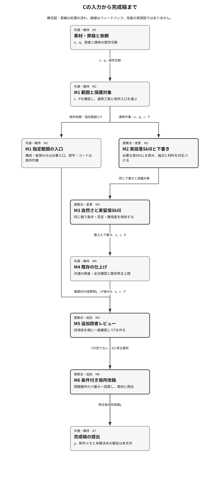

## 提案手法

**説明対象：c — 改善案C：A＋読者視点レビュー**

設計記述と図の構造チェック済み。新規性・有効性・比較上の優越を認定するものではありません。

親の既存audit-writing、audit-protected-holdout、audit-nativeには同一runのreceiptがあり、いずれもexit\_code=0、timed\_out=false、truncated=false。根拠は登録済みbaseline\_S\_PARENT\_WRITING／PROTECTED／NATIVEと各実成果物。主比較は94完了・採点済み、2timeout。全試行分母はbaseline24/24、A23/24、B23/24、C24/24。完成稿分母の品質合格率は全条件100%。baselineとBの取得稿は全品質項目4/4、AはW09-a-1の自然さが3、CはW09-c-2とW12-c-1の自然さが3で、他の保存評点は4。取得稿の保存評定には意味・境界違反所見なし。保護対象の有限な字面検査に所見なしで、意味保持全体の証明にはしない。holdoutはbaseline/c各6/6合格で全評点4、a/bは未測定。nativeは保存メタデータ条件付きでbaseline6/8、A5/8、B/C8/8。実tool出力に含まれた全文読込が証拠で、内部適用回数は未測定。元prompt本文がなく、依頼意図の独立照合は未確認。Cの改善閾値は未達。図は工程の説明で測定ではなく、生成後の図の視覚検査はこのunitでは未実施。

### ねらいと直感

Cは、必要な補助Skillを実際に参照するAの工程に、提出前の読者レビューを加える。完成稿の意味と正当な本文を守りながら、制作説明、情報の変化、段落の対応、定型表現を順に確認する。基準案にも全文確認があるため、変更の中心は点検順序と条件付き改稿の明文化である。問題がなければ同じ稿を出し、問題がある箇所だけ最大一回直す。品質改善の実証は未確認。

Aの下書き後に読者視点で境界・意味・段落・定型表現を順に一度確認し、問題箇所だけ最大一回直すと、既存確認から漏れた問題を抑えられる可能性がある。

Aの実補助SKILL連携と共有下書きを維持し、基準案にもある仕上げ確認の後に、明示された順序の読者レビューを加える。制作の会話を知らない読者として本文全体を読み、素材・読者・媒体・保護する事実に照らして、修正すべき位置と理由を整理する。順序は制作説明、情報と意味、段落の論点と根拠、定型表現。問題がなければ下書きをそのまま返し、あれば該当箇所だけ最大一回直して素材と照合する。レビューは同じモデル内の工程で、独立評価者や新しいモデルではない。

### 全体像と具体例

保存されたW02-c-1では、原入力の転換率4.1%と4.4%、p値0.18、有意差未確認、効果の有無を判断できないという内容を保持し、冒頭の制作説明と重複する予防線を除いた完成稿がある。最終稿は『対照群の転換率は4.1%、処置群は4.4%でした。検定のp値は0.18で、有意差は確認されませんでした。この結果だけでは効果の有無を判断できません。』で、保存評定は三品質項目とも4/4。説明上の処理では、数値と否定・確信度を保護し、制作説明を本文から分け、残った留保が結果の適用範囲を表すことを確認する。ただし中間下書きはなく、この変更をCの追加レビューが行ったかは未確認。工程の追跡部分は説明例で、測定はS6の最終稿と対応評定までである。



**図1．Cの入力から完成稿まで**　通常の文章作業はAの実連携と共通仕上げの後にCの追加レビューへ進む。局所依頼は範囲に応じた入口で完結する工程説明。

矢印は同じ素材・保護対象・下書きの受渡しを表す。段落と留保の変更はAから継承し、読者レビューと条件付き改稿がCの追加部分になる。局所経路は不要な全体工程を避けるために示す。工程図から実行回数や効果差を測定したとは判断できない。

[図1の編集用定義](figures/13d43cfc10043e8e39f3fdd19be4c9d995ffe04bccbdfce4e9677b934341ed81/F1.json)

### 構成要素の詳細

#### M1：作業範囲と保護対象の確認

**入力：** x、q、提供された読者・媒体の文脈。  
**出力：** r、P、通常工程か局所入口かの作業範囲。

読者が理解・判断・実行する内容を確認し、意味と指定形式を保護する。構成のみは段落入口、留保のみは留保入口で完結させる。誤字・コードなどには不要な全体工程を加えない。

**なぜ必要か：** 作業範囲の拡大と、正当な本文を制作説明と誤認する危険を抑える。

**既存法との差分：** 読者・範囲・保護対象を優先する基準案の規則を維持する。B固有の四区分工程はCへ追加しない。

**追加コスト：** 基準案と共通の確認。追加時間や内部判断回数は未測定。

#### M2：実段落Skill参照と下書き

**入力：** x、q、r、P。  
**出力：** 段落の論点と材料を対応づけた下書き。

複数段落の執筆・再構成ではparagraph-writingの実SKILLを解決して読む。兄弟配置を優先し、環境一覧の一意な同名参照を次に使う。特定できなければ同梱paragraphs.mdを使う。論点と根拠を対応づけ、設計メモを本文へ出さずに執筆する。

**なぜ必要か：** 参照の名前だけで連携を完了する抜けを防ぎ、段落の論点と材料をそろえる。

**既存法との差分：** 基準案の同梱参照からAの実補助SKILL参照へ変更する。段落の意味保護と共有下書きは共通。

**追加コスト：** 設計上は必要な実SKILL一種類の読込。タスク内で再読を省く。文脈量の増加はあり得るが、時間・課金差は未測定。

#### M3：自然さと実留保Skillの点検

**入力：** 同じ下書き、x、q、P。  
**出力：** 自然さと必要な確信度を確認した下書き。

既存の自然さ規則を同じ稿へ適用する。必要な留保工程ではjapanese-direct-writingの実SKILLをM2と同じ解決規則で読む。使えなければ同梱directness.mdを使う。重複する予防線を減らし、否定・条件・推量・義務は保持する。

**なぜ必要か：** 不要な留保の削除が、未確定の関係を断定する変更にならないようにする。

**既存法との差分：** 留保の参照をAの実補助SKILLへ変更する。自然さの規則、必要な確信度、同じ下書きの保持は共通。

**追加コスト：** 設計上は必要な実SKILL一種類の読込と既存点検。内部適用回数や因果的負担増は未測定。

#### M4：既存の仕上げ検査と全文確認

**入力：** 下書き、x、q、r、P。  
**出力：** 仕上げ後の下書きdと確認できた事項。

基準案の仕上げ条文に従い、実行可能な検査と全文確認を行う。研究文書の条件・結果・解釈・未検証事項、段落の論点と根拠、意味と境界を照合する。既存の修正上限を守り、実行できなかった検査を実行済みにしない。

**なぜ必要か：** Cの追加レビューへ進む前に、基準案と共通の安全確認を保つ。

**既存法との差分：** 変更なし。基準案にも読者を意識した全文確認と上限付き修正が存在する。

**追加コスト：** 基準案と共通。実行可能性に依存し、C固有の追加費用ではない。

#### M5：四項目を順に読む追加読者レビュー

**入力：** d、x、r、P。  
**出力：** F：修正位置・種別・理由のリスト。

制作の会話を知らない読者として一度読む。順に、制作への応答や報告、情報の脱落・創作と意味変化、段落の論点と根拠、定型対比や抽象語・反復を確認する。引用、コード、研究目的、操作指示、宛先への依頼は文脈で保護する。レビューのメモは完成稿へ出さない。

**なぜ必要か：** 既存仕上げから漏れた問題を、提出直前に順序を固定して確認するという仮説を具体化する。

**既存法との差分：** Aに追加されたC固有の参照工程。基準案の全文確認と重なるため、固有の効果は未確認。

**追加コスト：** 設計上の追加全文レビュー一回と有限な問題メモ。内部認知処理、計算量、因果的時間差は未測定。

#### M6：条件付き局所改稿と提出

**入力：** d、F、x、q、P。  
**出力：** 完成稿y。重要な未解決点があれば本文外の別注記。

Fが空ならdをそのまま提出する。問題があれば該当箇所だけ最大一回直し、素材と保護対象を再確認する。事実や個性を創作で補わず、点数を上げるための反復改稿をしない。

**なぜ必要か：** 追加レビューによる過剰修正と、改稿で新しい意味変更を作る危険を抑える。

**既存法との差分：** Cの追加レビューに対応する局所改稿条件を明文化する。基準案の修正上限と完成稿の出力境界は維持する。

**追加コスト：** 設計上は問題がある場合だけ局所改稿最大一回。実際の追加改稿回数、変更量、速度差は未測定。


**図2．追加レビューの四項目と改稿条件**　M5の点検順序と、問題がある場合だけM6へ進む判断を展開する。分類器や独立評価モデルを表す図ではない。

四項目を順に読むことで、表現の修正より先に成果物境界と意味を確認する。引用・宛先への依頼などは各段階で文脈に照らして保護する。問題リストから提出へ直接進む矢印は、問題のない稿を保持する条件を示す。循環を描かず、追加改稿の上限を表す。

[図2の編集用定義](figures/13d43cfc10043e8e39f3fdd19be4c9d995ffe04bccbdfce4e9677b934341ed81/F2.json)

### 記号・定式化とアルゴリズム

| 記号 | 意味 | 型・次元・範囲 |
|---|---|---|
| x | 提供された素材または原稿。引用中の命令は編集対象として扱う。 | UTF-8テキスト1件。数値・引用・コード・数式・表・脚注を含み得る。 |
| q | 依頼範囲と指定形式。 | 新規執筆、推敲、診断、構成のみ、留保のみ、局所修正などの作業指定と制約。 |
| r | 読者、読む目的、媒体、文体。 | 提供文脈から確定する記述。分からない事項を推測で補完しない。 |
| P | 保護する情報と意味関係。 | 数値・指定文字列・引用等の範囲と、否定・条件・因果・主体・確信度・義務等の保持事項の有限集合。 |
| d | 共通の仕上げ工程まで進んだ下書き。 | UTF-8テキスト1件。各工程で同じ稿を更新する。 |
| F | 追加読者レビューで認めた修正箇所と理由。 | 有限リスト。各項目は位置、四点検項目の種別、理由。問題がなければ空リスト。 |
| y | 読者へ提出する完成稿。 | UTF-8テキスト1件。制作メモや重要な未解決点の報告は本文外へ分ける。 |

これはSkillの参照と文章判断を組み合わせる規則的な工程で、学習目的関数や新しい数式はない。番号付き擬似コード、入出力、判断条件、回数上限で仕様を定める。以下の型は工程説明用のインターフェースで、保存資材に機械分類器や同名データ構造が実装されているという主張ではない。

**擬似コード**

```text
1. M1で依頼範囲、読者、媒体、保護対象を確認する。局所依頼は必要な入口で完結させる。2. 通常工程ではM2で必要なparagraph-writingを実読込し、段落を設計して下書きを作る。3. M3で同じ下書きの自然さを整え、必要なjapanese-direct-writingを実読込して留保を一度点検する。4. M4で基準案と共通の仕上げ検査・全文確認を行う。5. M5で制作説明、意味、段落、定型表現の順に一度読み、修正位置と理由のリストFを作る。6. Fが空なら同じ下書きを返す。空でなければM6で該当箇所を最大一回直し、素材と保護対象を確認して返す。7. 重要な未解決点と実行できなかった検査は完成稿の外で短く示す。点数を上げる反復改稿はしない。
```

### 学習・準備時と推論・実行時

**学習・準備時：** 学習・パラメータ更新は行わない。準備は固定されたSkill資材、原典、課題、保存評定、評価契約の確認。各条件の実資材を維持し、holdoutを使った新たな調整はしない。全稿取得と全経路成立による選択条件は結果を見た後の保守的条件として明示する。

**推論・実行時：** 通常の文章作業ではM1で依頼範囲と保護対象を確認し、M2の段落・執筆、M3の自然さ・留保、M4の既存仕上げへ同じ下書きを渡す。M5は本文全体を一度読み、修正位置と理由を列挙する。M6は問題がある場合だけ局所改稿を最大一回行い、素材と照合する。完成稿と作業メモを分け、良い稿は保持する。構成だけ・留保だけ・誤字・コードなどはM1の範囲判定に従い、通常工程を一律に適用しない。これは保存手法の実行仕様で、このunitで文章生成や検査を行った記述ではない。

### 既存法との差分とトレードオフ

| 観点 | 既存法 | 提案法 | 代償・成立条件 |
|---|---|---|---|
| 段落・留保の参照 | 通常工程は同梱paragraphs.mdとdirectness.mdを使う。 | Aを継承し、必要な補助SKILL実ファイルを読む。配置不明・未導入時は同梱代替を使う。 | 文書読込と文脈量が増え得る。実読込だけでは内部適用や品質改善を保証できない。 |
| 提出前レビュー | 既存の仕上げ検査と読者を意識した全文確認がある。 | 共通仕上げの後、境界・意味・段落・定型表現を順に一度確認する。 | 確認の重複と同じモデルによる見逃しがあり得る。固有の効果は未確認。 |
| 改稿の判断 | 既存の上限内で修正し、良い文章は保持する。 | 追加レビューの問題箇所だけ最大一回直し、問題がなければ同じ下書きを提出する。 | 局所改稿でも意味変更を作り得るため素材との照合が必要。内部回数は未測定。 |
| 測定と選択 | 主比較24/24合格、native6/8は保存メタデータ条件付き。 | 主比較24/24合格、native8/8は保存メタデータ条件付きで、後付け完全性条件に合う。 | 主指標差は0。元prompt欠落で経路・プロトコルはunknown。品質優位や一般的最適性は未確認。 |


**図3．基準案とCの共通工程・変更・追加**　通常の文章作業を左右の経路で比較する。基準案の既存全文確認を残し、A由来の参照変更とC固有の追加を区別する。

unchangedは範囲確認、共通仕上げ、提出境界。modifiedは同梱参照から実補助SKILLへの変更。addedはCの四項目レビューと対応する局所改稿である。基準案の仕上げにも読者を意識した全文確認と上限付き修正があり、図はレビュー自体の新規性や品質の優位を表さない。

[図3の編集用定義](figures/13d43cfc10043e8e39f3fdd19be4c9d995ffe04bccbdfce4e9677b934341ed81/F3.json)

### 先行研究からの導入と独自部分

S1の下書き点検、S3の構造と読みやすさの文脈レビュー、S5の仕上げと誤検知保護を、既存yomiyasuの提出前工程へ対応づける。保つ性質は情報保持と文脈判断。変更は点検順序と局所改稿の明文化で、原典のlint反復や検出ゼロの目標は導入しない。S2/S4の表現上の指摘は意味・文体を保てる場合だけ参考にする。

基準案自身に読者を意識した全文確認と上限付き改稿があり、S1には下書き点検、S3/S5には構造・読みやすさの仕上げがある。Cの差はAの実連携に加え、四項目を順に確認する提出前レビューと条件付き局所改稿を明文化する点。既存原則の組合せであり、新規アルゴリズムや独立批評機構とは主張しない。

**新規性の記録：** overlaps\_prior\_art（自動認定ではありません）

- S1：Humanizer: remove AI writing patterns。確認箇所：SKILL.md, How to work / What to return, lines 32–53。出典の詳細は主張・根拠の台帳を参照。
- S2：Stop Slop。確認箇所：SKILL.md, Core Rules / Quick Checks, lines 13–46。出典の詳細は主張・根拠の台帳を参照。
- S3：natural-japanese。確認箇所：SKILL.md, 検査\(2\) — 判断台帳と二つのレビュー, lines 86–109。出典の詳細は主張・根拠の台帳を参照。
- S4：Stop AI Slop\(日本語版\)。確認箇所：SKILL.md, コアルール A/B, lines 29–43。出典の詳細は主張・根拠の台帳を参照。
- S5：deslop-ja: 日本語のAI臭を消す。確認箇所：SKILL.md, 工程 lines 18–27; モード lines 79–93; 誤検知に注意する項目 lines 101–108。出典の詳細は主張・根拠の台帳を参照。

### 実装への組込みと計算負担

固定資材c/assets/SKILL.mdの提出前条文とc/assets/references/reader-review.mdが追加箇所。登録済みc\_S\_MECHANISMの原tool出力に点検順序と最大一回の局所改稿がある。入力と完成稿の形式、基準案の意味保護・仕上げ・修正上限、Aの補助SKILL解決と代替経路を維持する。追加依存は保存済みのレビュー参照文書で、分類器、追加評価モデル、学習処理は不要。今回は実資材を変更しない。

設計上はAに全文レビュー一回と条件付き局所改稿最大一回が増える。追加レビューは本文と素材を作業文脈で参照し、問題位置と理由を一時的に保持する。追加の処理回数には上限があるが、LLMの漸近計算量、内部適用回数、因果的elapsed差、課金差は未測定。保存主比較24/24とnative8/8は完了・経路の記録であり、計算効率の測定ではない。

### なぜこの案を詳しく検討するか

Cは保存メタデータを前提に、主比較24/24の取得・採点、安全所見0、品質各3以上、native8/8という保守的な後付け完全性条件に合うため、条件付き実装候補として詳述する。基準案の主指標も24/24で差0、改善閾値は全案未達。基準案は有力な簡単な代替として保持し、Bの品質劣位は結論しない。元prompt本文がなくCのK\_ROUTE/K\_PROTOCOLはunknownのため、保存dossierと同じprovisionalにとどめる。A/Bは未解決事項を持つ比較対象として保持し、恒久的に棄却しない。

説明対象は保存dossier.decision.candidate\_idと同じc。decision.statusはprovisionalのまま。Cは保存メタデータ上、主比較の全稿取得・採点、安全所見0、native8/8という後付け完全性条件に合うため、条件付き実装候補として詳述する。K\_ROUTE/K\_PROTOCOLはunknownで正式採択ではない。基準案との主指標差は0、文章品質の優位は未確認。Bの劣位も結論しない。

比較の目安は全4手法。現在の比較はベースライン1＋提案候補3。アブレーションを数合わせに使いません。

**比較数の例外理由：** ユーザーが固定した基準案と改善案A/B/Cの4条件だけを比較する。新規アルゴリズムの発明は対象外で、保存済み出力・評定・実資材に対応しない第5候補を追加すると比較の来歴を失うため、標準の約5手法から4条件へ限定する。

### 成立条件・反論と設計の改訂

**成立条件**

- 同じモデルが読者視点へ切り替えて、自分の下書きの問題を認識できる可能性がある。独立性は保証されない。
- レビュー時にも素材と保護対象へアクセスでき、局所改稿で意味を保てる。
- 問題のない稿を保持し、追加改稿を反復させない。
- nativeの依頼意図は保存メタデータに対応する。元prompt本文による独立確認は未完了。

**主要な反論**

- 基準案の全文確認を丁寧に実施すれば同じ効果になる可能性がある。C固有の機構効果は未確認。
- 追加の注意喚起や文脈量でも結果を説明でき、同じモデルの自己レビューは独立した誤り検出にならない。
- Cの自然さはW09-c-2とW12-c-1で3/4。基準案の保存評点は全稿4/4で、Cの品質優位は確認できない。
- 基準案の主指標は1.0で、範囲0～1の指標に\+1/24の差は作れない。この固定標本で改善閾値の達成を示すことはできない。
- 全稿取得とnative8/8による選択は後付け条件。Bにもnative8/8があり、1稿の欠測をBの言語品質の劣位として扱えない。

**反論を受けた改訂**

- 本説明では基準案の既存全文確認を図と本文へ残し、Cが初めてレビューを導入したという説明を避けた。
- 保存された自然さ3/4の2稿と改善閾値未達を明記し、説明対象の選択と実証上の優位を分けた。
- 四項目の順序、問題位置と理由、問題がない場合の保持、最大一回の局所改稿を具体化した。実資材は変更していない。
- 採用判断を保存dossierのprovisionalに合わせ、K\_ROUTE/K\_PROTOCOLのunknownと元prompt欠落を維持した。

**失敗すると予想される条件：** 同じモデルが自分の誤りを見逃す、素材の意味を取り違える、正当な本文を制作説明と誤認する場合に失敗する。追加改稿で確信度や義務を変える危険もある。品質が上限近くの課題では効果差を識別できず、長文や運用timeoutへの一般化も未確認。

### 仮説と検証実験の対応

| 仮説 | 対象 | 実験 | 競合する説明 | 棄却・修正する条件 |
|---|---|---|---|---|
| 実補助SKILL参照の条文が、必要経路の読込抜けを抑える。 | M1, M2, M3 | audit-native：executed | 保存メタデータの経路設定や実行条件の違い、timeoutの偶然で説明できる。 | 必要SKILL全文が成功tool出力にない、不要な全工程読込が増える、または元prompt確認でexpected\_readsとの不一致が判明した場合に仮説または条件付き判断を見直す。現在は依頼意図の独立照合が未確認。 |
| 追加読者レビューが、既存工程から漏れた境界・意味の問題を抑える。 | M4, M5, M6 | audit-protected-holdout：executed | 基準案の既存保護規則だけで十分だった可能性がある。取得稿は全案で違反所見0。 | Cに重大意味変更、制作説明残存、正例破壊があれば安全性の判断を見直す。全案で所見0の結果ではC固有の効果を認定しない。文字列一致だけを意味保持の証明にしない。 |
| レビューと局所改稿が完成稿の品質を改善する。 | M5, M6 | audit-writing：executed | 追加の注意喚起、文脈量、同一モデル採点、評点の天井効果で説明できる。 | 凍結改善閾値\+1/24を満たさなければ改善主張を採用しない。保存差は0で未達、Cの自然さ3/4も2稿あり、品質優位は未確認。工程別の因果効果と内部改稿回数は未測定。 |

図はこの設計の説明用です。結果の主張は後続の実験記録と結び付け、未実験の利点は仮説として扱います。
