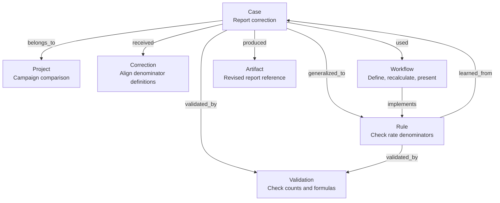
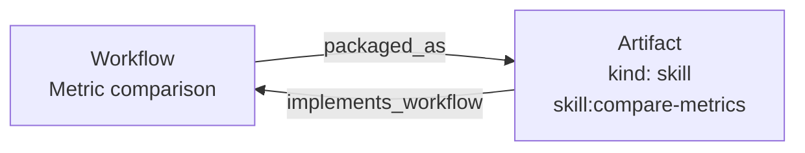

# The Workgraph knowledge graph

**English** | [日本語](../../basic-memory-workgraph/knowledge-graph.md)

[Overview](README.md) · [Usage and settings](usage.md) · [Policy and mechanisms](reference.md) · [Documentation](../README.md)

Workgraph stores rules, procedures, verification methods, and corrections in Markdown, linking them to supporting Cases and outputs. Before reuse, inspect applicable conditions and the evidence behind a lesson. Names, numbers, and Cases below are fictional structural examples, not personal Memory.

## Notes are nodes; relations are directed links

Basic Memory stores/parses Markdown and supports search and related-note navigation. Workgraph defines note types, structure, and admission. A note contains frontmatter, Observations for conditions/evidence, and Relations. `Rule → learned_from → Case` points to its originating event; `Rule → validated_by → Validation` points to how it can be checked. Direction runs from the note declaring the relation to its target.

### Note types

| Type | Content | Directory | Example |
|---|---|---|---|
| Case | Actual requests, outputs, corrections, revisions, outcomes | `cases/` | Correcting denominator definitions in a comparison |
| Correction | Instruction, desired result, context | `corrections/` | Comparison/recommendation before detail for decision makers |
| Rule | Conditional rule or explicit ongoing preference | `rules/` | Check denominator definitions before comparing rates |
| Workflow | Reusable procedure, applicability, exceptions | `workflows/` | Check definitions, recalculate, present comparison |
| Validation | Tested property and checking method | `validations/` | Match original counts and formulas |
| Artifact | Output or registered Skill reference | `artifacts/` | Revised report location |
| Project | Long-lived work scope | `projects/` | Campaign comparison |

`schemas/Rule.md` defines structure, not a knowledge instance. The Work Knowledge Graph index explains types/relations; installation does not create a set of example notes. A Basic Memory project is a storage location; a Project note is knowledge about a work scope within it.

## Example 1: align rate denominators

Suppose campaign A divides clicks by impressions, while B divides clicks by visitors. After the user points this out, both are recalculated per impression.

| Campaign | Original comparison | Aligned comparison |
|---|---|---|
| A | 40 clicks / 1,000 impressions = 4% | 40 clicks / 1,000 impressions = 4% |
| B | 30 clicks / 150 visitors = 20% | 30 clicks / 1,000 impressions = 3% |

Align definitions, not necessarily denominator values across campaigns. Assume recalculation and definitions were checked; user approval of the revised report remains unknown.

### Relations among saved notes

This example assumes an explicit request independently justified all the illustrated types. Normal automatic capture does not create every type.



`belongs_to` identifies scope, `received` an observed correction, `generalized_to` a derived conditional rule, `learned_from` its evidence, `used` a procedure, `implements` its rule, `validated_by` its check, and `produced` an output reference. These declarations do not generate notes or reverse relations automatically. Case and Rule qualify independently before linking; a generic “check denominators” maxim alone lacks added value.

Structured Cases keep sequence in JSON under `## Interaction`, not a note per utterance. Observations are searchable summaries; inspect Interaction for actual history. See [CAPTURE (Japanese)](../../../tools/basic-memory-workgraph/templates/CAPTURE.md).

### Markdown example

Example `rules/check-rate-denominators.md`; link only real, useful saved notes in actual use:

```markdown
---
title: Check denominator definitions before comparing rates
type: rule
schema: Rule
sharing_scope: private
training_use: excluded
privacy_review: pending
---

## Observations
- [trigger] Comparing campaign rates as the same metric.
- [action] Check what the numerator and denominator count. State differences; align definitions and recalculate when comparing the same metric.
- [reason] This example mixed impressions and visitors as if their rates had the same definition.
- [check] Recalculated campaign B from source counts and confirmed 3% per impression.
- [transfer_use] Other campaign comparisons and aggregate report reviews.
- [exception] When comparing metric definitions themselves, retain and explain their differences.

## Relations
- learned_from [[cases/align-click-rate-denominators]]
- validated_by [[validations/recalculate-click-rates]]
```

`type`/`schema` select structure; tagged Observations identify conditions/checks. Relations combine a type and wiki target. Artifacts reference outputs without copying output files into Memory.

### Verification is separate from approval

| Record | This example |
|---|---|
| `verification` | Calculation and denominator correspondence checked |
| `acceptance` | `unknown`: no explicit approval |
| `assessments` | Empty: no observed adoption/reuse behavior |

Tests support tested properties, not user satisfaction/adoption. Later adoption evidence must identify the relevant output and limited inference. See [evidence design (Japanese)](../../basic-memory-workgraph/evidence-design.md).

### Reuse in another task

Search applicable Rules, inspect the Case behind `learned_from` and method behind `validated_by`, and use a related Workflow when appropriate. These can inform the next first draft. Relations indicate relevance, not automatic applicability: compare goals, conditions, and exceptions.

## Example 2: retain a structural correction

Suppose a decision-maker report initially explains every option before comparison, and the user asks for comparison and recommendation first.

| Field | Record |
|---|---|
| Context | Decision document for selecting an option |
| Initial mismatch | Detailed options preceded comparison |
| Requested output | Comparison, recommendation, then detail |
| Scope | This decision context; broader ongoing preference unknown |
| Evidence state | Instruction confirmed; effect unverified; outcome/approval unknown |

Capture requires explicit instruction or `correction=scoped`; see [settings](usage.md#correction-mode). Recall for similar purpose/audience/output before drafting. This does not establish a technical-tutorial format or an ongoing preference for brevity. A Correction can exist alone; link a Case/Rule only when each is independently saved.

## After registering a procedure as a Skill

A reviewed, validated, registered Skill may have an Artifact:



The Skill holds execution/resources; Workflow holds rationale, evidence, conditions, and packaging decisions. `skill:compare-metrics` illustrates a reference, not an installed Skill. Candidates alone do not get a registered-Skill Artifact. Default `skill=review` assesses only; registration needs `skill=auto` and successful review/validation. See [procedure (Japanese)](../../../tools/basic-memory-workgraph/templates/SKILL_REVIEW.md).

## Capture depends on modes and value

New defaults are `auto=smart`, `correction=off`, `case=off`, `skill=review`; updates preserve settings. Thus qualifying abstract lessons can be evaluated, Corrections/Cases need explicit requests, and Skills are not automatically registered.

Automatic Rule/Workflow/Validation capture needs concrete transfer, utility, checked evidence, durable conditions/exceptions, and added value. Completion or generic passing tests are insufficient. Explicit ongoing preferences use their instruction/scope as evidence. Project/Artifact companion sets are not automatic.

1. Identify current purpose/audience/output/constraints and search relevant Corrections, Rules, Workflows, Validations, and Cases.
2. Check effective modes and type-specific criteria for any candidate.
3. Search duplicates; update only for new evidence/conditions/corrections. Failed search means skip automatic capture.
4. Save conditions/evidence/exceptions, link useful existing notes, and read back.
5. Before reuse, inspect underlying evidence, counterevidence, and integrity, prioritizing current instructions.

Hooks prompt recall/evaluation; Codex judges/writes and may miss candidates. Plan/read-only permits recall only. `auto=off` stops all automatic capture/review, while explicit requests stay scoped. Registration CLI requires enabled automation and `skill=auto`.

Notes default to private and training-excluded. Capture, verification, acceptance, adoption inference, sharing, and training remain separate. Sharing/training exports need explicit designation and content review. See [policy (Japanese)](../../../tools/basic-memory-workgraph/memory-policy.md), [types and relations (Japanese)](../../../tools/basic-memory-workgraph/templates/Work-Knowledge-Graph.md), [settings](usage.md#modes), [reference](reference.md), and [audits](troubleshooting.md#audit).
