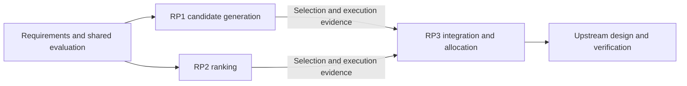

# Reassess requirements and designs with Design Research

**English** | [日本語](../../speckit-upstream/reassessment.md)

[Overview](README.md) · [Usage](usage.md) · [Installation](installation.md) · [Design Research](../design-research/README.md)

Revisit whether requirements remain necessary, evaluation is appropriate, and another method can improve results. Workbench 2.0.6 requires relevant Research for new/changed mechanisms before design finalization. Standard choices need evidence-backed `standard`; As-Is/typos do not mandate global research. State the goal and let the Skill select scope/dispatch.

“Accuracy” may mean confidence in requirements/design judgments or actual retrieval/extraction/classification/reasoning quality. Identify the target and verification: stakeholder goals/agreement establish requirements, while research/measurements support feasibility, methods, and evaluation.

## Output locations and review targets

| Question | Primary document |
|---|---|
| What to build/preserve | `docs/upstream/requirements.md` |
| How it works and changes | `docs/upstream/design.md` |
| Acceptance/checks/results/gaps | `docs/upstream/verification.md` |
| Executed research findings | `docs/design-research/<slug>/report.md` |

Use actual `docs_dir`, slug, and run ID. Return research conclusions to choices and actual evaluation to verification; do not duplicate full reports or create separate decision/fix documents. Latest reports update at start/stop too; long-lived references use `runs/<run-id>/reports/report.md`. Old layout remains until [migration](usage.md#output-locations-and-review-targets). Final answers prioritize conclusions and primary-document links, identifying pending/unexecuted work; internal records are supplementary for diagnosis.

## Choose an entry

| Need | Entry | Research role |
|---|---|---|
| Unknown specifications / mismatch | existing → check | `audit` if actual backend checks needed |
| Retain/change/retire requirements | check → change | `research` for technical feasibility/constraints |
| Clarify accuracy/acceptance/evaluation | check → change | Compare evaluation methods |
| Improve processing accuracy | check → change | Compare actual baseline/candidate effects |
| Preserve behavior, improve internals | refactor | Research changed mechanisms |
| Diagnose bugs/fix plan | bug | `audit` reproduction, `research` method choice |
| Changed data/model/environment | check → change/refactor | `reassess` completed research |

Arrows show separate workflow steps, not automatic execution. Each Skill has a fixed mode and identifies reasons/targets for handoff. Even unchanged API shape is a `change` when results/acceptance/quality contracts change; refactor explicitly preserves behavior/data/compatibility.

## Shared workflow

1. Read code/version/docs/prior decisions; separate observed state, agreements, and proposals.
2. Narrow the question, related IDs, editable scope, preserved contracts, unknowns.
3. Fix input/data, truth/scoring, metrics/criteria, failures, performance/cost/operation limits; unknown numbers stay undecided.
4. Classify requirements/themes/contracts/dependencies/budget/integration, complete needed approval, freeze the plan, then use actual Research. About 5 candidates per theme is a guide.
5. Return supported results to requirements/acceptance, design choices, verification, and history.
6. Separate recommendation from approval; fix a review packet, obtain explicit approval, then record it and run checks/trace/gate.

## Design a new feature from a story

```text
$upstream-new I want to search documents and check answers against their evidence.
```

Clarify what users decide and the harm of incorrect evidence/answers. Turn stories/concerns into search, evidence checking, and recovery use cases, then requirements/acceptance. Split search/ranking/generation questions, integrate results, and review the overall design/technology/verification. Apply real available UI Skills to screens; see [workflow](usage.md#from-stories-through-research-to-design).

## Split core logic into research themes

```text
$upstream-change Improve missed search results and top-ranked quality while revisiting latency constraints.
```

| Theme | Question | Fixed conditions / metrics |
|---|---|---|
| RP1 candidate generation | Reduce missing relevant candidates? | Inputs/filters, candidate Recall, resources |
| RP2 ranking | Move relevant results upward? | Fixed candidates, ranking metrics/failures/additional latency |
| RP3 integration/resource allocation | Meet combined constraints? | Overall quality/latency/memory/contracts |



This is research dependency, not app runtime order or automatic parallelism. RP1/RP2 can be explored independently only with fixed shared inputs/conditions; integration waits for both actual results. Save `.specify/workbench/research-plan.json` and human summary in requirements. Classify all requirements as `research`, `standard`, `clarify`, or `out_of_scope`, linking reasons/themes, fixed contracts/data/metrics, dependencies/resources/budget, integrator, and whole-system acceptance.

Five candidates is per theme, not five themes or counting ablations as methods. CLI checks/plans dependencies; it does not spawn/copy/collect parallel experiments or automatically increase budget. Same-project runs serialize. Plan-only stops before research; report executed/unexecuted themes separately. Check interoperability and overall quality/time/resources, not only local best scores. Unexecuted integration remains `planned`, not globally verified.

## 1. Unclear specifications or implementation mismatch

```text
$upstream-existing Compare storage implementation and specifications. Separate current behavior, agreed requirements, and proposed improvements. Do not change code.
```

Identify version/source of truth and avoid legitimizing current bugs as specification. Summarize baseline/differences and link requirements/verification. Document-only answers need no Research; actual measurements cite report/receipts. Present agreed and pending points, then use check.

## 2. Retain, change, or retire requirements

```text
$upstream-check Assess whether nightly full recalculation is still needed. Propose retain/change/retire options and leave unconfirmed business reasons as questions.
```

Check original purpose, stakeholder needs, contractual obligations, cost, and change impact. Technical papers alone cannot decide necessity/priority. Summarize goal mapping, evidence, acceptance changes, impact, and questions. Research only technical uncertainty; preserve conditional recommendations. Hand a reviewable proposal to change, retaining retired IDs/history.

## 3. Ambiguous accuracy or evaluation

```text
$upstream-check Make document extraction's “high accuracy” requirement verifiable. If the target is undecided, identify evidence and questions needed to choose it.
```

Clarify correct answers, error impact, user needs, representative data, scoring variance, metrics, versions, and acceptance. Distinguish improving the method from changing evaluation; ensure common-condition comparisons. Unresolved critical thresholds/scoring remain pending, not a claim of verified testability.

## 4. Improve actual processing accuracy

```text
$upstream-change Reduce missed search results. Compare current and candidate methods under latency/cost limits and revisit quality requirements and design.
```

Classify baseline errors and fix evaluation/limits. Summarize baseline, candidates, measured evidence, and conditional advice into design/verification. Do not judge only tuning inputs; consider independent evaluation/repetition. Study completion differs from meeting accuracy targets. Retain unverified effects and review acceptance/rejection reasons.

## 5. Improve internal design while preserving behavior

```text
$upstream-refactor Revisit aggregation internals while retaining external APIs, outputs, stored data, and quality floors. Plan migration and rollback.
```

Separate invariants from improvement objectives; technology names are not goals. Compare choices with migration/rollback/regression plans. Standard or small verified cleanup uses existing evidence; changed mechanisms need research. Changed results/quality contracts hand off to change. Stop at reviewable plans; implementation is separate.

## 6. Diagnose bugs and fix strategy

```text
$upstream-bug Investigate duplicate storage after repeated submission and organize the fix strategy and regression checks. Use test data; do not fix app code yet.
```

Record symptoms, expected/actual behavior, environment/reproduction/impact/requirements, separating hypotheses from confirmed causes. Produce trace, reproduction, related design, fix/regression proposal. Known small causes need no blanket literature study; unreproduced remains unreproduced. Completed audit report does not mean fixed.

## 7. Reassess a past decision under changed conditions

```text
$upstream-check Reevaluate extraction because input document types increased. Keep the prior decision and decide retain/change/defer under new conditions.
```

Check prior applicability/recheck triggers and current goals/contracts/changes. Completed prior state/archive supports `reassess` with a new slug/run; include the current approach and at least 1 different principle. Trace changed requirements through theme/dependency/integration and check unchanged findings' scope. Requirements are byte-bound, so never relabel old measurements as performed under new requirements. Evaluate current/candidate methods under new matched conditions, not just old-versus-new numbers. End with supported retain/update/defer reasons and next entry.

## Use Design Research directly

```text
$design-research Revisit this project's search approach.
```

The Skill reads available requirements/design/verification; ambiguity needs selection and missing docs remain explicit. Research compares/PoCs/reports, handing overall design to Upstream when needed. Reassessment/resume/status use the same entry. To return findings, replace placeholders:

```text
$upstream-change Read docs/design-research/<slug>/runs/<run-id>/reports/. Check applicability and propose changes to related requirements, design, and verification.
```

Reuse existing findings only when question/version/conditions/evidence fit. See [terminal usage](../design-research/usage.md).

## Return research to specifications

Use the actual primary report/evidence, not invented file links. Keep decision summaries, IDs/run ID, and archived report/receipt references.

| Destination | Content |
|---|---|
| Requirements/acceptance | Retain/change/retire proposals, targets/scoring, agreement needed |
| Design | Baseline/candidates, common conditions, reasons, impact, gaps/recheck triggers |
| Verification | Data/version/metrics/truth, expected results, failure/regression scope |
| Change/bug trace | Rationale, IDs/impact, prior decisions, run state |

Keep IDs where possible and track retirement/replacement with `retired/supersedes` and history. Put summaries/references in `sources` and normal Markdown. External file bodies are not part of approval hashes, so retain adoption rationale/conditions in approved text. Latest reports can change; cite run-specific `reports/report.md` and real receipts.

`research_complete` means conditional recommendation complete; `reviewed` means audit report complete. Neither exit proves target accuracy or adoption approval. Leave incomplete research/criteria pending, distinguish appending observations from changing specifications, and [review changed requirements/design/evidence](usage.md#record-review-and-approval).

## Missing, old, or unusable Research

Research is [installed separately](../design-research/installation.md). Missing harness, failed doctor, or execution failure leaves required research unexecuted with setup guidance. Upstream does not automatically install it. Requirements/As-Is can progress, but dependent mechanism design cannot finalize. Check actual version/path for single-entry/workstream support, not just distribution version; see [validation (Japanese)](../../design-research/validation.md).

This integration uses `research/audit` for authorized local experiments, test data, and reporting. App/production modifications or `run` fixes require a separate implementation request. `check/gate` structural success alone proves neither actual research nor valid conclusions/measurements.
