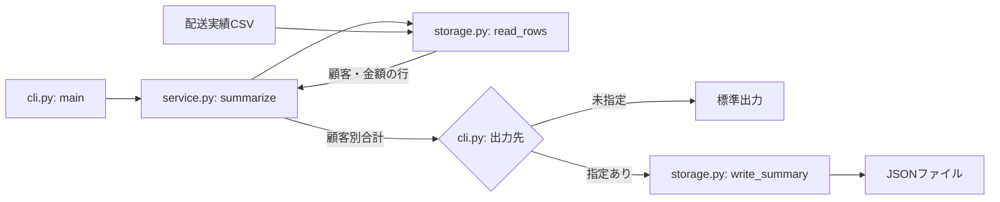

# 文書構成と生成結果の確認

2026-11-02にRepository Director 1.2.0の文書生成を確認した。
標準のdocsは目的・設計・開発の3冊とし、事業目的はpurpose.md、リポジトリの導入と利用の入口はREADMEへ配置する。

## 確認結果

| 対象 | 結果 |
| --- | --- |
| 全体テスト | 572件、失敗・エラー0、スキップ16 |
| 単体キット | 32件成功。既定3冊、READMEの案内、再実行、既存6文書の保持、独自名・同一文書への複数役割の対応を含む |
| Git・PR運用の試験器 | 既存5件成功 |
| 実モデル：CLI | 正常終了。docsは3冊。入力データ・ソース・依存定義は不変、既存ルールを保持 |
| 実モデル：Web/API | 正常終了。docsは3冊。入力データ・ソース・依存定義は不変、既存ルールを保持 |

モデル試験は架空の小さな実装を使い、各1回、上限300秒とした。
実行条件はCodex CLI 0.166.0、gpt-6.1-sol、reasoning effort medium、workspace-writeである。
CLIはPythonのCSV集計、Web/APIはNode.js標準ライブラリの受注集計APIで、事業目的を入力として与えた。
両方の単体テスト各2件は試験前に成功し、モデルも既存テストを実行した。
通常導入と自己テストからモデルは呼び出さない。外部接続、投稿、commit/push、サーバー起動は依頼していない。

## 本文とコードの照合

両ケースで、事業上の課題と利用者が目的文書に残り、READMEは導入・使用例・文書への案内になった。
設計には注釈付きのファイルツリー、入口、呼び出しとデータの流れのMermaidがあった。
CLIの引数解析から顧客別集計・CSV読込・JSON出力への接続、APIのHTTP入口から顧客別集計・非同期JSON読込・応答への接続を、実際の関数呼び出しと照合した。
独立した索引や、要件・コアロジック・検証を分けた文書は追加されなかった。

一方、例外型や細かな入力条件の説明が多く、採用経緯が不明であるという不要な文が混じった。
今回の試験だけの操作制限を恒久的な開発ルールへ転記し、一時配置したSkillのパスを開発手順へ載せる箇所もあった。
ファイル数と構造が合うことだけで文章品質を合格とはしていない。

これを受け、利用・変更判断に必要な詳細へ絞り、根拠のない採用経緯の説明、今回だけの制約、一時的なツール配置を本文へ残さない指示を補った。
補正後の実モデル試験は行っていない。モデルの再実行で一般的な改善効果を確認したとは主張しない。
最終指示は読者の目的と矛盾しないか通読し、下記の手作業による見本で説明の粒度を示す。

## 設計文書の説明粒度の見本

以下はCLIの試験コードを基に編集した見本であり、モデルの生成結果そのものではない。
実際の設計文書では、この説明の前にファイル構成、後に必要な設計上の要点を置く。

### 全体像と担当ファイル

配送実績CSVを読み、顧客ごとの合計金額をJSONで返す。
引数と出力先の選択をCLI、集計をサービス、ファイルの読み書きをストレージに分けている。

```text
billing/
├── cli.py      # 入力・出力先の引数を受け、集計と出力を呼ぶ
├── service.py  # 顧客ごとに金額を合算する
└── storage.py  # CSVを読み、必要に応じてJSONを保存する
```

### 入口と主要処理

`python3 -m billing.cli <csv_path> [--output <path>]`で`cli.py`の`main()`が始まる。
`summarize()`がCSVの行を読み、顧客別の合計を返す。CLIは結果を表示し、出力先が指定された場合はファイルへ保存する。



CSVの`customer`と整数の`amount`を使って合算する。集計方法を変えるなら`service.py`、入出力形式なら`storage.py`、引数や表示なら`cli.py`を読む。
保存は指定先を上書きするため、入力CSVと異なる出力先を使う。

## 再現用の入口

```bash
python3 -B -m unittest discover -s tools/repository-director/tests -v
python3 -B tools/repository-director/evals/documents.py
# モデル試験を明示的に行う場合だけ、新しい出力先を指定する
python3 -B tools/repository-director/evals/documents.py --apply --out /absolute/path/to/new-output
```

生の推論イベントや認証情報は記録しない。操作、生成文書、入力のハッシュと終了状態を確認する。
2例による確認であり、あらゆる規模のリポジトリでの読みやすさや要件の十分性を証明するものではない。
